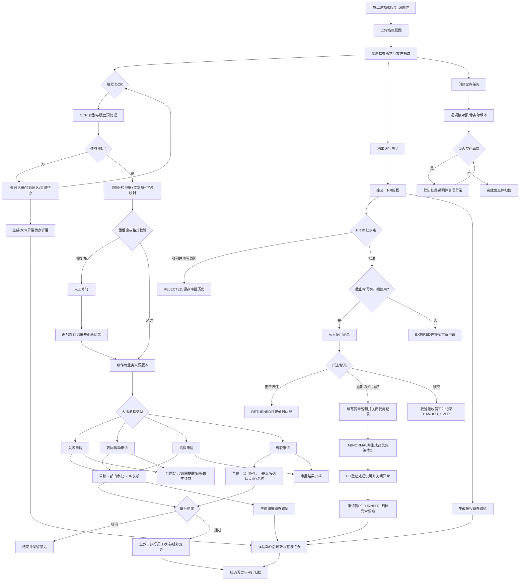

# 企业员工档案与人事流程业务闭环设计

## 2026-10-11 17:13 流程审查记录

- 修复人事申请状态约束：入职仅允许待入职员工，离职仅允许在职或休假员工；审批实际执行前重新检查员工状态，避免覆盖并发变更。
- 补齐获批后未开始使用的授权过期路径：定时扫描只把仍为 `APPROVED` 且截止时间已过的申请标为 `EXPIRED`，递增版本并记录系统操作；过期申请不能创建使用记录，详情页提示重新申请。
- 修复异常关闭顺序：存在活跃使用记录时 HR 不能直接关闭异常；应先完成归还登记，再填写处理说明关闭异常。
- 验证：`RequestServiceTest` 14 项、`ArchiveAccessServiceTest` 21 项、`ArchiveAccessExpiryContractTest` 3 项、`AccessMapperPersistenceTest` 6 项通过；待办详情测试 3 项、前端生产构建、`git diff --check` 和 Draw.io XML 校验通过。
- 本轮未运行写入演示业务数据的持久化端到端脚本；运行中的 8080 服务连接 13306，隔离验收 MySQL 位于 3307，避免对当前应用数据执行未经配置的业务写入。

---

## 1. 目标与边界

系统围绕员工、员工档案、组织岗位和人事申请建立可追溯闭环。每一条业务记录都必须具备：当前状态、允许动作、操作人、操作时间、版本号和异常处理路径。原图与 OCR 原始结果只读保存，人工修订以追加版本记录的方式保存。

本设计覆盖员工建档、档案 OCR、入职、转岗调动、请假、离职交接、档案访问授权、归还移交、盘点、合同和统一待办。统计与审计从这些业务状态和操作记录派生，不直接修改业务状态。

## 2. 角色与数据范围

| 角色 | 主要职责 | 数据范围 |
| --- | --- | --- |
| 员工 | 查看本人信息，发起本人申请，使用已授权档案并归还 | 本人 |
| 部门负责人 | 审批本部门人事申请，查看本部门员工和档案 | 本部门 |
| 人事专员 | HR 复核、档案授权、OCR 复核、离职交接确认、合同维护 | 全部 |
| 系统管理员 | 账号角色、组织配置、聚合统计和审计 | 无业务明细数据范围；统计接口仅返回聚合结果 |

所有查询和状态变更都在服务层执行数据范围校验。前端隐藏按钮不是权限控制，接口必须独立返回无权或状态冲突错误。

## 3. 统一状态规则

### 3.1 人事申请

`DRAFT -> PENDING_DEPT_APPROVAL -> PENDING_HR_APPROVAL -> APPROVED`。部门负责人审批本人所属部门申请，HR 管理员完成最终复核；系统管理员不参与业务审批。任一审批节点可进入 `REJECTED`。离职申请在 HR 节点先完成交接确认，再允许 `APPROVED`。入职、调动和离职在生效日到达后执行员工主数据变更，并写入状态历史；请假只保留审批结果，不改变员工组织关系。

申请对象状态也必须匹配流程：入职仅关联 `PENDING_ONBOARD` 员工，调动仅关联 `ACTIVE` 员工，离职仅关联 `ACTIVE` 或 `ON_LEAVE` 员工。生效时再次校验当前状态，避免审批期间发生的其他变更被覆盖。

### 3.2 档案访问

`DRAFT -> PENDING_APPROVAL -> APPROVED -> IN_USE -> RETURNED`。HR 可在 `PENDING_APPROVAL` 将申请驳回为终态 `REJECTED`，必须填写原因并记录审批人和时间；申请人需要再次访问时创建新申请。已授权申请若在归还截止时间前未开始使用，定时任务将其转为 `EXPIRED`，详情页只读提示重新申请；归还时发现逾期、缺件或损坏进入 `ABNORMAL`。移交成功仍保留使用记录并以 `HANDED_OVER` 标记。异常归还必须填写说明并关闭当前使用记录，保留 `ABNORMAL` 归还事实；随后由 HR 填写处理说明关闭异常，申请才转为 `RETURNED`。申请人不得对已关闭的使用记录重复归还。

### 3.3 OCR 任务

`RECOGNIZING -> SUCCEEDED` 或 `FAILED`。成功任务按字段置信度和格式校验决定 `reviewRequired`，人工修订只更新 OCR 服务当前任务结果并向平台追加 `ocr_field_revision`，不覆盖原图、原始文本块或历史修订。失败任务必须展示失败原因，并提供重新触发入口；OCR 服务暂时不可用时返回 `UNAVAILABLE`，页面说明结果暂不可用并允许刷新，不得将空字段误显示为识别通过。不存在绑定或已无权访问时展示明确错误态。

### 3.4 盘点任务

`CREATED -> IN_PROGRESS -> COMPLETED`。盘点项记录预期版本和实际版本；缺失、版本变化、损坏或无法核对时形成异常。存在未解决异常时禁止完成任务，解决动作写入处理人、时间和说明。

## 4. 业务流程

### 4.1 员工建档与 OCR

1. HR 创建或维护员工，绑定部门和岗位。
2. HR 上传 PNG/JPEG 脱敏档案，平台写入文件对象、SHA-256、档案目录和版本记录，上一版本保持不可变。
3. HR 触发 OCR，平台向 OCR 服务提交受控对象键，保存 `bindingId`、`versionId`、`taskId` 和状态。
4. 成功后展示原图、检测框预览、文本块、原始字段、映射字段、格式校验和置信度。
5. 低置信度或格式失败字段进入人工复核；修订必须填写值并可填写原因，追加修订记录后刷新当前结果。
6. 失败时展示错误码、错误原因、原图和重试动作；重试生成新的任务结果但不删除失败记录。服务暂时不可用时区分于识别失败，刷新后重新读取任务结果。
7. OCR 结果可作为入职、调动和离职申请的来源版本，申请中保存 `sourceVersionId`。

### 4.2 人事申请

员工或经办人创建草稿，填写类型专属明细和必要材料。申请人提交后进入部门节点，部门负责人通过后进入 HR 节点，HR 通过后结束；离职申请还需要 HR 确认交接。审批详情必须展示申请明细、员工当前信息、目标组织、审批时间线和当前可执行动作。状态变更使用版本号乐观锁，成功后待办立即消失或进入下一个节点。

### 4.3 档案授权、使用和归还

申请人选择当前档案版本、用途、使用方式、开始时间和归还截止时间创建草稿并提交。HR 可批准或填写原因驳回；两种决定均记录处理人、时间和审批意见，驳回进入终态 `REJECTED`，需再次访问时由申请人新建申请。批准后，申请人在授权时间窗内开始使用，系统写入使用记录；超过截止时间仍未开始时，定时任务将申请标记为 `EXPIRED`。查阅或借用完成后登记归还；移交必须选择同部门在职接收员工；使用逾期自动将申请标记为 `ABNORMAL` 并生成高优先级待办。异常归还时申请人登记原因并关闭使用记录，HR 在待办详情中登记处理说明后关闭异常，申请状态回到 `RETURNED`。详情页展示申请、审批、档案版本、使用记录和归还/移交/异常关闭时间线。

原图下载、OCR 原图读取、识别结果、检测预览和字段修订都按档案版本校验授权：申请人或当前使用人必须有未归还且未过期的 `IN_USE` 记录；HR 只可在待审申请中核验关联版本，或维护自己上传的版本。目录和版本元数据用于选择申请材料，不代表内容访问权限。

### 4.4 盘点与异常

运营人员创建盘点任务，系统按当前档案版本生成盘点项。开始后逐项选择实际版本和状态，自动计算差异类型。异常逐项登记处理说明并关闭，全部异常关闭后才允许完成任务，完成时间和操作日志归档。

### 4.5 合同

HR 登记合同并关联员工和档案来源版本。系统根据结束日期计算到期状态，续签创建新版本并关联原合同；不续签保留原因。合同状态只由合同动作和到期规则驱动，不直接修改员工审批状态。

## 5. 统一待办详情契约

待办接口返回 `type`、`resourceId`、`targetPath`、`status`、`priority`、`dueAt` 和 `createdAt`。`targetPath` 必须进入统一详情路由：

| 待办类型 | 详情路由 | 详情数据 | 可执行动作 |
| --- | --- | --- | --- |
| `HR_REQUEST_APPROVAL` | `/todos/hr-request/:id` | 人事申请、员工、明细、审批记录 | 通过、驳回、确认交接 |
| `ARCHIVE_ACCESS_APPROVAL` | `/todos/archive-access/:id` | 授权申请、审批历史、档案版本和使用时间线 | 批准、填写原因驳回、开始使用、归还、异常归还、移交、HR 关闭异常 |
| `ARCHIVE_RETURN_DUE` | `/todos/archive-return/:id` | 授权申请、逾期状态、使用记录 | 归还、异常登记、移交、HR 关闭异常 |
| `OCR_FAILED` | `/todos/ocr/:versionId` | OCR 绑定、原图、失败原因、任务号 | 重新识别、查看原图 |

详情动作复用原业务接口，成功后刷新详情和待办列表；已完成、已失效或无权限状态必须显示只读态和服务端错误信息，不能静默跳回列表。

## 6. 流程图

## 7. 验收标准

- 任一待办均可从工作台或待办中心进入带业务数据的详情页，详情页能执行当前角色有权执行的动作。
- 人事审批详情包含申请明细和审批时间线，离职交接在 HR 确认前不能通过。
- OCR 复核页显示受控预览或明确的预览缺失错误，能区分识别失败、待复核和已通过，字段修订后能显示最新值与修订历史。
- 档案授权支持提交、审批、使用、归还、移交、逾期和异常处理，状态与使用记录一致。
- 盘点存在未解决异常时无法完成，解决后才可归档。
- 所有动作经过数据范围、角色和状态机校验，并写入操作日志。
