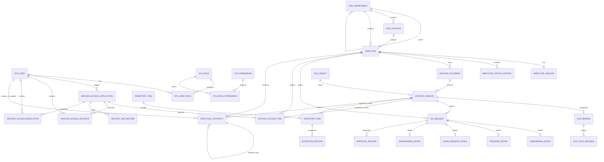

# 当前数据模型

数据库以 `server/src/main/resources/db/migration/V1__...sql` 至 `V18__...sql` 为准，开发与生产启动时由 Flyway 按版本迁移。MySQL 使用 InnoDB 和 `utf8mb4`。本文件概述业务实体与真实外键，不替代迁移 SQL。

## 实体关系

## 业务表

| 领域 | 核心表 | 用途与关键关联 |
| --- | --- | --- |
| 身份与组织 | `sys_user`、`sys_role`、`sys_permission`、`sys_user_role`、`sys_role_permission` | 登录账号、角色和权限映射；角色关系通过关联表表达。 |
| 组织与员工 | `org_department`、`org_position`、`employee` | 部门有父子层级；岗位属于部门；员工关联当前部门和岗位，员工编号唯一。 |
| 员工状态 | `employee_status_history` | 记录员工状态、部门、岗位变化及来源申请和操作人。 |
| 档案与文件 | `employee_archive`、`archive_document`、`file_object`、`archive_version` | 员工档案目录、文档逻辑记录、对象存储元数据和不可覆盖的版本记录；版本保留 SHA-256、操作者和变更原因。 |
| OCR | `ocr_binding`、`ocr_field_revision` | 档案版本到 OCR 任务的绑定、引擎和状态信息、人工修订前后值及操作者。原图、OCR 文本块及 OCR 服务侧任务记录保存在对象存储与独立 OCR 元数据库。 |
| 人事流程 | `hr_request`、`onboarding_detail`、`transfer_detail`、`leave_request_detail`、`offboarding_detail`、`approval_record` | 统一申请主表加类型明细和审批时间线；来源档案版本可选关联。 |
| 档案访问 | `archive_access_application`、`archive_access_item`、`archive_access_decision`、`archive_use_record`、`archive_access_resolution` | 访问申请、批准或驳回决定及原因、申请涉及的档案版本、使用/归还/移交记录和异常处理历史。 |
| 盘点 | `inventory_task`、`inventory_item`、`exception_record` | 任务、按档案版本核对的明细和差异处理结果；任务存在未解决异常时不能完成。 |
| 合同 | `employee_contract` | 合同关联员工及来源档案版本；续签通过 `renewed_from_contract_id` 形成链路。 |
| 审计 | `operation_log` | 操作人、动作、对象、结果、前后摘要、追踪 ID 和时间。 |

## 一致性与约束

- 业务主数据外键、唯一键、索引和部分 `CHECK` 约束定义在版本迁移中。`sys_user.employee_id` 与 `sys_user.department_id` 当前只有索引，关联由认证和服务逻辑维护，并非数据库外键。
- 人事申请保存 `version_no`，审批动作按状态机和版本校验；已审批的入职、调动、离职在生效时另外写员工状态历史。
- 档案新版本增加新的 `archive_version` 和对象引用；历史版本及其 OCR 绑定继续保留，当前版本通过 `is_current` 标记。
- OCR 每个档案版本最多一个平台绑定；人工修订追加到 `ocr_field_revision`，OCR 服务本身也保留原始任务和修订数据。
- 授权申请和盘点任务分别使用版本号或状态字段控制并发与动作顺序。授权异常处理写入 `archive_access_resolution`，盘点差异使用异常记录保存处理人和说明。
- 统计查询只返回授权范围内的聚合值：月度趋势按创建时间分组，部门比较按启用部门分组，流程周期按申请创建到完成时间计算小时数；日期范围的 `from` 包含、`to` 包含。
- 档案访问审批仅作用于 `PENDING_APPROVAL`；批准或驳回均写入 `archive_access_decision`，驳回必须提供原因，终态申请不能开始使用。
- `V6`、`V15` 提供演示数据；`V16` 在非 demo profile 下停用演示账号、员工和组织。生产部署不得依赖演示账号。

## 数据最小化

员工主档只保存当前业务需要的姓名、员工编号、联系电话、部门、岗位、任职状态和必要日期。档案文件位于受控对象存储；数据库保存对象键、文件类型、大小和摘要。OCR 仅抽取材料流程需要的字段，按角色及数据范围授权访问，不把身份证号等非必要个人信息作为普通列表默认展示字段。
