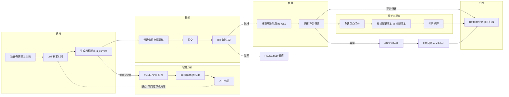
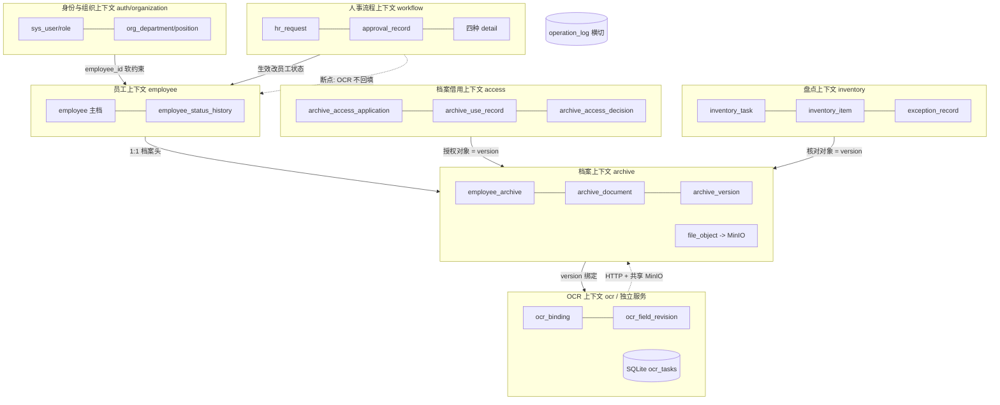
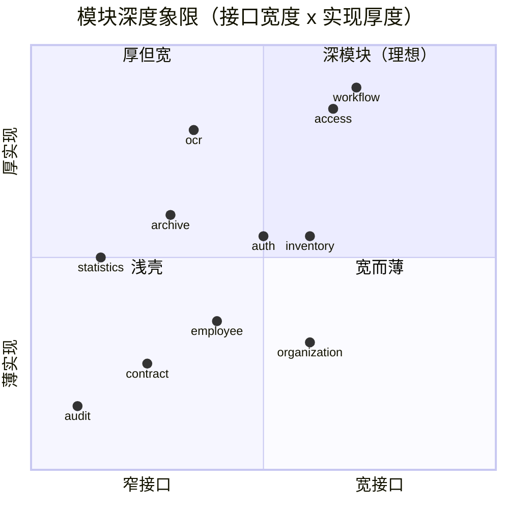
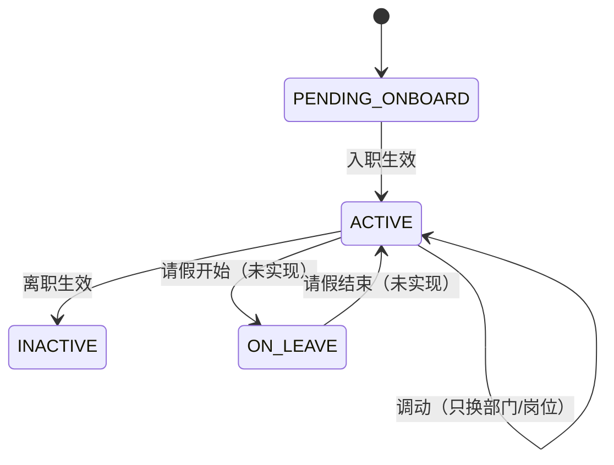
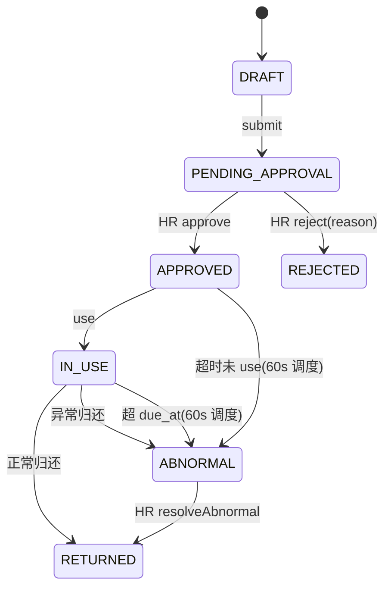
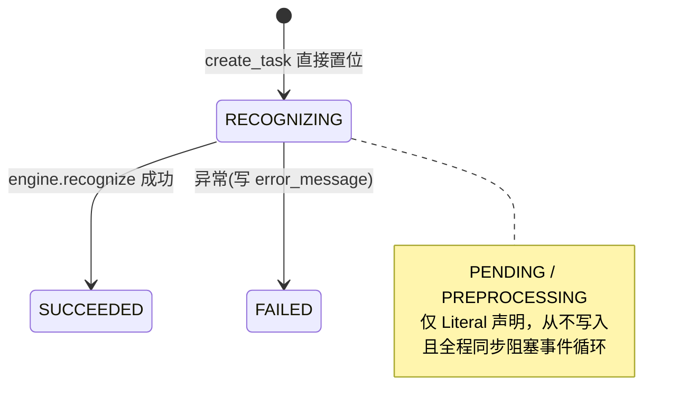
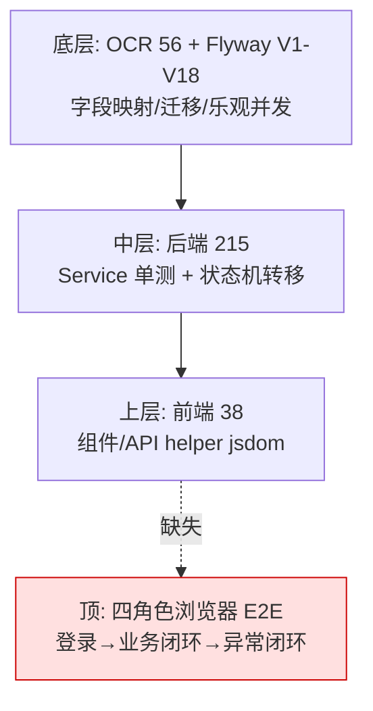

# 00 · 完成度复盘（Matt Pocock 方法论视角）

> 写作日期：2026-10-13
> 视角声明：本文不重复 [project-readiness-assessment.md](../../project-readiness-assessment.md) 的"问题清单"，而是借用 Matt Pocock 式的三个思维工具重述完成度：
>
> 1. **facts vs decisions vs assumptions**——区分"代码里已验证的事实"、"已经做出但未沉淀为 ADR 的决策"、"尚未验证的假设"；
> 2. **domain modeling**——用统一语言（ubiquitous language）审视术语，揪出 overloaded word（一词多义），把硬决策逼成 ADR；
> 3. **codebase design**——用"深模块/浅模块"（窄接口 + 厚实现）与"seam（可测试/可替换接缝）"评判每个后端包。
>
> 所有"已实现"结论必须能在 [`_facts/`](./_facts/README.md) 或源码中找到出处；找不到的标"未实现/未验证"。

---

## 1. 课题任务书逐条打分矩阵

> 状态口径：**已实现** = 代码事实充分且闭环；**部分实现** = 主链路在但缺关键边界/验证；**未实现** = 代码无出处；**未验证** = 有代码但无运行/测试证据。
> 证据列引用 `_facts/0x-*.md` 小节号。

| # | 课题要求（简述） | 状态 | 代码事实证据 | 差距与建议（domain/codebase 语言重述） |
|---|---|---|---|---|
| 1 | 四角色（员工/部门负责人/HR/系统管理员）可用 | 部分实现 | 四端独立 SPA（`_facts/04` §1）；角色常量 `EMPLOYEE/DEPT_MANAGER/HR_ADMIN/SYSTEM_ADMIN`（`_facts/01` §5）；JWT liveValidation（`_facts/01` §5） | 角色已落地为路由守卫 + `@PreAuthorize` 双层，但**缺四角色浏览器端到端验收**；`sys_permission`/`sys_role_permission` 是死表（`_facts/01` §5 末），统一语言里"权限"一词分裂成"角色注解"与"权限点"两套。 |
| 2 | 员工主档 + 组织岗位（建档起点） | 已实现 | `employee`/`org_department`/`org_position`（`_facts/02` V1）；`EmployeeController` 5 个接口（`_facts/01` §2.4） | `sys_user.employee_id/department_id` 只有索引无外键（`_facts/02` V1 `sys_user`），"账号↔员工"关系是软约束，需要 ADR。 |
| 3 | 档案三层结构（员工档案/文档/版本） | 已实现 | `employee_archive`(1:1)/`archive_document`/`archive_version`/`file_object`（`_facts/02` V2）；`is_current` 切换（`_facts/03` §7） | "档案"一词在中文语境同时指三层实体（见 §2.2 overloaded word）；版本状态机退化为单一 `UPLOADED`（`_facts/03` §7），无"废弃/锁定"状态。 |
| 4 | 人事申请闭环：入职/调动/请假/离职 | 部分实现 | `hr_request` + 四种 detail 表 + `approval_record`（`_facts/02` V4/V8）；`RequestStateMachine`（`_facts/03` §2）；`EmployeeChangeScheduler` 每分钟生效（`_facts/01` §8） | **请假状态不闭环**：`EmployeeStatus.ON_LEAVE` 枚举存在但 grep 不到写入路径（`_facts/03` §1）。这是领域模型缺口，不是页面缺口。 |
| 5 | 档案访问：申请→授权→使用→归还→异常 | 部分实现 | `archive_access_application` + item/use_record/resolution/decision（`_facts/02` V5/V14/V17/V18）；7 态状态机 + 60s 超时调度（`_facts/03` §3） | 状态机本身完整，但**授权矩阵缺 MySQL 全组合测试**；"审批"一词在人事侧写 `approval_record`、档案侧写 `archive_access_decision`（`_facts/02` V18），统一语言需显式区分。 |
| 6 | 维护：盘点/异常/全程归档 | 部分实现 | `inventory_task`/`inventory_item`/`exception_record`（`_facts/02` V5/V12）；item 闭环态 `PENDING/NOT_REQUIRED/OPEN/RESOLVED`（`_facts/03` §5） | 盘点核对的是**数字档案版本**（`actual_version_id` vs 期望版本），任务书若指"纸质实物"则缺柜/盒/位置模型——需要 ADR 划定数字/纸质边界。 |
| 7 | 合同台账与续签 | 部分实现 | `employee_contract` + `renewal_status` CHECK（`_facts/02` V7）；`markNotRenewing` 唯一写操作（`_facts/03` §6） | `DUE`（即将到期）是查询时派生、不落库、无定时提醒事件（`_facts/03` §6 备注），"续签提醒"是假设中的产品语义。 |
| 8 | OCR 智能化：识别→映射→校验→人工修订 | 部分实现 | PaddleOCR 调用链 + 4 字段正则映射 + 置信度 0.85 阈值（`_facts/05` §3/§4）；`ocr_field_revision` 修订留痕（`_facts/02` V3） | **OCR 结果不回填正式档案**（`_facts/05` §8.4）：智能识别停留在"附件层"，没有"确认→写回 employee/employee_archive"的受控接口，智能化闭环缺最后一跳。 |
| 9 | 不同清晰度样例准确率与失败分析 | 部分实现 | 评测口径（检出率/准确率/失败率/分组）在 `evaluation.py`（`_facts/05` §5） | 样本是**同一底图派生的 36 张合成图**（readiness §2），仅覆盖姓名/工号两字段；泛化结论是假设。 |
| 10 | 认证/权限/数据校验/组合分页/统计/日志 | 部分实现 | JWT+BCrypt+DataScope 四层（`_facts/01` §5）；Bean Validation→400 错误码（`_facts/01` §6）；统计概览/月报（`_facts/01` §2.12） | 操作日志**无 AOP 切面**，靠 13 个 Service 手动调用（`_facts/01` §3.14）——横切关注点泄漏进业务模块。 |
| 11 | 核心数据关系、版本与变更留痕 | 部分实现 | `employee_status_history` 前后值留痕（`_facts/02` V2）；`approval_record`/`archive_access_decision`/`archive_access_resolution` 三套历史（`_facts/02` V4/V17/V18） | `sys_user.employee_id/department_id` 软约束（`_facts/02` V1）；跨表语义（旧版本可读性、OCR 修订追溯）未集中说明。 |
| 12 | 模拟/脱敏数据与最小必要授权 | 部分实现 | demo profile + V16 非 demo 自动禁用 demo 账号（`_facts/01` §9.5）；手机号 HR 外脱敏（`_facts/02` V1 `employee.phone`） | 授权状态全矩阵未测；敏感日志（手机号/原图文本）落库/落日志的边界未审查。 |

### 1.1 业务闭环对照图（建档→授权→使用→维护→归还→归档）

任务书描述的业务闭环在代码里的实际落点如下；虚线环节是当前未闭或仅派生态的断点。

**对照读法**：实线环节全部有状态机与落库表（`_facts/03` §3/§5）；唯一虚线断点是 `O3→A2`（OCR 不回填），对应 P0-5；合同 `DUE` 提醒不在此闭环内，是独立的派生断点（ADR-7）。

**小结**：12 条里 2 条已实现、10 条部分实现，无"未实现"大模块，但 10 条"部分实现"的缺口高度集中在三类：① 状态机未闭环（请假/OCR 回填/合同提醒）；② 统一语言分裂（档案/审批/状态/版本/权限）；③ 架构叙事与代码事实不一致（Redis/读写分离/微服务）。

---

## 2. 领域语言评判（domain-modeling 视角）

### 2.1 核心术语表（GLOSSARY 种子）

| 术语 | 定义 | 代码锚点 | 易混淆近义词 |
|---|---|---|---|
| **员工主档** | 一名员工的人事事实行（工号/姓名/部门/岗位/status） | `employee`（`_facts/02` V1） | ≠ "员工档案" |
| **员工档案** | 员工主档 1:1 的档案头（完整度/密级/status） | `employee_archive`（`_facts/02` V2） | ≠ 文档、≠ 版本 |
| **档案文档** | 某类材料（身份证/学历/合同）的类别聚合 | `archive_document`（`_facts/02` V2） | — |
| **档案版本** | 某文档类别下的一次上传（指向 file_object，带 is_current） | `archive_version`（`_facts/02` V2） | ≠ 合同续签版本、≠ Flyway 版本 |
| **人事申请** | 入/调/请假/离四类统一流程单 | `hr_request`（`_facts/02` V4） | ≠ 档案借用申请 |
| **审批记录** | 人事申请每个节点的决定 | `approval_record`（`_facts/02` V4） | ≠ 访问决定 |
| **档案访问/借用** | 对档案版本的受控读取申请（统一术语） | `archive_access_application`（`_facts/02` V5） | 不要混用"借阅/授权/借用" |
| **访问决定** | HR 对档案借用的批准/驳回历史 | `archive_access_decision`（`_facts/02` V18） | ≠ 审批记录 |
| **OCR 绑定** | 一个档案版本对应一次 OCR 任务（1:1 唯一键） | `ocr_binding`（`_facts/02` V3，`uk_ocr_binding_version`） | — |
| **盘点** | 对数字档案"期望版本 vs 实际版本"的核对任务 | `inventory_task`+`inventory_item`（`_facts/02` V5/V12） | ≠ 纸质实物盘点 |
| **操作日志** | 全系统动作审计流 | `operation_log`（`_facts/02` V2） | — |

### 2.2 Overloaded word（一词多义）显式清单

领域建模的第一性原理是"同一个词在模型里只能指一件事"。本项目至少有 4 组高危 overloaded word：

1. **"档案"** = 三层实体：`employee_archive`（档案头）/ `archive_document`（文档类别）/ `archive_version`（版本）。论文里写"档案管理"时必须注明指哪一层，否则 OCR 触发对象（version）、授权对象（version）、盘点对象（version）会被误读成同一层。
2. **"审批"** = 两套独立历史：人事侧 `approval_record`（节点 DEPARTMENT/HR，`_facts/02` V4）vs 档案侧 `archive_access_decision`（仅 HR 单节点，`_facts/02` V18）。二者表结构相似但业务语义不同，不能合并成一张"审批表"。
3. **"状态"** = 至少 4 个正交状态机：`employee.status`、`hr_request.status`、`ocr_binding.status`、`inventory_task.status`。前端列表过滤、统计口径、待办聚合各取其一，混用语会把"员工请假中"与"申请待审批"错误关联。
4. **"版本"** = 三个完全无关的概念：`archive_version`（档案文档版本）/ `employee_contract.renewed_from_contract_id`（合同续签链，`_facts/02` V7）/ Flyway `V1–V18`（schema 迁移版本，`_facts/02` 全文件）。

### 2.2.1 限界上下文映射（Context Map）

**读法**：实线是代码里真实存在的跨上下文引用（外键或 HTTP 契约）；唯一虚线断点是 `BC5/BC4 → BC2`（OCR 识别结果与人事生效都没有反向写回员工主档的受控通道）。这张图对应论文第 4 章"限界上下文划分"。

### 2.3 需要落成 ADR 的硬决策

> 这些决策目前散落在旧设计文档或代码默认行为里，没有显式记录；按"facts vs decisions"纪律，每条都应写一份 ADR（现状 vs 决策 vs 后果）。

| # | 硬决策 | 现状（事实） | 需要拍板的选项 |
|---|---|---|---|
| ADR-1 | **数字档案 vs 纸质实物边界** | 盘点核对的是 `archive_version`（数字文件版本，`_facts/03` §5.3）；MinIO 是唯一二进制通道（`_facts/06` §7.2） | ① 只做数字档案，论文显式排除实物；② 补柜/盒/位置/交接模型。 |
| ADR-2 | **Redis 去留** | compose 起了 Redis，业务代码零调用（`_facts/01` §9.2、`_facts/06` §7.1） | ① 移除依赖与容器；② 至少实现一个可解释职责（待办 cache-aside / 幂等键 / 审批短锁）。 |
| ADR-3 | **单库 vs 读写分离** | 仅一个 `spring.datasource.url`，无路由数据源（readiness §3.2） | ① 保持单库并删除论文里"主从"表述；② 补 `AbstractRoutingDataSource` + 写后读一致性。 |
| ADR-4 | **OCR 结果是否回填正式档案** | 无确认回填接口（`_facts/05` §8.4） | ① 增加"待确认/已确认"受控接口 + 字段白名单 + 前后值审计；② 明确 OCR 仅作辅助、不回填。 |
| ADR-5 | **RBAC：权限表 vs 注解** | `sys_permission`/`sys_role_permission` 建了不读，权限全靠 `@PreAuthorize` 字符串（`_facts/01` §5 末） | ① 固定四角色模型，删除死表；② 实现数据库驱动权限。 |
| ADR-6 | **操作日志：手动 vs 声明式** | 13 个 Service 手动调 `OperationLogService.record()`，无 `@Aspect`（`_facts/01` §3.14） | ① 引入 AOP 切面声明式记录；② 保留手动但接受横切泄漏。 |
| ADR-7 | **合同到期：查询派生 vs 事件** | `DUE` 查询时派生，无定时任务（`_facts/03` §6 备注） | ① 明确"只查询不通知"；② 补提醒待办事件表 + 幂等调度。 |
| ADR-8 | **请假状态机闭环** | `ON_LEAVE` 枚举无写入路径（`_facts/03` §1） | 批准→开始生效(→ON_LEAVE)→结束恢复(→ACTIVE) 三段式 + 补偿规则。 |
| ADR-9 | **单体 vs 微服务叙事** | 实际是模块化单体 + 独立 OCR 服务（readiness §3.1） | 论文统一口径为"模块化单体 + HTTP OCR 契约"。 |

---

## 3. 模块深度评判（codebase-design 视角）

> 评判维度（John Ousterhout《A Philosophy of Software Design》+ Matt Pocock codebase-design）：
> - **接口宽度** = Controller 公开方法数（来自 `_facts/01` §2）；
> - **实现厚度** = Service/Mapper/状态机/调度的复杂度；
> - **深度评级**：深 = 窄接口 + 厚实现；浅 = 接口与实现同宽（pass-through）；
> - **seam** = 可单独测试/替换的接缝位置；
> - **加深机会** = 如何把浅模块变深、把泄漏的横切关注点收进去。

| 包名 | 接口宽度（Controller 方法数） | 实现厚度 | 深度评级 | seam 位置 | 加深建议 |
|---|---|---|---|---|---|
| `workflow` | 10（RequestController 9 + TodoController 1，`_facts/01` §2.7/2.8） | 厚：`RequestStateMachine` + `EmployeeChangeService` + `EmployeeChangeScheduler` + 乐观锁 + 4 种 detail 表 | **深模块** | `RequestStateMachine`（转移规则可单测）、`EmployeeChangeService.applyDueEmployeeChange` | 把请假生效补进 `EmployeeChangeService` 的生效分支（现仅 ONBOARDING/TRANSFER/OFFBOARDING，`_facts/03` §1），让 seam 真正闭环。 |
| `access` | 9（`_facts/01` §2.9） | 厚：`ArchiveAccessStateMachine` + 60s 过期调度 + `ArchiveReadAuthorizationPolicy` + V17/V18 决策/闭环历史 | **深模块** | `ArchiveAccessStateMachine`、`ArchiveReadAuthorization`（读授权策略独立） | seam 已清晰；加深点是把"授权矩阵"从策略类下沉成一张可参数化的状态×角色规则表。 |
| `archive` | 4（`_facts/01` §2.5） | 中：MinIO 存储 + `is_current` 版本切换 + 读授权前置校验 | **较深** | `ObjectStorage`（`MinioObjectStorage` 实现，可换 mock）、`ArchiveCatalog` | 接口窄是优点；加深点是把"版本升级时旧版本语义"（只读？可盘点？）收进 `ArchiveCatalog`。 |
| `ocr` | 4（`_facts/01` §2.6） | 厚但 seam 有缺陷：`HttpOcrClient` seam 在，但 `triggerResult` 在事务内同步等待（`_facts/01` §9.1） | **深但脆弱** | `OcrClient`（可换 MockOcrEngine，`_facts/05` §8.5） | 把"同步 create_task"抽成 `TaskQueue` seam（队列/超时/并发上限），否则 seism 只能替换客户端、不能替换执行模型。 |
| `inventory` | 8（`_facts/01` §2.10） | 中：task/item/exception 三层状态 + 差异判定三元表达式 | **中等** | `InventoryService.checkItem`（差异判定 seam） | 把 `difference_type` 判定抽成独立策略类，便于扩展 VERSION_MISMATCH 以外的差异类型。 |
| `employee` | 5（`_facts/01` §2.4） | 薄：CRUD + DataScope 过滤 | **偏浅** | `EmployeeMapper`（SQL 层） | "员工状态变更规则"实际住在 `workflow.EmployeeChangeService` 里，employee 包反而是浅壳；建议抽 `EmployeeStateMachine` seam 把规则收回。 |
| `contract` | 3（`_facts/01` §2.11） | 薄：list/create/markNotRenewing，`DUE` 查询派生 | **浅模块** | `ContractMapper.xml`（聚合 SQL） | 加深点：把"到期判定"抽成 `ContractDuePolicy` seam，为 ADR-7 的事件化预留位置。 |
| `statistics` | 2（`_facts/01` §2.12） | 中但口径黑盒：多表聚合 SQL | **中等偏深** | `StatisticsMapper`（SQL 层） | 接口极窄是优点；风险是"时区/边界/空数据"口径未参数化，建议抽 `StatisticsWindow` 值对象。 |
| `organization` | 8（`_facts/01` §2.3） | 薄：部门树 + 岗位 CRUD | **偏浅** | `OrganizationMapper` | pass-through 型 CRUD；可接受为浅层，但"部门树"建议缓存（呼应 ADR-2）。 |
| `auth` | 7（AuthController 3 + AdminUserController 4，`_facts/01` §2.1/2.2） | 中：JWT liveValidation + BCrypt + 生产引导 | **中等** | `JwtService`、`JwtAuthenticationFilter` | seam 清晰；加深点是把"账号↔员工绑定"软约束（`sys_user.employee_id` 无外键）收进 auth 包统一校验。 |
| `audit` | 1（`_facts/01` §2.13） | 极薄（只查 operation_log），但 `OperationLogService` 被 13 处手动调用 | **浅模块 + 横切泄漏** | `OperationLogService.record`（手动 seam） | 典型"浅模块泄漏"：审计本应是深横切（声明式），现在把记录责任推给每个业务 Service。见 ADR-6。 |
| `common` | 0（无 Controller） | 厚：Security/JWT/DataScope/GlobalExceptionHandler/TraceId/生产校验 | **横切深模块**（基础设施层） | `DataScope`、`GlobalExceptionHandler`（错误码映射集中） | 这是全系统最"深"的一层：接口不可见（不可被业务绕过）、实现集中。保持。 |

---

## 4. 状态机清单（代码里实际存在的 7 个）

> 全部来自 `_facts/03-state-machines.md`。每个给：状态值全集、合法转移、当前实现完整度、目标设计。

### 4.1 员工状态 `EmployeeStatus`
- **全集**：`PENDING_ONBOARD`（待入职）/ `ACTIVE`（在职）/ `ON_LEAVE`（请假中）/ `INACTIVE`（离职停用）。
- **合法转移**（`EmployeeChangeService.applyApprovedChange`，`_facts/03` §1）：
  - `PENDING_ONBOARD --入职生效--> ACTIVE`；`ACTIVE --离职生效--> INACTIVE`；`TRANSFER` 保持 `ACTIVE`。
- **完整度**：**不完整**。`ON_LEAVE` 枚举存在但**无任何写入路径**；请假审批通过只写 `employee_change_applied_at`，不改 status（`_facts/03` §1 事实备注）。
- **目标**：补 `ACTIVE --请假开始--> ON_LEAVE --请假结束--> ACTIVE` + 服务重启补偿（ADR-8）。

### 4.2 人事申请 `hr_request.status`
- **全集**：`DRAFT`（草稿）/ `PENDING_DEPT_APPROVAL`（待部门审批）/ `PENDING_HR_APPROVAL`（待人事审批）/ `APPROVED`（已通过）/ `REJECTED`（驳回）/ `CANCELLED`（撤回）。
- **转移**（`_facts/03` §2.2）：DRAFT→submit→PENDING_DEPT→dept approve→PENDING_HR→hr approve→APPROVED；任一 PENDING→reject→REJECTED；DRAFT→cancel→CANCELLED。
- **完整度**：**完整**。每个节点 `uk_approval_request_node` 防重，乐观锁 `version_no` 在位。
- **目标**：无需改结构；补跨角色端到端测试。

### 4.3 档案借用 `archive_access_application.status`
- **全集**：`DRAFT` / `PENDING_APPROVAL` / `APPROVED` / `REJECTED` / `IN_USE`（使用中）/ `ABNORMAL`（异常）/ `RETURNED`（归还闭环）。
- **转移**（`_facts/03` §3.2/3.3）：手工转移 7 条 + 定时转移 2 条（`IN_USE` 超 `due_at`、`APPROVED` 到点未 use → `ABNORMAL`，60s 调度）。
- **完整度**：**完整且含补偿**。这是全项目最成熟的状态机。
- **目标**：补状态×角色授权矩阵测试（readiness P0-3）。

### 4.4 OCR 任务状态（双写）
- **全集**：`PENDING` / `PREPROCESSING` / `RECOGNIZING` / `SUCCEEDED` / `FAILED`（SQLite Pydantic Literal，`_facts/05` §2）；MySQL `ocr_binding.status` 同值。
- **完整度**：**退化**。`PENDING`/`PREPROCESSING` 只在 Literal 声明、从不写入；`create_task` 直接置 `RECOGNIZING`（`_facts/05` §2 表格）。且整个执行**同步阻塞事件循环**（`_facts/05` §3 关键事实）。
- **目标**：要么真正分阶段写状态，要么删掉预留态；并把同步执行抽成队列 seam（§3 ocr 行）。

### 4.5 盘点 `inventory_task` / `inventory_item`
- **task 全集**：`DRAFT` / `IN_PROGRESS` / `COMPLETED`（`ABNORMAL` 是 complete 校验中的拒绝态，`_facts/03` §5.1）。
- **item 全集**：`resolution_status` = `PENDING` / `NOT_REQUIRED`（无差异）/ `OPEN`（有差异）/ `RESOLVED`（闭环）。
- **完整度**：**完整**。OPEN 项未闭环不允许 complete（`_facts/03` §5.4）。
- **目标**：无结构缺口；明确盘点对象是数字版本（ADR-1）。

### 4.6 合同 `employee_contract.renewal_status`
- **全集（落库）**：`NOT_DUE` / `RENEWED` / `NOT_RENEWING`（V7 CHECK，`_facts/02` V7）。
- **派生态（不落库）**：`status` = `ACTIVE`/`EXPIRED`（按 ends_on 比较）；前端 `DUE`（即将到期）也是查询派生（`_facts/03` §6）。
- **完整度**：**部分**。落库枚举完整，但"提醒"语义是查询时假态，无事件、无已处理记录。
- **目标**：ADR-7——决定是"纯查询派生"还是"持久化提醒事件"。

### 4.7 档案版本 `archive_version.status`
- **全集**：仅 `UPLOADED`（V2 DDL 默认值），代码中无其他状态字面量；版本身份实际由 `is_current` 布尔表达（`_facts/03` §7）。
- **完整度**：**退化**。版本状态机不存在，"当前版本"靠布尔标志，旧版本自动 `is_current=false`。
- **目标**：若需"废弃/锁定/只读"语义则补状态枚举；否则在论文中说明"版本即追加、当前即标志"。

---

## 5. P0 / P1 / P2 缺口（新视角组织）

> 与 [readiness-assessment](../../project-readiness-assessment.md) §5 对齐，但用 domain-modeling / codebase-design 语言重述，不照抄条目。每条给：**现状证据 + 目标设计 + 验收标准**。

### 5.1 P0：交付前必须关闭（7 条）

**P0-1 交付基线不可复现（facts 无法对齐 decisions）**
- 现状证据：工作区大量未提交/删除/未跟踪文件（readiness §2 末行）。
- 目标：从干净 clone 一键构建→迁移 V1–V18→启动四端→跑通演示。
- 验收：GitHub commit、镜像版本、文档命令三者一致。

**P0-2 架构叙事与代码事实矛盾（微服务/读写分离/Redis 三个 false claim）**
- 现状证据：单 `spring.datasource.url`（`_facts/06` §2.1）；Redis 零业务调用（`_facts/01` §9.2）；实际是模块化单体（readiness §3.1）。
- 目标：落地 ADR-2/3/9，论文、README、架构图三者口径一致。
- 验收：全文检索"读写分离/缓存/微服务"无一处指向不存在的实现。

**P0-3 授权矩阵跨状态未闭合（overloaded "审批/授权"）**
- 现状证据：内容入口有无授权拒绝测试，但待审/批准/过期/使用中/归还/异常的全组合未在 MySQL 覆盖（readiness §5 P0-3）。
- 目标：以 4 角色 × 7 借用状态的矩阵参数化 `ArchiveReadAuthorizationPolicy`。
- 验收：每格正向/负向 MySQL 测试归档。

**P0-4 员工状态机断裂（ON_LEAVE 悬空）**
- 现状证据：`EmployeeStatus.ON_LEAVE` 无写入路径（`_facts/03` §1）。
- 目标：ADR-8 三段式生效 + 补偿。
- 验收：开始日/结束日/补偿后员工状态、历史、统计、权限四者一致；重复执行不重复写历史。

**P0-5 OCR 上下文映射断裂（识别结果不进正式档案）**
- 现状证据：无确认回填接口（`_facts/05` §8.4）。
- 目标：ADR-4——"待确认/已确认"受控接口 + 字段白名单 + 前后值审计。
- 验收：低置信度/无效格式不可确认；确认后正式档案可读出来源 OCR 版本；审计含操作者/时间/前后值/任务号。

**P0-6 OCR 执行 seam 脆弱（async 声明 + 同步实现）**
- 现状证据：`create_ocr_task` 是 async 路由但函数体内无 await，同步阻塞（`_facts/05` §3）；readTimeout 30s 但服务仍在跑。
- 目标：抽 `TaskQueue` seam——超时/并发上限/失败态/幂等/重启恢复。
- 验收：并发压测、超时、对象存储失败、进程重启、重复请求均得稳定态。

**P0-7 审计横切关注点泄漏（浅模块反向依赖）**
- 现状证据：13 个 Service 手动调 `OperationLogService.record`，无 AOP（`_facts/01` §3.14）。
- 目标：ADR-6——声明式切面，或显式保留手动并文档化。
- 验收：新增业务方法不再需要手写审计调用；失败路径统一落 `REQUEST_FAILED`。

### 5.2 P1：决定论文质量（8 条）

| # | 缺口 | 现状证据 | 目标 |
|---|---|---|---|
| P1-1 | OCR 样本泛化不足 | 36 张同底图合成，仅姓名/工号（readiness §2） | 多版式/拍摄/旋转/模糊样本集 + 脱敏真值 + 样本哈希 |
| P1-2 | OCR 指标不全 | 现有检出率/准确率/失败率（`_facts/05` §5.2） | 补置信度分层、修订率、P50/P95 延迟，区分识别错 vs 映射错 |
| P1-3 | 权限模型双重来源 | `sys_permission` 死表 + `@PreAuthorize` 字符串（`_facts/01` §5 末） | ADR-5 二选一，管理员页不得暗示动态权限已生效 |
| P1-4 | 数字/纸质边界未定 | 盘点核对数字版本（`_facts/03` §5.3） | ADR-1 显式划定，否则补实物柜/盒模型 |
| P1-5 | 合同提醒是假态 | `DUE` 查询派生不落库（`_facts/03` §6） | ADR-7 决定纯查询 or 事件化待办 |
| P1-6 | 统计口径不可复算 | 概览/月报 SQL 黑盒（`_facts/01` §2.12） | 定义时区/边界/空数据/取消驳回是否计入，导出可复算 |
| P1-7 | 生产恢复无实战证据 | 有备份脚本未做一致性恢复演练（readiness P1-14） | 隔离环境完成 MySQL/MinIO/SQLite 恢复 + 业务读写验收 |
| P1-8 | 论文与参考文献未定稿 | 现有用例/流程/ER/OCR 材料零散（`_facts/07` §9） | 按第3章需求/第4章架构/第5章模块组织正文 |

### 5.3 P2：质量提升（4 条）

1. 跨角色异常矩阵：重复提交/重复归还/并发审批/离职交接未完成/盘点异常未关闭/OCR 不可用/MinIO 不可用。
2. 历史档案时间线：串起版本、OCR 修订、访问决定、使用/归还、合同、员工状态变更的因果序。
3. 失败日志脱敏：保留 traceId 与稳定错误码，但不落姓名/手机号/原图文本/私有 object key/完整 OCR JSON。
4. 干净机器验证：镜像构建、密钥检查、迁移顺序、OCR 模型准备、MinIO 权限、健康检查、备份关停脚本全流程重放。

---

## 6. 测试与验证证据

| 层 | 证据 | 覆盖范围 | 盲区（facts vs assumptions） |
|---|---|---|---|
| 后端 | `mvn -q test`（Java 17）**215 通过**，5 项因缺 MySQL 环境跳过（readiness §2） | Service/Mapper 单测、状态机转移、无授权拒绝 | 主力持久化测试跑在 H2，**不等于 MySQL 业务验收**；Java 26 本机 64 项 Mockito 内联 mock 报错（CI 固定 Java 17） |
| 前端 | `npm test -- --run` **38 通过**（14 文件） | 组件/API helper 单测（`_facts/04` §3） | **无浏览器端到端**；四角色从登录到闭环的脚本缺失 |
| OCR | `pytest -q` **56 通过** | PaddleOCR 调用链、字段映射正则、评测口径（`_facts/05`） | 样本仅 36 张同底图合成；并发/超时/重启路径未测 |
| Flyway | `FlywayMySqlMigrationTest` 覆盖 **V1–V18** | 全量迁移、重复 migrate、乐观并发、员工历史、统计查询（readiness §2） | 完整业务 API 的 MySQL 组合测试未全覆盖 |
| 部署 | compose + 生产校验器存在（`_facts/06` §1/§2.2） | `ProductionConfigurationValidator` 拒弱密钥、`ProductionAdminBootstrap` 引导首管理员（`_facts/01` §7） | 生产等价环境恢复演练未做（P1-7）；生产无容器编排，三服务需独立部署 |

**核心缺口一句话**：单元测试证明"代码在 H2/jsdom/mock 下行为正确"，但**没有任何证据证明四角色在浏览器里、在真实 MySQL 上、跨完整状态机走通了业务闭环**。

### 6.1 测试金字塔视角

- **基座偏厚、塔尖为空**：下层（OCR/Flyway/Service）有 300+ 用例，但最顶层"真实用户路径"零覆盖。
- **H2 ≠ MySQL**：主力持久化测试在 H2（readiness §2），MySQL 方言差异（JSON、CHECK、外键行为）只靠 Flyway 迁移测试兜底，Mapper 组合 SQL 未在 MySQL 全量验证。
- **OCR 评测是"自测"不是"实验"**：56 项 pytest 测的是代码逻辑（正则/口径计算），不是识别准确率；真正的 36 张样本准确率报告在 [`../../ocr-clarity-evaluation.md`](../../ocr-clarity-evaluation.md)，且样本同源。

---

## 7. 综合结论

### 7.1 项目处于什么阶段

按 readiness §1 的命名 + 本文模块深度评判：项目处于**"可运行的系统骨架，正在向可答辩交付演进"**——不是原型（四端、13 包、31 表、7 状态机真实在跑），也还不是答辩级最终交付（P0 七项未闭）。

- **已长成深模块的**：`workflow`、`access`、`common`（横切）——这是论文第 5 章可以讲"模块设计"的本钱。
- **仍是浅壳/泄漏的**：`employee`、`contract`、`audit`，以及 OCR 的执行 seam——这是答辩时最容易被追问的薄弱面。

### 7.2 facts vs decisions vs assumptions 三分清单

| 类别 | 内容 |
|---|---|
| **已验证事实（facts）** | 四端独立 SPA；13 包/31 表/V1–V18；7 个状态机及其实际转移；OCR 同步阻塞；Redis 零调用；`ON_LEAVE` 无写入路径；OCR 不回填；215/38/56 测试通过；MinIO 是 Spring↔OCR 唯一二进制通道。 |
| **已做但未沉淀的决策（decisions，需 ADR）** | 模块化单体 + 独立 OCR 服务；四角色固定模型（放弃权限点）；MinIO 存全部档案二进制；60s/每分钟两个调度；演示账号开关 profile 化。 |
| **未验证假设（assumptions）** | OCR 准确率可泛化到真实企业档案；单库够演示规模；合同 `DUE` 用户能接受"只查询不通知"；盘点=数字版本核对符合任务书语义；干净 clone 可一键复现。 |

> **方法论收束**：把上表右列每一条"assumption"，要么补证据变成 fact，要么写成 ADR 变成 explicit decision，项目就从"骨架"升级为"可答辩交付"。这正是 Matt Pocock 式复盘的最终动作——**不增加新功能，只把不确定性从"代码里的隐行为"搬到"文档里的显陈述"**。

### 7.3 与论文章节的映射（对齐学校模板）

| 论文章节 | 本文对应节 | 可直接引用的事实 |
|---|---|---|
| 第 3 章 需求建模 | §1 打分矩阵、§1.1 业务闭环图 | 12 条课题要求状态、建档→归还→归档闭环 |
| 第 4 章 架构设计 | §2.2.1 限界上下文图、§3 模块深度表 | 7 个限界上下文、模块化单体 + OCR 独立服务（ADR-9） |
| 第 5 章 模块设计 | §3 深模块象限、§4 七个状态机 | workflow/access 深模块、7 态状态机转移表 |
| 实验章节 | §6 测试证据、P1-1/P1-2 | OCR 评测口径、36 样本局限 |
| 结论与局限 | §7.2 facts/decisions/assumptions | 三条 assumption 即"局限"的诚实写法 |

---

## 附：引用索引

- 事实清单总入口：[`_facts/README.md`](./_facts/README.md)
- 后端模块/路由/Service：[`_facts/01-backend-modules.md`](./_facts/01-backend-modules.md)
- 数据库 31 表逐字段：[`_facts/02-database-tables.md`](./_facts/02-database-tables.md)
- 7 个状态机转移表：[`_facts/03-state-machines.md`](./_facts/03-state-machines.md)
- 四端前端视图/API：[`_facts/04-frontend-views.md`](./_facts/04-frontend-views.md)
- OCR 服务调用链/评测口径：[`_facts/05-ocr-service.md`](./_facts/05-ocr-service.md)
- 部署拓扑/运行时：[`_facts/06-deployment-topology.md`](./_facts/06-deployment-topology.md)
- 代码锚点全限定名：[`_facts/07-key-classes-and-paths.md`](./_facts/07-key-classes-and-paths.md)
- 已有就绪评估（P0/P1/P2 原始版）：[../../project-readiness-assessment.md](../../project-readiness-assessment.md)
