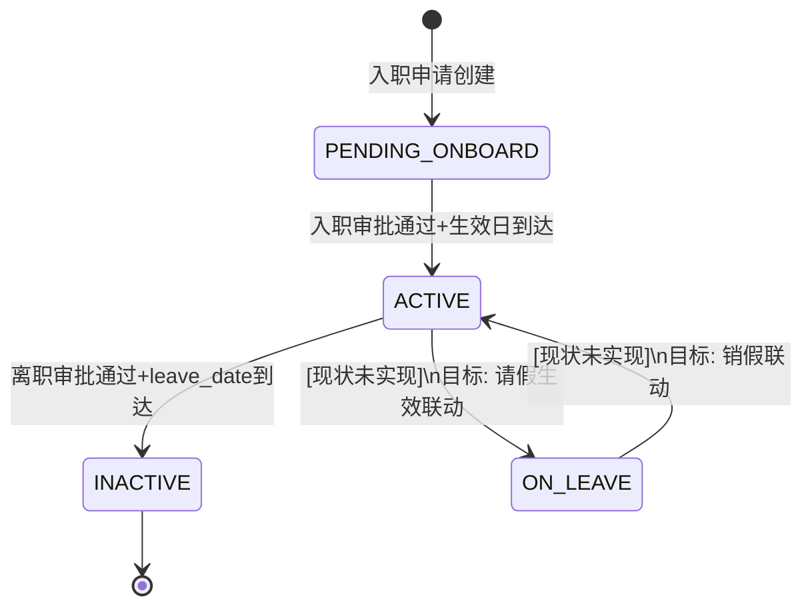
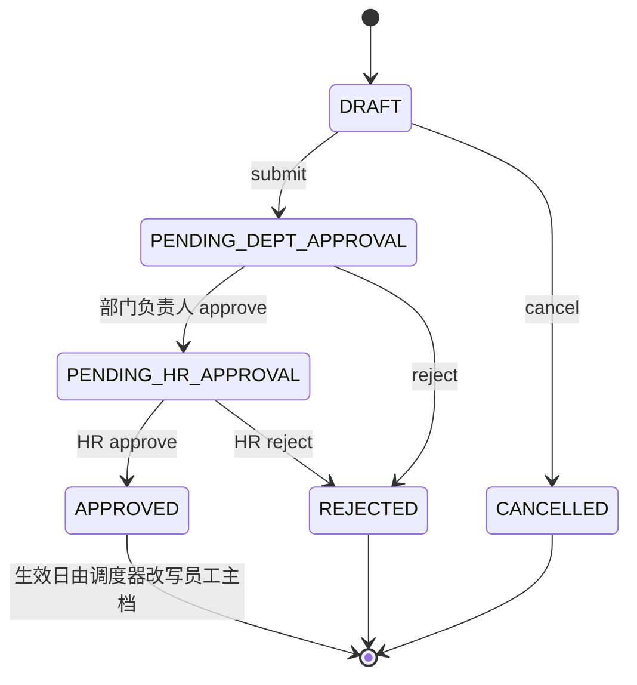
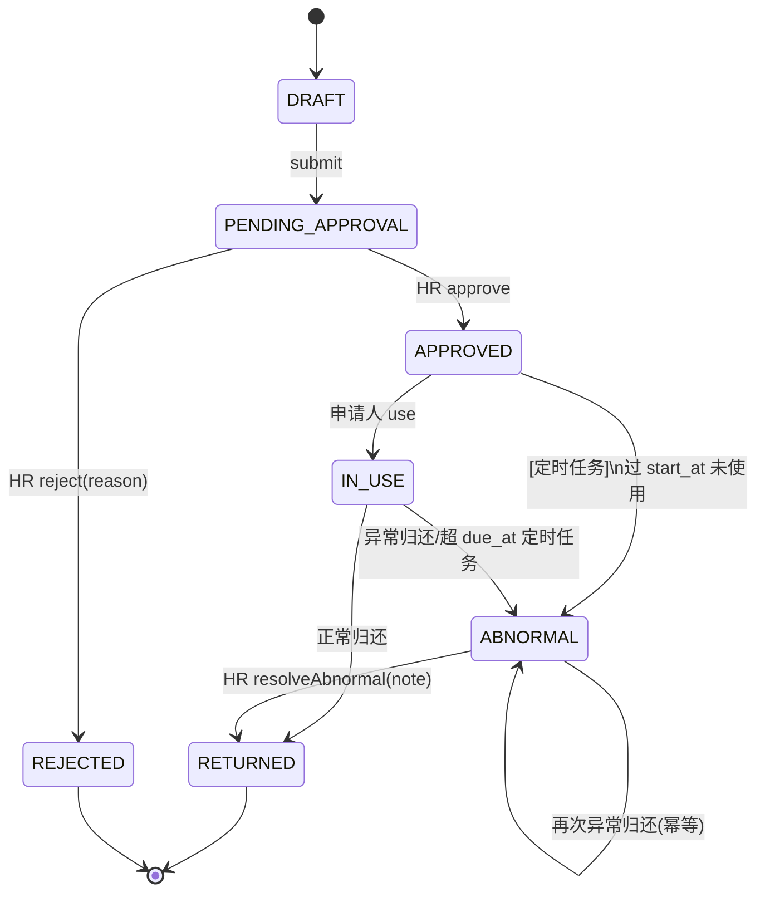
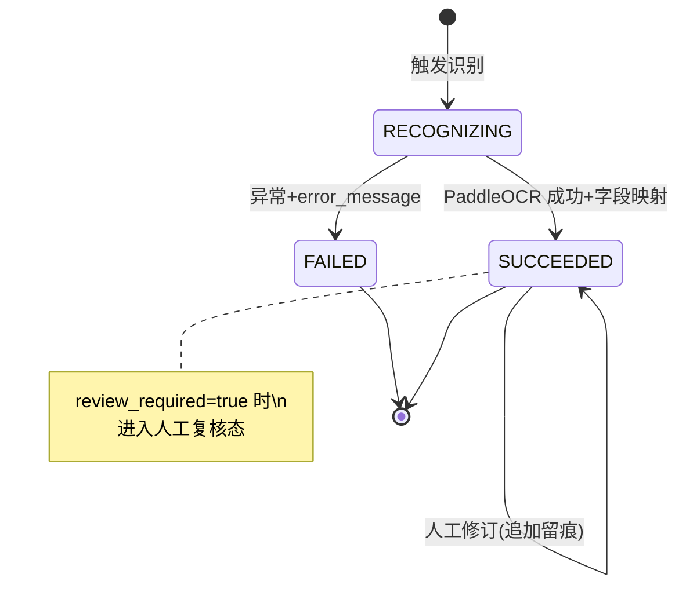
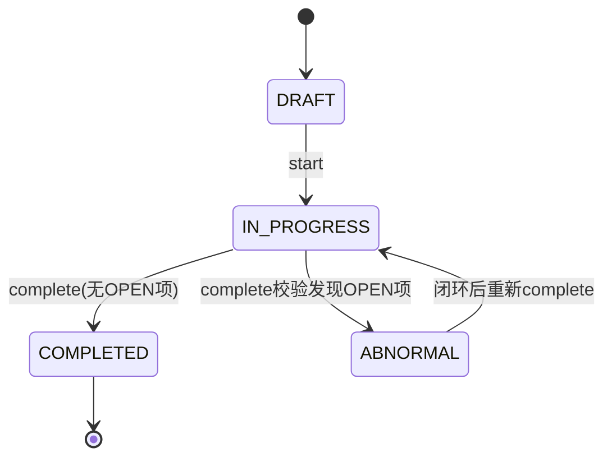
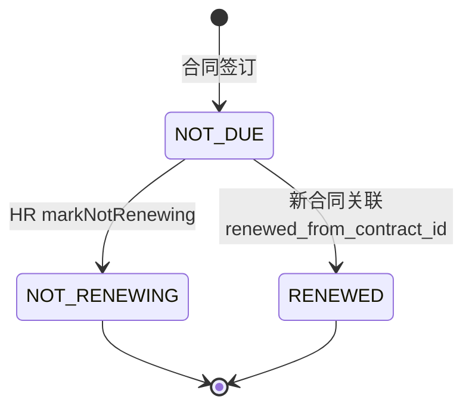
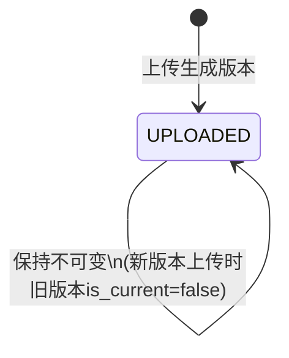

# 01 · 需求分析与需求建模

> 对应论文章节：**第 3 章 需求建模**。
> 本文基于反向工程事实清单（见 [`_facts/`](_facts/)）与已有业务流程文档（[`../../use-case-analysis.md`](../../use-case-analysis.md)、[`../../business-process-design.md`](../../business-process-design.md)）提炼，系统边界、角色、状态枚举与接口口径均与代码实现一致；凡"现状"与"目标设计"不一致处，均以 **现状：xxx / 目标设计：xxx** 明确标注。
> 术语约定：员工档案 = `employee_archive` + `archive_document` + `archive_version` 三层；人事申请 = `hr_request`；档案借用 = `archive_access_application`；盘点 = `inventory_task` + `inventory_item` + `exception_record`；OCR 绑定 = `ocr_binding`。

---

## 1. 业务需求描述

### 1.1 业务背景

中小企业在员工全生命周期管理中普遍存在以下痛点：

1. **档案分散、介质混乱**：员工身份证、学历证、劳动合同、调动/离职材料以纸质或零散扫描件形式存放于人事抽屉、共享盘、个人电脑，缺少统一的数字档案目录，"找一份三年前的合同"往往需要翻遍多个文件夹。
2. **重复录入、人工搬运**：HR 在新员工入职、调动、续签等场景需要把同一份证件上的姓名、工号、身份证号、手机号反复手工录入多个表单，既慢又易错（身份证号 18 位录错一位即产生后续风险）。
3. **版本无法追溯**：合同续签后旧合同仍在原位，档案更新后不知道"当前有效版本"是哪一份；纸质材料借出后无人跟踪是否归还，遗失、超期无人预警。
4. **操作无留痕**：谁在什么时候看过/下载过/修改过哪份档案，没有完整记录，发生泄露或纠纷时无法举证。
5. **审批与执行两张皮**：入职/调动/离职申请审批通过后，员工主档的部门、岗位、状态靠 HR 手工改，容易漏改或错改。

本课题面向上述场景，设计并实现一个"以数字档案为中心、以 OCR 减少重复录入、以状态机驱动审批与借用闭环"的企业员工档案与人事流程管理平台。

### 1.2 系统目标

| 目标编号 | 目标描述 | 对应可验证结果 |
|---|---|---|
| G1 | 减少重复录入 | 档案材料上传后由 PaddleOCR 自动抽取姓名/工号/身份证号/手机号等字段，HR 人工复核后确认；字段映射与人工修订全程留痕（`ocr_binding` + `ocr_field_revision`） |
| G2 | 档案版本可追溯 | 每次上传生成新 `archive_version` 且旧版本不可覆盖（`is_current` 标记当前版本），文件指纹 SHA-256 落库，支持版本列表与按版本下载 |
| G3 | 借用超期风险可控 | 档案借用全流程状态机（草稿→待审批→已批准→使用中→已归还/异常），超 `due_at` 未还的申请由定时任务自动转异常（`ArchiveAccessExpiryScheduler`，60s fixedDelay） |
| G4 | 操作全程留痕 | 关键业务动作写 `operation_log`（操作人、动作、对象、结果、变更前后摘要、traceId），HR 与系统管理员可分页检索 |
| G5 | 审批与主档联动 | 入职/调动/离职审批通过后，由 `EmployeeChangeScheduler`（每分钟 cron）在生效日自动改写员工状态/部门/岗位并写 `employee_status_history`，无需人工二次修改 |

### 1.3 业务范围

**系统做什么（In Scope）：**

- 员工主档与数字档案的建档、上传、版本管理、下载；
- OCR 智能识别（当前仅 `employee_profile` 版式）、字段映射、低置信度复核、人工修订留痕；
- 四类人事申请（入职 ONBOARDING / 调动 TRANSFER / 请假 LEAVE / 离职 OFFBOARDING）的两级审批（部门负责人→HR）；
- 档案借用/访问授权的申请、审批、使用、归还、异常闭环；
- 劳动合同台账与续签状态维护；
- 部门级档案盘点任务、差异登记与异常闭环；
- 人事统计概览与月报；
- 账号、角色、组织岗位维护与操作审计。

**系统不做什么（Out of Scope）：**

- **纸质实物档案的实体流转管理**：本平台只管理数字副本及其授权关系；纸质档案的库房位置、条形码、实物借出柜台等不纳入。> 现状：完全未实现；目标设计：可在 `archive_document` 上扩展 `physicalLocation` 字段作为后续方向，本期仅在需求层面标注边界。
- 薪酬、考勤打卡、排班、招聘 ATS、培训绩效等模块；
- OCR 版式扩展（学历证、身份证双面、合同正文抽取、印章检测等）——**现状仅支持 `employee_profile` 单一 documentType**（见 [`_facts/05-ocr-service.md`](_facts/05-ocr-service.md) §1），目标设计：多版式脱敏样本接入；
- 即时通讯、IM 审批通知、邮件推送——**现状：待办仅靠平台内 `GET /api/todos` 聚合，无外部通知**。

### 1.4 业务闭环

平台以"数字档案"为中心，串起建档、授权、使用、变更、盘点、统计六个环节：

```mermaid
flowchart LR
    A[建档<br/>HR 录入员工主档] --> B[上传档案材料<br/>生成版本+SHA-256]
    B --> C[OCR 识别<br/>字段映射+置信度]
    C --> D[人工复核<br/>修订留痕]
    D --> E[发起人事申请<br/>入职/调动/请假/离职]
    E --> F[两级审批<br/>部门负责人→HR]
    F --> G[生效自动改写<br/>员工状态/部门/岗位]
    G --> H[档案借用申请<br/>填写用途与起止时间]
    H --> I[HR 审批授权]
    I --> J[开始使用<br/>IN_USE]
    J --> K{是否按时归还?}
    K -- 正常 --> L[归还 RETURNED]
    K -- 逾期/异常 --> M[异常 ABNORMAL<br/>定时任务自动标记]
    M --> N[HR 异常闭环]
    N --> L
    L --> O[定期盘点<br/>核对实际版本]
    O --> P{是否有差异?}
    P -- 无 --> Q[盘点完成]
    P -- 有 --> R[差异登记+闭环]
    R --> Q
    Q --> S[统计与看板<br/>概览/月报/流程周期]
    S -.数据反哺.-> A
```

> 状态机细节见 [`_facts/03-state-machines.md`](_facts/03-state-machines.md) 与本文 §7。

---

## 2. 角色与权益

系统共四类业务角色（`sys_role.code`，V1 seed）：`EMPLOYEE` / `DEPT_MANAGER` / `HR_ADMIN` / `SYSTEM_ADMIN`。权限模型为"方法级 `@PreAuthorize` 角色校验 + 业务层 `DataScope` 数据范围二次过滤"双层，详见 [`_facts/01-backend-modules.md`](_facts/01-backend-modules.md) §5。

| 角色 | 对应门户 | 核心职责 | 数据范围（`DataScope.Type`） | demo 账号 |
|---|---|---|---|---|
| 企业员工（EMPLOYEE） | `employee.html` | 查看本人档案与状态；发起人事申请草稿并提交；发起档案借用申请；标记使用/归还；查看本人合同与待办 | `EMPLOYEE`：仅本人 `employeeId` 关联数据 | `demo-employee` / `password` |
| 部门负责人（DEPT_MANAGER） | `manager.html` | 审批本部门人事申请（DEPARTMENT 节点）；查看本部门员工与档案；创建并执行本部门盘点任务；登记盘点差异 | `DEPARTMENT`：本 `departmentId` 下员工 | `demo-manager` / `password` |
| 人事管理员（HR_ADMIN） | `hr.html` | 全企业人事业务：建档、档案上传、OCR 触发与人工修订；HR 节点审批；档案借用授权审批/异常闭环；合同台账；盘点异常闭环；查看操作日志 | `ALL`：全企业 | `demo-hr` / `password` |
| 系统管理员（SYSTEM_ADMIN） | `admin.html` | 系统账号与角色管理；组织结构维护；查看操作日志与平台概览；**不参与业务审批、不读取档案明细**（统计接口对其强制 ALL 范围但仅返回聚合值） | `ALL` 但无业务明细读权限；`@PreAuthorize("hasRole('SYSTEM_ADMIN')")` 仅用于 `/api/admin/users` | `demo-admin` / `password` |

> **复合角色说明**：`demo-hr-manager`（密码 `password`，V15 seed）挂在 `DEMO-HR` 部门，角色为 `DEPT_MANAGER`，用于演示"人事部门的负责人"这一复合身份——既是 HR 业务的操作者，又是本部门申请的审批节点。实际企业中一名用户可通过 `sys_user_role` 多对多关联多个角色。

**最小授权原则的关键约束（现状已落实）：**

- `SYSTEM_ADMIN` 没有任何业务 Controller 的 `@PreAuthorize` 权限，无法调用 `/api/employees`、`/api/archive/*`、`/api/hr-requests/*`、`/api/archive-access/*`、`/api/inventory-tasks/*`、`/api/contracts/*`；
- OCR 触发前强制走 `ArchiveReadAuthorization.allowsRead(versionId, createdBy, dataScope)`，无有效授权的版本抛 `OcrBindingNotFoundException("档案版本不存在或无有效访问授权")`；
- 手机号等敏感字段仅 HR 可见完整值，其他角色脱敏返回（见 `EmployeeController` 权限矩阵）。

---

## 3. 功能性需求

> 需求编号规则：`FR-<模块缩写>-<序号>`。"现状"列引用代码事实，"目标设计"列标注本期未实现但论文中应作为展望的内容。

### 3.1 身份认证与账号（AUTH）

| 编号 | 需求描述 | 后端 API | 现状 |
|---|---|---|---|
| FR-AUTH-01 | 账号密码登录，签发 JWT（claims：`sub=userId`、`employeeId`、`departmentId`、`roles`），默认有效期 8 小时 | `POST /api/auth/login` → `AuthService.login` | 已实现 |
| FR-AUTH-02 | 员工自助注册 | `POST /api/auth/register` → `AuthService.register` | 已实现；公开端点 |
| FR-AUTH-03 | 无状态会话；每个请求经 `JwtAuthenticationFilter` 解析 Bearer Token；`liveValidation=true` 时回查 `sys_user.enabled` 并重载角色 | `JwtAuthenticationFilter` | 已实现 |
| FR-AUTH-04 | 系统管理员分页查询/创建/更新系统用户及角色分配 | `/api/admin/users`（类级 `hasRole('SYSTEM_ADMIN')`） | 已实现 |
| FR-AUTH-05 | 密码 BCrypt 存储（`PasswordEncoder` bean） | — | 已实现 |
| FR-AUTH-06 | 生产环境启动校验：JWT_SECRET、MySQL 密码、OCR internal token、MinIO 密钥不得使用默认值；demo 账号开关必须关闭；首个管理员由 `BOOTSTRAP_ADMIN_*` 引导创建 | `ProductionConfigurationValidator` / `ProductionAdminBootstrap` | 已实现（`production` profile） |

### 3.2 组织与岗位（ORG）

| 编号 | 需求描述 | 后端 API | 现状 |
|---|---|---|---|
| FR-ORG-01 | 部门树查询（自引用 `parent_id`） | `GET /api/departments/tree` | 已实现 |
| FR-ORG-02 | 部门下岗位列表 | `GET /api/departments/{id}/positions` | 已实现 |
| FR-ORG-03 | HR/系统管理员新建/更新部门与岗位 | `POST/PUT /api/departments[/{id}]`、`POST/PUT /api/departments/{id}/positions[/{posId}]` | 已实现；岗位唯一键 `(department_id, code)` |

### 3.3 员工档案管理（EMP / ARC）

| 编号 | 需求描述 | 后端 API | 现状 |
|---|---|---|---|
| FR-EMP-01 | HR 创建员工主档（工号唯一、绑定部门/岗位、初始状态 `PENDING_ONBOARD`） | `POST /api/employees` | 已实现 |
| FR-EMP-02 | 员工详情、列表（keyword/departmentId/status 过滤）、状态变更历史分页 | `GET /api/employees[/{id}]`、`GET /api/employees/{id}/status-history` | 已实现；按 `DataScope` 过滤 |
| FR-EMP-03 | HR 更新员工档案 | `PUT /api/employees/{id}/profile` | 已实现 |
| FR-ARC-01 | 上传档案材料（multipart：`documentType` + file），写 `file_object`（SHA-256 落库）、`archive_document`（按员工+文档类型唯一）、`archive_version`（`version_no` 自增、`is_current` 切换） | `POST /api/archive/employees/{id}/documents` | 已实现；文件存 MinIO（`archive/` 前缀） |
| FR-ARC-02 | 档案文档列表、文档版本列表、按版本下载（inline 流） | `GET /api/archive/employees/{id}/documents`、`GET /api/archive/documents/{id}/versions`、`GET /api/archive/versions/{id}/download` | 已实现；旧版本不可覆盖 |
| FR-ARC-03 | 档案完整度（`completeness` 百分比）与密级（`confidentiality`）维护 | `employee_archive` 表字段 | 表结构已建；**现状：完整度由 HR 手工维护，无自动计算；目标设计：按文档类型清单自动计算** |

### 3.4 人事申请（WF）

| 编号 | 需求描述 | 后端 API | 现状 |
|---|---|---|---|
| FR-WF-01 | 创建四类申请草稿（ONBOARDING/TRANSFER/LEAVE/OFFBOARDING），按类型校验员工前置状态（入职须 `PENDING_ONBOARD`，调动/请假/离职须 `ACTIVE`） | `POST /api/hr-requests` → `RequestService.create` | 已实现 |
| FR-WF-02 | 草稿提交（DRAFT→PENDING_DEPT_APPROVAL）、撤回（DRAFT→CANCELLED） | `POST /api/hr-requests/{id}/submit|cancel` | 已实现 |
| FR-WF-03 | 部门负责人审批 DEPARTMENT 节点（通过→PENDING_HR_APPROVAL；驳回→REJECTED） | `POST /api/hr-requests/{id}/approve|reject` | 已实现；每节点写 `approval_record` 且每节点仅一次（`uk_approval_request_node`） |
| FR-WF-04 | HR 审批 HR 节点（通过→APPROVED） | 同上 | 已实现 |
| FR-WF-05 | 离职交接完成登记（仅 OFFBOARDING） | `PUT /api/hr-requests/{id}/handover` | 已实现；写 `offboarding_detail.handover_status` |
| FR-WF-06 | 审批通过后在生效日自动改写员工主档（入职→ACTIVE+hire_date；调动→换部门/岗位；离职→INACTIVE+leave_date），并写 `employee_status_history` | `EmployeeChangeScheduler`（每分钟 cron）→ `EmployeeChangeService.applyApprovedChange` | 已实现（入职/调动/离职）；**现状：LEAVE 审批通过后员工状态未切到 `ON_LEAVE`（`ON_LEAVE` 枚举已定义但无写入路径）——目标设计：请假生效/回岗时联动状态** |
| FR-WF-07 | 待办聚合（当前用户待审批/到期/异常/OCR 失败） | `GET /api/todos` | 已实现 |

### 3.5 档案访问授权（ACC）

| 编号 | 需求描述 | 后端 API | 现状 |
|---|---|---|---|
| FR-ACC-01 | 创建借用申请草稿（用途、借用类型、起止时间 `start_at/due_at`、明细清单含哪些 `archive_version_id`） | `POST /api/archive-access` | 已实现 |
| FR-ACC-02 | 提交草稿（DRAFT→PENDING_APPROVAL） | `POST /api/archive-access/{id}/submit` | 已实现 |
| FR-ACC-03 | HR 审批：通过→APPROVED；驳回→REJECTED（reason 必填），写 `archive_access_decision`（V18） | `POST /api/archive-access/{id}/approve|reject` | 已实现 |
| FR-ACC-04 | 申请人标记开始使用（APPROVED→IN_USE） | `POST /api/archive-access/{id}/use` | 已实现 |
| FR-ACC-05 | 正常归还（IN_USE→RETURNED，写 `archive_use_record.returned_at`） | `POST /api/archive-access/{id}/return` | 已实现 |
| FR-ACC-06 | 异常归还（IN_USE→ABNORMAL，可登记 `handover_to_employee_id` 移交对象） | 同上（`abnormal=true`） | 已实现（V14 移交字段） |
| FR-ACC-07 | HR 异常闭环（ABNORMAL→RETURNED，写 `archive_access_resolution`，V17） | `POST /api/archive-access/{id}/resolve` | 已实现 |
| FR-ACC-08 | 超期自动转异常：`IN_USE` 且超过 `due_at`，或 `APPROVED` 但过了 `start_at` 仍未使用 | `ArchiveAccessExpiryScheduler`（60s） | 已实现 |

### 3.6 合同管理（CON）

| 编号 | 需求描述 | 后端 API | 现状 |
|---|---|---|---|
| FR-CON-01 | 合同台账（工号/状态/续签状态过滤）；合同类型 FIXED_TERM/OPEN_ENDED/INTERN；日期约束 `ends_on>=starts_on>=signed_on` | `GET /api/contracts` | 已实现 |
| FR-CON-02 | HR 新建合同，可关联档案版本（`source_version_id`）与上一份合同（`renewed_from_contract_id`）形成续签链路 | `POST /api/contracts` | 已实现 |
| FR-CON-03 | 标记"不再续签"（`renewal_status` → NOT_RENEWING） | `PUT /api/contracts/{id}/renewal-status` | 已实现 |
| FR-CON-04 | 即将到期提醒（前端按 `ends_on` 与当前日期派生 `DUE`，Dashboard 主动查询） | `GET /contracts?status=ACTIVE&renewalStatus=DUE` | **现状：无定时任务扫描到期合同，纯查询时派生；目标设计：定时生成到期提醒待办** |

### 3.7 盘点与异常（INV）

| 编号 | 需求描述 | 后端 API | 现状 |
|---|---|---|---|
| FR-INV-01 | 部门负责人/HR 创建盘点任务（勾选一批 `versionIds` 作为"期望版本"） | `POST /api/inventory-tasks` | 已实现 |
| FR-INV-02 | 启动任务（DRAFT→IN_PROGRESS）、任务分页列表、任务下盘点项列表 | `POST /api/inventory-tasks/{id}/start`、`GET /api/inventory-tasks[/{id}/items]` | 已实现 |
| FR-INV-03 | 逐项核对：提交实际版本 `actualVersionId`，系统比对期望版本自动判定 `difference_type`（NONE / VERSION_MISMATCH） | `POST /api/inventory-tasks/{id}/items/{itemId}/check` | 已实现 |
| FR-INV-04 | 存在 OPEN 差异项时禁止完成任务；无 OPEN 项时可 complete（→COMPLETED） | `POST /api/inventory-tasks/{id}/complete` | 已实现 |
| FR-INV-05 | 差异闭环：登记处理说明，写 `exception_record.status=RESOLVED`，`inventory_item.resolution_status` → RESOLVED | `POST /api/inventory-tasks/{id}/items/{itemId}/resolve` | 已实现（V12 闭环模型） |

### 3.8 OCR 智能识别（OCR）

> 本模块单列于 §4 详述。

| 编号 | 需求描述 | 后端 API | 现状 |
|---|---|---|---|
| FR-OCR-01 | 对档案版本触发一次 OCR（同步等待结果） | `POST /api/archive/versions/{id}/ocr` | 已实现；同步阻塞（详见 §4.4） |
| FR-OCR-02 | 查询版本 OCR 结果（文本块、字段、置信度、检测框预览） | `GET /api/archive/versions/{id}/ocr-result` | 已实现 |
| FR-OCR-03 | 检测框效果图 PNG 预览 | `GET /api/archive/ocr-bindings/{id}/preview` | 已实现 |
| FR-OCR-04 | HR 人工修订字段值（value + reason），追加 `ocr_field_revision`，不覆盖原始识别结果 | `PUT /api/archive/ocr-bindings/{id}/fields/{fieldCode}` | 已实现 |

### 3.9 统计与看板（STAT）

| 编号 | 需求描述 | 后端 API | 现状 |
|---|---|---|---|
| FR-STAT-01 | 概览指标（员工数、档案完整度、待办数、OCR 统计等），按调用者 `DataScope` 聚合 | `GET /api/statistics/overview` | 已实现；SYSTEM_ADMIN 强制 ALL 范围但仅返回聚合值 |
| FR-STAT-02 | 月报：月度趋势 + 部门分布 + 流程周期（入职/调动/审批耗时等） | `GET /api/statistics/report` | 已实现 |

### 3.10 操作日志与审计（AUD）

| 编号 | 需求描述 | 后端 API | 现状 |
|---|---|---|---|
| FR-AUD-01 | 关键业务动作写 `operation_log`（operatorId/action/objectType/objectId/result/beforeSummary/afterSummary/traceId） | `OperationLogService.record`（13 个 Service 类手动调用） | 已实现；**现状：无 AOP 切面，靠手动埋点，可能存在漏埋；目标设计：接入 `@Aspect` 自动审计** |
| FR-AUD-02 | 全局异常自动落审计（如 `REQUEST_FAILED`） | `GlobalExceptionHandler` 兜底 | 已实现 |
| FR-AUD-03 | HR/系统管理员分页检索操作日志（operator/action/objectType/result/时间范围） | `GET /api/operation-logs` | 已实现 |

---

## 4. OCR 智能需求专项

> 详细技术事实见 [`_facts/05-ocr-service.md`](_facts/05-ocr-service.md)。本节从需求视角组织。

### 4.1 输入

- **输入对象**：扫描件或照片，MIME ∈ `image/png` / `image/jpeg`，单文件 ≤ 10MB，图像最长边 ≤ 4096px；
- **输入来源两种**：
  1. Spring Boot 侧已上传的档案版本（通过 `sourceObjectKey` 引用 MinIO 中 `archive/` 前缀下的同一份文件，不重复传二进制）；
  2. 直接 multipart 上传文件；
- **当前支持版式**：仅 `documentType=employee_profile`（员工登记表）。> 现状：学历证、身份证、合同正文等版式未接入；目标设计：多版式脱敏样本扩展。

### 4.2 处理流水线

**流水线各环节落点：**

| 环节 | 实现位置 | 产物 |
|---|---|---|
| 版面预处理 | `PaddleOcrEngine._preprocess`（`ImageOps.exif_transpose` → grayscale → autocontrast → thumbnail） | 临时 PNG |
| 识别 | `PaddleOcrEngine._predict`（优先 `ocr.predict()`，回退 `ocr.ocr(cls=True)`，`text_det_limit_side_len=4096`） | `List[TextBlock(pageNo, text, confidence, bbox)]` |
| 字段映射 | `EmployeeProfileFieldExtractor.extract`（正则 `^\s*(?P<label>[^:：]+?)\s*[:：]\s*(?P<value>.+?)\s*$`） | `fields` dict |
| 坐标/置信度保存 | 文本块与完整结果存 OCR 服务 SQLite `ocr_tasks.payload`；MySQL 侧 `ocr_binding` 只存摘要（status/engineVersion/processingDurationMs/reviewRequired/preview 元数据） | 两处库分工 |
| 格式校验 | `validate(field_code, value)` | `validationStatus: PASSED/FAILED` |
| 低置信度提示 | `review_required = (confidence < 0.85) OR (not validation_passed)`，阈值可由 `OCR_LOW_CONFIDENCE_THRESHOLD` 配置 | 前端高亮 |
| 人工修订 | `PUT /api/ocr/tasks/{task_id}/fields/{field_code}`，重新校验并写 `field_revisions`（SQLite）+ `ocr_field_revision`（MySQL） | 修订历史时间线 |

> **现状关键事实**：OCR 识别出的字段值**不回写** `employee` / `employee_archive` 表（grep 未发现相关 service 方法）。即"OCR 识别→人工复核→自动建档"这一闭环在本期是**断开的**——HR 仍需把复核后的值手工录入员工主档。目标设计：增加"确认回填"接口，把已复核字段写回员工主档并写 `operation_log`。

### 4.3 字段清单

> 来源：[`_facts/05-ocr-service.md`](_facts/05-ocr-service.md) §4.1。

| fieldCode | 中文标签 | 校验正则 | 失败提示 |
|---|---|---|---|
| `employee_name` | 员工姓名 / 姓名 | `^[\u4e00-\u9fffA-Za-z· ]+$` | 员工姓名格式错误 |
| `employee_id` | 员工编号 / 工号 | `^[A-Za-z0-9][A-Za-z0-9_-]{1,31}$` | 员工编号格式错误 |
| `id_number` | 身份证号 / 身份证号码 | `^\d{17}[\dXx]$` | 身份证号格式错误 |
| `phone` | 联系电话 / 手机号码 / 手机号 | `^1[3-9]\d{9}$` | 联系电话格式错误 |

同一 fieldCode 只取第一个匹配文本块（去重）；归一化规则（用于评测比对）：`employee_id/id_number/phone` 去空白与 `-` 并转大写，其余字段去空白并 casefold。

### 4.4 评估要求

OCR 服务提供 `POST /api/ocr/evaluations` 即时评测接口（真值不落库，每次请求即时计算）：

| 指标 | 公式 | 业务含义 |
|---|---|---|
| `sampleCount` | 样本数 | 评测规模 |
| `fieldDetectionRate` | detectedFieldCount / expectedFieldCount | 字段检出率 |
| `fieldAccuracy` | correctFieldCount / expectedFieldCount | 字段准确率（归一化后与真值完全相等） |
| `failureRate` | failedTaskCount / sampleCount | 任务失败率 |
| `averageProcessingDurationMs` | 所有样本 `processingDurationMs` 均值 | 平均处理耗时 |
| `byClarity` | 按 HIGH / MEDIUM / LOW 三档分别统计上述指标 | 不同清晰度下的鲁棒性 |

**评测样本要求**：按高/中/低三种清晰度构造样例（清晰打印件、轻微模糊、低光照/倾斜/压缩噪声），覆盖姓名、工号、身份证号、手机号四个字段。

> **现状**：当前评测样本为 36 张合成图、由单一底图派生（见 [`../../ocr-clarity-evaluation.md`](../../ocr-clarity-evaluation.md)），版式单一、无真实脱敏样本；**目标设计**：引入多版式、多来源（扫描件实拍、手机拍照）脱敏样本集，并统计 P50/P95 处理耗时。

### 4.5 可靠性约束（OCR 专项）

| 项 | 现状 | 目标设计 |
|---|---|---|
| 同步/异步 | **同步阻塞**：FastAPI `create_ocr_task` 路由虽是 `async def`，但函数体内无任何 `await`，PaddleOCR 推理 + MinIO 下载/上传 + Pillow 渲染全部在 HTTP 请求线程内完成；Spring Boot 侧 `HttpOcrClient` readTimeout=30s | 引入后台队列（如 Celery / RQ），Spring Boot 提交后轮询任务状态 |
| 超时 | Spring Boot 30s readTimeout 到期即抛 `OcrClientException`，但 OCR 服务仍在继续跑 | 任务幂等键 + 超时取消 + 进度回写 |
| 重试 | 无自动重试，失败任务需 HR 手动重新触发 | 失败自动重试 N 次（限网络错误，非识别失败） |
| 幂等 | `uk_ocr_binding_version(archive_version_id)` 保证同一版本仅一条绑定；重复触发走 `getTask` | 已实现 |

---

## 5. 非功能性需求

### 5.1 性能

| 编号 | 指标 | 现状/目标 |
|---|---|---|
| NFR-P-01 | 常规业务接口（员工列表、申请列表、待办、统计概览）响应时间 P95 ≤ 1s | **现状**：开发环境未做压测；目标设计：demo 规模（百级员工）下满足，千级以上需引入 Redis 缓存（注：Redis 容器在跑但业务代码零使用，见 [`_facts/01-backend-modules.md`](_facts/01-backend-modules.md) §9） |
| NFR-P-02 | 并发支持 | 目标：单机部署下支持 50 并发用户；本期未做压测 |
| NFR-P-03 | OCR 处理耗时 | **现状**：同步等待，单次含 PaddleOCR 推理，均值见 `ocr_binding.processing_duration_ms`；目标：P50 ≤ 5s，P95 ≤ 15s（单张 10MB 以内图片） |

### 5.2 可靠性

| 编号 | 需求 | 现状/目标 |
|---|---|---|
| NFR-R-01 | OCR 任务超时/重试/幂等 | 现状：仅幂等（版本唯一绑定）；超时后 OCR 服务仍在跑，结果可能晚于请求返回；目标设计见 §4.5 |
| NFR-R-02 | 档案借用超期自动处理 | 已实现：`ArchiveAccessExpiryScheduler` 每 60s 扫描 |
| NFR-R-03 | 员工异动到期生效 | 已实现：`EmployeeChangeScheduler` 每分钟 cron，失败写审计 |
| NFR-R-04 | 数据库迁移可重复执行 | 已实现：Flyway V1–V18 顺序迁移，`baseline-on-migrate=true` |
| NFR-R-05 | 生产启动自检 | 已实现：`ProductionConfigurationValidator` 拒绝弱密钥启动 |

### 5.3 安全性

| 编号 | 需求 | 现状 |
|---|---|---|
| NFR-S-01 | 认证：JWT 无状态 + 可开关 liveValidation | 已实现 |
| NFR-S-02 | 口令：BCrypt 哈希存储 | 已实现 |
| NFR-S-03 | 授权：方法级 `@PreAuthorize` + 业务层 `DataScope`（NONE/EMPLOYEE/DEPARTMENT/ALL）二次过滤 | 已实现 |
| NFR-S-04 | 最小授权：SYSTEM_ADMIN 不读档案明细；OCR 触发前强制 `ArchiveReadAuthorization` 校验 | 已实现 |
| NFR-S-05 | 敏感字段脱敏：手机号对非 HR 角色脱敏 | 已实现（HR 可见完整） |
| NFR-S-06 | 服务间互信：Spring Boot ↔ FastAPI 调用必须带 `X-OCR-Internal-Token`，不匹配 403 | 已实现；生产环境 token ≥ 32 字符 |
| NFR-S-07 | 文件完整性：所有上传文件计算 SHA-256 落 `file_object.sha256`，索引去重 | 已实现 |
| NFR-S-08 | **现状缺口**：`sys_permission` / `sys_role_permission` 表已建但代码未读取，权限颗粒度粗（仅角色级） | 目标设计：引入权限点级控制 |

### 5.4 易用性

- 四端独立 SPA（employee / manager / hr / admin），按角色路由守卫 + 门户级双重保护；
- 统一待办中心（`GET /api/todos`）聚合待审批、到期、异常、OCR 失败事项；
- OCR 低置信度字段在前端高亮提示，HR 可直接在复核页修订并填写原因；
- 检测框效果图 PNG 帮助 HR 直观判断识别位置是否正确。

### 5.5 可维护性

- Flyway 迁移版本化管理（V1–V18，31 张表）；
- 后端按业务领域分 13 个 package（auth / organization / employee / archive / ocr / workflow / access / inventory / contract / statistics / audit / common.security / common.web），模块边界清晰；
- 统一 `ApiResponse<T>{code,message,data,traceId}` 包装与全局异常映射；
- TraceId 全链路（`TraceIdFilter` 写入 MDC 与响应头）。

### 5.6 合规

- 不收集与业务无关的个人信息；
- 演示数据全部脱敏（`DEMO-EMP-*` 员工、`demo-*` 账号），生产环境通过 `PLATFORM_DEMO_ACCOUNTS_ENABLED=false` + V16 迁移自动禁用；
- OCR 评测真值不落库（即时计算），避免真实身份证号等敏感数据长期留存。

---

## 6. 用例分析

> 本节仅展开两个核心用例的详细描述；完整用例清单、用例图、参与者与系统边界见 [`../../use-case-analysis.md`](../../use-case-analysis.md) 与 [`../../business-process-design.md`](../../business-process-design.md)，不重复罗列。

### 6.1 用例 UC-OCR-01：OCR 识别员工档案并人工复核

**参与者**：人事管理员（HR_ADMIN，主）；外部系统 PaddleOCR 服务、MinIO 对象存储（副）。

**前置条件**：

1. HR 已登录 `hr.html` 门户，且对目标员工档案版本有读权限；
2. OCR 服务健康（`GET /health` 返回 `status=ok`）；
3. 档案版本文件已存在于 MinIO `archive/` 前缀下，SHA-256 一致。

**主事件流**：

1. HR 在员工档案详情页选择某文档当前版本，点击"OCR 识别"；
2. 系统校验读权限通过，调用 `POST /api/archive/versions/{versionId}/ocr`；
3. Spring Boot 通过 `HttpOcrClient` 以 `sourceObjectKey` + `X-OCR-Internal-Token` 调用 FastAPI `POST /api/ocr/tasks`；
4. OCR 服务完成预处理 → PaddleOCR 识别 → 字段映射 → 预览图渲染，返回任务结果；
5. Spring Boot 写 `ocr_binding`（status=SUCCEEDED、engineVersion、processingDurationMs、reviewRequired、preview 元数据）；
6. HR 在 OCR 复核页查看文本块、字段值、置信度、检测框预览图；
7. 对低置信度或校验失败字段，HR 填写正确值与原因，提交修订；
8. 系统重新校验格式，写 `ocr_field_revision`（MySQL）与 `field_revisions`（SQLite），更新当前字段值。

**异常流**：

- **E1 OCR 服务不可达**：Spring Boot 抛 `OcrClientException`，前端展示 `OCR_RESULT_UNAVAILABLE`，允许刷新重试（不显示为空字段的成功）；
- **E2 识别失败**：`ocr_binding.status=FAILED`，记录 `error_code/error_message`，前端展示失败原因与"重新触发"按钮；
- **E3 无访问授权**：抛 `OcrBindingNotFoundException("档案版本不存在或无有效访问授权")`，前端展示 404；
- **E4 修订值格式仍不合法**：`validationStatus=FAILED`，`review_required` 保持 true，不允许以无效格式关闭复核。

**后置条件**：`ocr_binding` 状态终态为 SUCCEEDED 或 FAILED；所有人工修订以追加方式留痕，原始识别文本块不被覆盖。> 现状：复核结果不回写员工主档（见 §4.2）。

### 6.2 用例 UC-ACC-01：员工发起档案借用 → 审批 → 使用 → 归还

**参与者**：企业员工（EMPLOYEE，主）；部门负责人（DEPT_MANAGER，副审批）；人事管理员（HR_ADMIN，授权审批与异常闭环）；定时任务（副，超期自动转异常）。

**前置条件**：

1. 员工已登录，状态为 ACTIVE；
2. 目标档案版本存在且当前有效（`is_current=true`）；
3. 员工在本部门数据范围内。

**主事件流**：

1. 员工在"档案访问"页新建借用申请：填写用途、借用类型、`start_at`/`due_at`、勾选档案版本明细；
2. 提交草稿：DRAFT → PENDING_APPROVAL；
3. HR 在待办中心看到该申请，审批通过：PENDING_APPROVAL → APPROVED，写 `archive_access_decision`；
4. 员工在 `start_at` 到达后点击"开始使用"：APPROVED → IN_USE，写 `archive_use_record.used_at`；
5. 员工在 `due_at` 前完成使用，点击"正常归还"：IN_USE → RETURNED，写 `returned_at`。

**异常流**：

- **E1 HR 驳回**：PENDING_APPROVAL → REJECTED，reason 必填；员工需重新创建申请；
- **E2 逾期未还**：定时任务（60s 扫描）发现 IN_USE 且 `due_at < now`，自动转 ABNORMAL；
- **E3 批准后未在约定时间使用**：定时任务发现 APPROVED 且过了 `start_at`，自动转 ABNORMAL；
- **E4 归还时发现缺件/损坏**：员工标记异常归还（abnormal=true），IN_USE → ABNORMAL，可登记 `handover_to_employee_id`；
- **E5 HR 异常闭环**：HR 填写处理说明，ABNORMAL → RETURNED，写 `archive_access_resolution`。

**后置条件**：申请终态为 RETURNED / REJECTED；使用流水、审批决策、异常闭环全程留痕。

---

## 7. 业务状态机概览

> 7 个状态机的状态值全集如下；详细转移表、进入条件与触发方法见 [`_facts/03-state-machines.md`](_facts/03-state-machines.md)，详细设计与类图见 `06-detailed-design.md`（后续文档）。

### 7.1 员工状态 `employee.status`

枚举：`PENDING_ONBOARD（待入职）` / `ACTIVE（在职）` / `ON_LEAVE（请假中）` / `INACTIVE（离职停用）`。

### 7.2 人事申请状态 `hr_request.status`

枚举：`DRAFT` / `PENDING_DEPT_APPROVAL` / `PENDING_HR_APPROVAL` / `APPROVED` / `REJECTED` / `CANCELLED`。

### 7.3 档案借用状态 `archive_access_application.status`

枚举：`DRAFT` / `PENDING_APPROVAL` / `APPROVED` / `REJECTED` / `IN_USE` / `ABNORMAL` / `RETURNED`。

### 7.4 OCR 任务状态 `ocr_binding.status`（与 SQLite `ocr_tasks.status` 同步）

枚举：`PENDING`（预留）/ `PREPROCESSING`（预留）/ `RECOGNIZING` / `SUCCEEDED` / `FAILED`；查询时派生 `UNAVAILABLE`（不写库）。

### 7.5 盘点任务状态 `inventory_task.status` 与盘点项 `inventory_item.resolution_status`

任务枚举：`DRAFT` / `IN_PROGRESS` / `COMPLETED` / `ABNORMAL`（complete 校验时发现 OPEN 项）。
盘点项枚举：`PENDING` / `NOT_REQUIRED`（无差异）/ `OPEN`（有差异）/ `RESOLVED`。

### 7.6 合同续签状态 `employee_contract.renewal_status`

枚举：`NOT_DUE`（未到期）/ `RENEWED`（已续签，由新合同 `renewed_from_contract_id` 派生）/ `NOT_RENEWING`（HR 标记不续签）；前端额外派生 `DUE`（即将到期，纯查询时计算）。

### 7.7 档案版本状态 `archive_version.status`

枚举：`UPLOADED`（当前唯一值）；版本有效性由 `is_current` 布尔字段控制——新版本上传后旧版本自动 `is_current=false`，旧版本文件本身不可覆盖、可按版本下载。

---

## 8. 本章小结

本章从业务背景出发，明确了平台"以数字档案为中心、OCR 减少重复录入、状态机驱动审批与借用闭环"的定位；定义了四类角色与双层权限模型；按 10 个模块拆解了约 40 条功能性需求并逐条对照后端 API 现状；单列了 OCR 智能识别的输入、流水线、字段清单、评估口径与可靠性缺口；从性能、可靠性、安全、易用、可维护、合规六个维度给出非功能性需求；最后以两个核心用例和 7 个状态机收束，为第 4 章系统设计与第 5 章详细设计建立需求基线。

**现状与目标设计的关键差距汇总**（论文中需在"展望"章节呼应）：

1. OCR 字段复核后不回写员工主档（"识别→复核→回填"闭环断开）；
2. 请假审批后员工状态不切 `ON_LEAVE`（请假状态机未闭环）；
3. OCR 识别为同步阻塞，无后台队列、无自动重试；
4. Redis 容器已部署但业务代码零使用；
5. 操作日志靠手动埋点，无 AOP 切面；
6. 权限颗粒度仅到角色级，`sys_permission` 未启用；
7. OCR 版式单一（仅 employee_profile），评测样本为单底图派生的合成图；
8. 合同到期无定时提醒，纯查询时派生。
