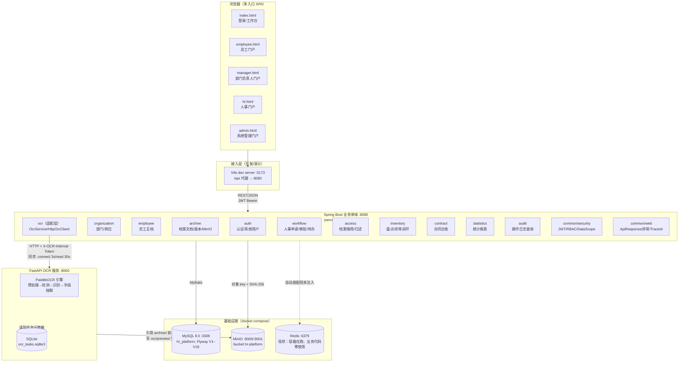
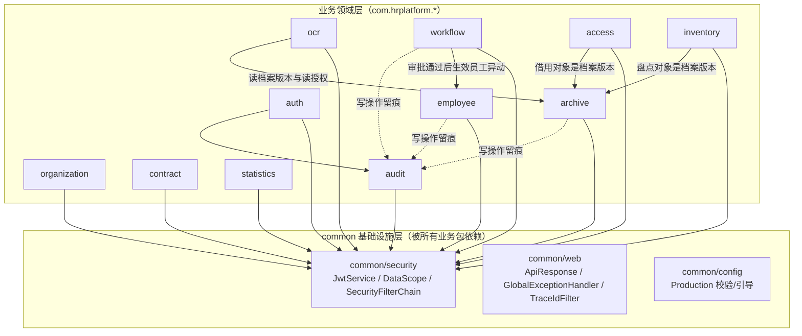
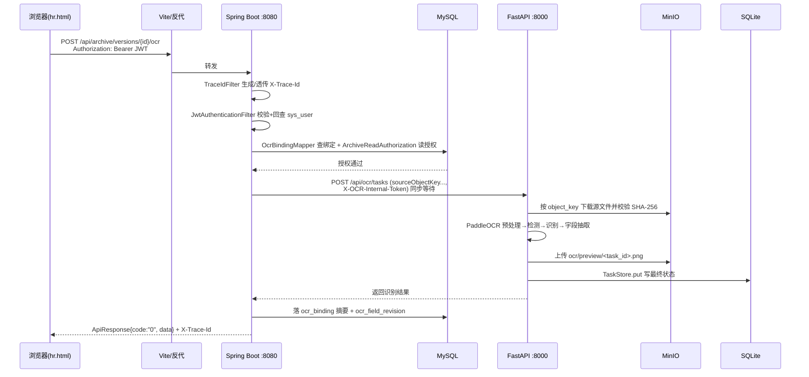

# 02 · 系统架构设计（论文第 4 章）

> 本章结论均来自代码与配置的事实阅读，引用 `docs/design/_facts/` 下对应文件编号。
> 凡"现状"表述，均指向 facts 证据；凡"目标/待决策"表述，均为就绪评估（`docs/project-readiness-assessment.md`）指出的偏差，不冒充已实现。

---

## 1. 总体架构

### 1.1 架构形态声明

本系统采用**模块化单体业务服务（Spring Boot）+ 独立 OCR 识别服务（FastAPI）+ 前端多入口 SPA** 的三段式架构：

- **业务后端**：单一 Spring Boot 应用（`server/`），内部按业务领域划包，进程内通过 Spring Bean 调用，不拆微服务；
- **OCR 识别服务**：独立 Python FastAPI 进程（`ocr-service/`），封装 PaddleOCR，与业务后端通过 HTTP + 共享 MinIO 对象存储解耦；
- **前端**：Vue 3 + TypeScript + Element Plus，构建为**多个独立 HTML 入口**（登录/工作台 `index.html` 与员工/部门负责人/人事/系统管理员四个门户），开发态由 Vite dev server 代理 `/api`。

> 历史设计文档曾出现过 identity / workflow / archive 等微服务边界划分，但**当前可运行代码并不是微服务**。本章以 `server + ocr-service + MySQL + MinIO` 的实际形态为准（依据：`_facts/01`、`_facts/06`、就绪评估 §3.1）。

### 1.2 总体架构图

**读图要点：**

1. 浏览器与后端之间只走一个入口（开发态 Vite proxy，生产态同源反向代理），后端**未配置 CORS 过滤器**（依据：`_facts/01` §7、`_facts/06` §7.5）。
2. Spring Boot 与 OCR 服务之间**不共享数据库**：业务侧 MySQL `ocr_binding` 只存绑定摘要，完整文本块与字段落在 OCR 服务自己的 SQLite（依据：`_facts/05` §8.3、`_facts/02` V3 注）。
3. **MinIO 是两者之间唯一的二进制共享通道**：档案文件上传到 `archive/` 前缀，OCR 服务通过 `sourceObjectKey` 引用同一份对象，不重复传输文件字节；识别后的检测框预览图写到 `ocr/preview/<task_id>.png`（依据：`_facts/06` §7.2）。
4. **Redis 容器在 compose 中启动，但 Spring Boot 业务代码零调用**（`RedisTemplate/@Cacheable` 在 `server/src/main/java` 下零命中），图中以虚线表示这一现状偏差（依据：`_facts/01` §9.2、`_facts/06` §7.1）。

---

## 2. 技术选型理由

| 技术 | 版本 | 用途 | 选择理由 | 备注 |
|---|---|---|---|---|
| Spring Boot | 3.x / Java 17 | 业务后端主框架 | 成熟的企业级 IoC/Web/安全生态；主类 `PlatformApplication` 开启 `@EnableScheduling` + `@MapperScan`，一个进程承载全部业务包 | CI 固定 Java 17；本机 Java 26 会触发 Mockito 内联 mock 错误（就绪评估 §2） |
| MyBatis | Spring Boot Starter 版本随 Boot | SQL 映射 | XML mapper（`classpath:/mapper/**/*.xml`）便于手写统计 SQL 与多表聚合，避免 JPA 自动生成不可控 SQL | Mapper 接口全部 `@Mapper`，由 `@MapperScan` 扫描（`_facts/01` §4） |
| MySQL | 8.0.39（镜像） | 业务主库（写） + 从库（读） | InnoDB + utf8mb4，事务与外键约束成熟；`AbstractRoutingDataSource` 按 SqlCommandType 路由 | **已实现读写分离路由**，演示环境 master/replica 同实例，生产经 `MYSQL_REPLICA_URL` 接独立从库（见 ADR-003） |
| Flyway | V1–V18 迁移脚本 | schema 版本管理 | 启动自动迁移，保证演示环境从空库可复现；`baseline-on-migrate=true` | V16 通过 `${demoAccountsEnabled}` 占位符控制演示数据禁用 |
| Vue 3 + TypeScript | Vite 构建 | 前端 SPA | 组合式 API + 类型安全；Element Plus 由 `unplugin-vue-components` 按需引入 | 5 个 HTML 入口（index/employee/manager/hr/admin） |
| Element Plus | 随前端依赖 | UI 组件库 | 中后台表格/表单/弹窗组件齐全，适配人事系统表单密集场景 | — |
| Vite | 5173 dev / 4173 preview | 前端构建与 dev proxy | dev 态 `/api` 代理到后端，省去 CORS；构建产物即生产静态站 | `strictPort` 固定端口（`_facts/06` §4） |
| FastAPI | uvicorn 运行 | OCR 服务框架 | 异步声明 + Pydantic 模型校验，与 Python AI 生态天然衔接 | **现状：路由虽为 async 声明，但体内全部同步阻塞调用**（见 §7） |
| PaddleOCR | Python 引擎 | 文档文字检测/识别 | 中文识别效果好，自带检测+识别+方向分类；提供 mock 引擎用于无 GPU 联调 | `OCR_ENGINE=paddle\|mock` 可切换（`_facts/05` §6） |
| MinIO | `quay.io/minio/minio:latest` | 对象存储 | S3 兼容；对象 key 寻址、SHA-256 完整性校验、内容不可变版本；解耦业务库与大文件 | bucket `hr-platform`，`archive/` 与 `ocr/` 前缀分域（ADR-005） |
| Redis | `redis:7.4-alpine` 容器 | **现状：依赖在、业务未用** | 原设计意图：待办缓存 / 幂等键 / 审批短锁 | **就绪评估 §3.3 指出未承担任何业务职责，目标去留待决策**（ADR-004） |
| docker-compose | 仅中间件 | 本地/演示编排 | 一键起 MySQL/Redis/MinIO，降低演示环境搭建成本 | 后端、OCR 服务、前端在开发/演示时本地直接运行，**未容器化编排**（`_facts/06` §1） |

---

## 3. 模块划分

### 3.1 后端包职责（一句话描述）

依据 `_facts/01` §1，业务包集中在 `com.hrplatform` 下：

| # | 包 | 职责 |
|---|---|---|
| 1 | `auth` | 账号密码登录/注册、JWT 签发后的系统用户管理（`AuthController`/`AdminUserController`） |
| 2 | `organization` | 部门树与岗位的增删改查及管理视图 |
| 3 | `employee` | 员工主档维护、按数据范围查询、员工状态变更历史 |
| 4 | `archive` | 档案文档与版本上传、MinIO 对象存储、版本下载与目录读授权 |
| 5 | `ocr` | OCR 触发编排、结果查询、检测预览、字段人工修订，内部经 `HttpOcrClient` 调独立 OCR 服务 |
| 6 | `workflow` | 入职/调动/请假/离职四类人事申请的状态机、审批、待办聚合与到期员工异动生效 |
| 7 | `access` | 档案借用申请的提交/审批/使用/归还/异常闭环与过期回收调度 |
| 8 | `inventory` | 盘点任务创建、逐项核对、差异记录与闭环 |
| 9 | `contract` | 员工劳动合同台账与续签状态标记 |
| 10 | `statistics` | 人事概览指标与月报（多表只读聚合 SQL） |
| 11 | `audit` | 操作日志分页查询（写入由各 Service 手动调用） |
| 12 | `common/security` | JWT 签发/校验、Spring Security 过滤链、RBAC 角色与 `DataScope` 数据范围 |
| 13 | `common/web` | 统一响应包装 `ApiResponse`、全局异常映射、`X-Trace-Id` 透传 |
| 14 | `common/config` | production profile 的启动配置校验与首个管理员引导 |

### 3.2 模块依赖关系图

**依赖规则说明：**

- 所有业务包都依赖 `common/security`（取 `JwtPrincipal`/`DataScope`）与 `common/web`（返回 `ApiResponse`、抛业务异常）；
- 跨领域调用走**领域服务方法**而非直接读对方 Mapper：如 `workflow` 审批通过后经 `EmployeeChangeService` 改员工状态，`ocr` 触发前经 `ArchiveReadAuthorization.allowsRead(...)` 做读授权校验（依据：`_facts/01` §2.6 注）；
- `statistics` 是只读聚合方，不被其他业务包反向依赖。

### 3.3 深模块（信息隐藏）原则

每个业务包对外只暴露 **Controller 层路由 + Service 公开方法签名**，内部的 Mapper XML、状态机类、领域对象全部封装在包内：

- 例：`access` 包对外只给 `ArchiveAccessController` 的 REST 路由与 `ArchiveAccessService` 的几个动作方法；状态迁移规则藏在 `ArchiveAccessStateMachine`，过期回收藏在 `ArchiveAccessExpiryScheduler`，外部无需感知（依据：`_facts/07` §1/§2/§4）。
- 写方法统一 `@Transactional`，只读方法 `@Transactional(readOnly=true)`，事务边界由 Service 方法声明划定（依据：`_facts/01` §3）。
- OCR 的外部地址、token、超时等细节封在 `HttpOcrClient`（实现 `OcrClient` 接口），`OcrService` 只面向接口编程，便于单测 mock（依据：`_facts/07` §1）。

### 3.4 运行时支撑：定时任务

主类开启 `@EnableScheduling`，系统内有两个常驻调度器，作为状态机的"时间推进器"（依据：`_facts/01` §8、`_facts/07` §4）：

| 调度器 | 触发 | 作用 |
|---|---|---|
| `ArchiveAccessExpiryScheduler` | `fixedDelay=60s`（`hr.archive-access.expiry-delay-ms`） | 把超过 `due_at` 仍在 `IN_USE` 的借用申请标记异常，把已批准但未在 `start_at` 后使用的申请回收 |
| `EmployeeChangeScheduler` | cron `0 * * * * *`（每分钟，Asia/Shanghai） | 扫描到期的已批准申请，逐个调 `EmployeeChangeService` 生效员工异动，失败写审计 |

> 现状边界：异动生效分支只处理入职/调动/离职，`LEAVE` 请假走默认分支保留原状态——请假开始/结束的状态闭环尚未实现，属就绪评估 P0.6，不在本章架构层面解决。

---

## 4. 部署拓扑

### 4.1 docker-compose 服务清单

依据 `_facts/06` §1，`infra/docker-compose.yml` 只编排三个中间件，且端口全部绑定 `127.0.0.1`：

| 服务 | 镜像 | 容器内端口 | 宿主机端口 | 数据卷 | 健康检查 |
|---|---|---|---|---|---|
| `mysql` | `mysql:8.0.39` | 3306 | `${MYSQL_PORT:-3306}` | `mysql_data:/var/lib/mysql` | `mysqladmin ping` |
| `redis` | `redis:7.4-alpine` | 6379 | `${REDIS_PORT:-6379}` | `redis_data:/data`（appendonly） | `redis-cli ping` |
| `minio` | `quay.io/minio/minio:latest` | 9000(API)/9001(Console) | `${MINIO_API_PORT:-9000}` / `${MINIO_CONSOLE_PORT:-9001}` | `minio_data:/data` | `curl /minio/health/live` |

> Spring Boot 后端、FastAPI OCR 服务、前端静态站**不在 compose 中**，开发/演示时本地进程运行；`infra/docker-compose.production.yml` 存在但本次未展开（依据：`_facts/06` §1）。MinIO bucket 与访问策略由 `infra/minio-bootstrap.sh` + `infra/minio-policy.json` 初始化。

### 4.2 全栈端口映射表

| 进程 | 端口 | 说明 |
|---|---|---|
| MySQL | 3306 | 业务库 `hr_platform` |
| Redis | 6379 | 现状空转（见 ADR-004） |
| MinIO API | 9000 | S3 兼容接口，Spring Boot 与 OCR 服务共用 |
| MinIO Console | 9001 | 对象存储管理界面 |
| Spring Boot | `${SERVER_PORT:8080}` | 全部 REST API |
| FastAPI OCR | `${OCR_PORT:8000}` | `/api/ocr/*`，仅对内 |
| Vite dev | 5173 | 前端开发服务器，`/api` 代理到 8080 |
| Vite preview | 4173 | 构建产物预览 |

### 4.3 启动顺序（事实）

依据 `_facts/06` §6，从空环境启动顺序为：

1. `docker compose up -d mysql redis minio`（基础设施，含健康检查）；
2. 启动 Spring Boot：`./mvnw spring-boot:run`（Flyway 自动执行 V1–V18 建表与 seed）；
3. 启动 OCR 服务：`uvicorn app.main:app --port 8000`（首次启动加载 PaddleOCR 模型）；
4. 启动前端：`npm run dev`（Vite :5173）。

> Redis 与 MySQL/MinIO 同批启动，但当前无业务依赖它；OCR 服务与 Spring Boot 的启动先后不影响功能（OCR 仅在用户触发识别时被 HTTP 调用）。

### 4.4 配置项与环境变量（不写真实口令）

**Spring Boot 侧**（`application.yml` / `application-production.yml`，依据 `_facts/06` §2）：

| 配置键 | 环境变量 | 说明 |
|---|---|---|
| `server.port` | `SERVER_PORT` | 默认 8080 |
| `spring.datasource.master.url` | `MYSQL_URL` | 主库（写），默认指向 127.0.0.1:3306/hr_platform |
| `spring.datasource.replica.url` | `MYSQL_REPLICA_URL`（缺省回退 `MYSQL_URL`） | 从库（读）；演示环境同主库，生产指向独立从库 |
| `spring.datasource.master.username/password` | `MYSQL_USERNAME` / `MYSQL_PASSWORD` | 生产 profile 无默认值 |
| `spring.flyway.enabled` | `FLYWAY_ENABLED` | 默认 true |
| `spring.flyway.placeholders.demoAccountsEnabled` | `PLATFORM_DEMO_ACCOUNTS_ENABLED` | V16 迁移开关 |
| `spring.data.redis.host/port` | `REDIS_HOST` / `REDIS_PORT` | **仅自动装配，业务未用** |
| `platform.jwt.secret` | `JWT_SECRET` | ≥32 字节，生产无默认值 |
| `platform.jwt.expiration` | `JWT_EXPIRATION` | 默认 PT8H |
| `platform.ocr.base-url` | `OCR_BASE_URL` | 默认 http://127.0.0.1:8000 |
| `platform.ocr.internal-token` | `OCR_INTERNAL_TOKEN` | 与 OCR 服务互信 |
| `platform.storage.*` | `MINIO_ENDPOINT` / `MINIO_ACCESS_KEY` / `MINIO_SECRET_KEY` / `MINIO_BUCKET` | 对象存储连接 |
| `platform.security.live-jwt-validation` | `PLATFORM_LIVE_JWT_VALIDATION` | true 时每请求回查 sys_user |
| 定时任务 | `HR_ARCHIVE_ACCESS_EXPIRY_DELAY_MS` / `HR_WORKFLOW_EMPLOYEE_CHANGE_CRON` | 借用过期回收 / 员工异动扫描 |

**OCR 服务侧**（`config.py:Settings`，依据 `_facts/05` §6）：`OCR_ENV`、`OCR_ENGINE`、`OCR_DATA_DIR`、`OCR_MAX_FILE_SIZE_BYTES`(10MB)、`OCR_MAX_IMAGE_EDGE`(4096)、`OCR_LOW_CONFIDENCE_THRESHOLD`(0.85)、`MINIO_ENDPOINT`、`MINIO_ACCESS_KEY`、`MINIO_SECRET_KEY`、`MINIO_BUCKET`、`MINIO_ALLOWED_SOURCE_PREFIX`(`archive/`)、`OCR_INTERNAL_TOKEN`。

### 4.5 demo profile vs production profile

| 维度 | demo / dev（默认） | production |
|---|---|---|
| 演示账号 | `PLATFORM_DEMO_ACCOUNTS_ENABLED=true`，V6/V15 seed 出 `demo-admin/demo-hr/demo-manager/demo-hr-manager/demo-employee`（密码 `password`） | 必须为 false；`ProductionConfigurationValidator` 启动时校验，否则抛 `IllegalStateException` 拒绝启动（`_facts/01` §7） |
| 密钥 | 允许 `local-development-...` 类默认值 | `JWT_SECRET/MYSQL_PASSWORD/OCR_INTERNAL_TOKEN/MINIO_*` 不得用默认值 |
| OCR 引擎 | 允许 `OCR_ENGINE=mock` 无 GPU 联调 | 必须 `paddle`，`data_dir` 必须绝对路径，`internal_token` ≥32 字符（`_facts/05` §6） |
| 管理员引导 | 无 | `ProductionAdminBootstrap` 在无 enabled SYSTEM_ADMIN 时用 `BOOTSTRAP_ADMIN_USERNAME/PASSWORD` 创建首个管理员并写审计 |
| 错误详情 | — | `server.error.include-message/stacktrace: never` |
| CORS/反代 | Vite proxy | 生产应同源反向代理（后端未配 CORS 过滤器） |

---

## 5. 外部契约

### 5.1 Spring Boot ↔ 浏览器

- **协议**：HTTP/1.1 + REST/JSON；开发态经 Vite proxy，生产态同源反代。
- **认证**：`Authorization: Bearer <JWT>`；JWT claims 含 `sub=userId`、`employeeId`、`departmentId`、`roles`，默认 8 小时过期；`liveValidation=true` 时每个请求回查 `sys_user` 是否 enabled（依据：`_facts/01` §5）。
- **统一响应**：`ApiResponse<T> = {code, message, data, traceId}`，成功 `code="0"`；失败由 `GlobalExceptionHandler` 映射为 400/401/403/404/409/500 与对应错误码（`VALIDATION_ERROR`/`UNAUTHORIZED`/`FORBIDDEN`/`NOT_FOUND`/`STATE_CONFLICT`/`INTERNAL_ERROR`）（依据：`_facts/07` §3.1）。
- **链路追踪**：`TraceIdFilter` 从 `X-Trace-Id` 读取或生成 UUID，写入 MDC 与响应头；过滤器链顺序为 `TraceIdFilter → JwtAuthenticationFilter`。
- **授权**：方法级 `@PreAuthorize("hasRole(...)")` + Service 层 `DataScope` 二次数据范围过滤（HR→ALL、部门负责人→DEPARTMENT、员工本人→EMPLOYEE）。

### 5.2 Spring Boot ↔ FastAPI OCR 服务

- **协议**：HTTP，请求头 `X-OCR-Internal-Token`（不匹配返回 403 `FORBIDDEN`）；响应同为 `{code, message, data}` 包装。
- **HTTP 客户端**：`HttpOcrClient` 基于 `RestClient`，`connectTimeout=3s`、`readTimeout=30s`，外层包 `BufferingClientHttpRequestFactory`；错误映射为 `OcrClientException`（依据：`_facts/05` §7）。

| Spring Boot 调用 | OCR 路由 | 说明 |
|---|---|---|
| `OcrClient.create(...)` | `POST /api/ocr/tasks` | 传 `sourceObjectKey/originalName/contentType/size/sha256/documentType`，**不重复传文件字节**，由 OCR 服务回 MinIO 取 |
| `OcrClient.getTask(taskId)` | `GET /api/ocr/tasks/{task_id}` | 查状态与完整 text_blocks/fields |
| `OcrClient.getPreview(taskId)` | `GET /api/ocr/tasks/{task_id}/detection-preview` | 返回 PNG 字节流；404 映射为 `OcrPreviewMissingException` |
| `OcrClient.correctField(...)` | `PUT /api/ocr/tasks/{task_id}/fields/{field_code}` | JSON body `{value, operatorId, reason}` |

> 现状：`create` 是**同步等待**识别完成的调用，`OcrService.triggerResult` 在 MySQL 事务内阻塞等待 FastAPI 返回（依据：`_facts/01` §9.1）。

### 5.3 Spring Boot ↔ MySQL

- **访问方式**：MyBatis（`@Mapper` 接口 + XML），连接池由 Spring Boot 自动装配；`mapper-locations=classpath:/mapper/**/*.xml`。
- **Schema 治理**：Flyway 启动执行 `V1__*.sql` ~ `V18__*.sql`，覆盖身份/组织、档案文件、OCR 绑定、审批流、借用盘点、合同、请假明细、审批归属部门、交接追踪、演示数据禁用、异常闭环、时间范围、闭环历史、决策历史等（全表清单见 `_facts/02`）。
- **事务**：Service 写方法 `@Transactional`，跨表一致性在单库内保证；`RoutingDataSource` 按语句类型路由——写走主库、独立只读走从库，写事务内读复用主库连接，写后 3s 窗口内的读强制主库（见 ADR-003）。

### 5.4 Spring Boot ↔ MinIO

- **对象寻址**：档案文件经 `MinioObjectStorage`（实现 `ObjectStorage` 接口）写入 bucket `hr-platform`，对象 key 按前缀分域：`archive/...`（档案版本文件）、`ocr/source/<sha256><suffix>`、`ocr/preview/<task_id>.png`。
- **完整性与去重**：`file_object` 表记录 `object_key/byte_size/sha256`，索引 `idx_file_sha256(sha256)`；OCR 服务下载后做 SHA-256 一致性校验（依据：`_facts/02` V2、`_facts/05` §3）。
- **预览图**：OCR 识别后在原图上渲染检测框/序号/置信度/文本，输出 PNG 上传 `ocr/preview/`；业务侧 MySQL `ocr_binding` 只存预览元数据（url/contentType/size/sha256/宽高）。
- **前缀约束**：OCR 服务侧 `MINIO_ALLOWED_SOURCE_PREFIX=archive/`，即只允许引用业务档案前缀的对象，防止越权读其他对象。

### 5.5 OCR 服务 ↔ SQLite

- **库文件**：`ocr-service/data/ocr_tasks.sqlite3`（运行时生成），由 `TaskStore` 管理（依据：`_facts/05` §2）。
- **表结构**：
  - `ocr_tasks(task_id PK, payload JSON, updated_at, source_bucket, source_object_key, preview_bucket, preview_object_key, storage_version)`；`payload` 是整个 `OcrTask` 模型的 JSON dump，内含 `text_blocks`、`fields`、`detection_preview`、`error_message`、`processing_duration_ms`。
  - `field_revisions(revision_id PK, task_id, field_code, payload, created_at)`：字段人工修订历史。
- **与 MySQL 的分工**：MySQL `ocr_binding` 只存 `task_id/status/engine_version/processing_duration_ms/review_required/error_code/preview_*` 等**摘要**；完整识别证据在 SQLite。前端要字段详情时，由 Spring Boot 调 `getTask` 从 SQLite 透传（依据：`_facts/05` §8.3）。
- **一致性代价**：两库不共享事务，属**最终一致**——这是 OCR 服务自治带来的取舍（见 ADR-006）。

### 5.6 一次请求的处理管线（综合 5.1–5.5）

以"人事触发某档案版本 OCR 识别"为例，各契约串接如下：

该管线同时暴露现状约束：OCR 段全程同步阻塞在 HTTP 请求线程内（5.2），MySQL 与 SQLite 两库最终一致（5.5）。

---

## 6. 关键架构决策记录（ADR）

> 格式：Context（背景）/ Decision（决策）/ Consequences（后果）。

### ADR-001：采用模块化单体而非微服务

- **Context**：历史设计文档曾按 identity / workflow / archive 划分微服务边界，但项目为本科毕业设计，部署与演示成本受限。
- **Decision**：业务能力收进单一 Spring Boot 进程（`server/`），以包结构表达模块边界；仅将依赖 Python AI 生态的 OCR 能力拆为独立服务。
- **Consequences**：跨模块调用是进程内方法调用，事务与一致性简单；一个 jar 即可演示全部业务；代价是模块边界只靠代码纪律维持，未来若要独立伸缩某模块需先做包→服务的抽取（就绪评估 §3.1）。

### ADR-002：OCR 独立成 FastAPI 服务

- **Context**：PaddleOCR 是 Python 生态依赖（Pillow、Paddle 推理），与 JVM 进程天然异构；模型加载占内存，且识别是 CPU/GPU 密集型。
- **Decision**：独立 uvicorn 进程，封装预处理→检测→识别→字段抽取→预览渲染全链路；与业务后端经 HTTP + 共享 MinIO 解耦。
- **Consequences**：JVM 不必管理 Python 运行时与模型依赖，OCR 可独立重启/换引擎（`mock`/`paddle` 切换）；代价是引入跨进程 HTTP 调用与双存储（MySQL + SQLite）的最终一致问题（见 ADR-006）。

### ADR-003：读写分离路由（已实现，2026-10-13 P0-6）

- **Context**：旧文档曾承诺主从读写分离，但 `application.yml` 长期只有一个 `spring.datasource.url`，代码中无 `AbstractRoutingDataSource`，属于"承诺未实现"。本轮把路由真正落地。
- **Decision**：在 `common/config/` 实现读写分离：
  - 双数据源 `spring.datasource.master.*` / `spring.datasource.replica.*`，`RoutingDataSource` 继承 `AbstractRoutingDataSource`，`@Primary` 注入 MyBatis/Flyway/事务管理器。
  - 路由用 MyBatis 拦截器 `DataSourceRoutingInterceptor` 按 `SqlCommandType` 零侵入分流（无需注解、不改 Mapper）：`insert/update/delete` 走主库并开 3s"强制主库"窗口；`select` 默认走从库，但**写事务内**或强制窗口未过期时仍走主库（写后读一致性、事务内读自己刚写的数据）。
  - 从库取连接失败时 `warn` 日志并 fail-open 降级主库，演示不因从库不可用而挂。
  - 演示/开发环境 master 与 replica 默认指向同一 MySQL 实例（`MYSQL_REPLICA_URL` 缺省回退 `MYSQL_URL`），生产环境用 `MYSQL_REPLICA_URL` 指向独立从库；测试环境两库同指一个 H2 内存实例，路由逻辑在 H2 上同样可工作。
- **Consequences**：架构陈述与代码一致，路由逻辑真实可测（11 个单测验证写走主/读走从/写后读强制主/写事务内读走主/从库挂降级主，全绿）。代价：演示环境并未真起第二个 MySQL，读库水平扩展能力要到生产接 `MYSQL_REPLICA_URL` 后才生效；写事务首条语句即绑定主库连接，后续语句复用，行为正确。

### ADR-004：Redis 落地为审批幂等键（已实现，2026-10-13 P0-4）

- **Context**：compose 起了 `redis:7.4-alpine`，依赖与连接配置都在，但业务代码零调用（无 `RedisTemplate/@Cacheable/CacheManager`），就绪评估 §3.3 标记为"容器在跑、业务未用"。
- **Decision**：采用方案 B——赋予 Redis 一个最小可测试职责：**人事审批幂等键**。在 `common/idempotency/IdempotencyService` 用 `SET key value NX EX 10`（key=`idem:{approve|reject}:{userId}:{requestId}`，TTL 10s）拦截同一审批人对同一申请单的重复提交，命中则抛 `IdempotentReplayException` → 409 `STATE_CONFLICT`。Redis 不可用时（连接失败、无 bean）降级为 warn 日志并放行，保证本地/CI 无 Redis 也能起服务。
- **Consequences**：Redis 不再是"空转容器"，答辩时有可演示的故事（10s 内连点两次审批，第二次返回"请勿重复提交"）；代价是审批通过后业务失败不回滚幂等键，10s 窗口内不可重试——本科演示规模可接受。待办缓存、OCR 短锁等其他职责**不做**，避免过度设计。

### ADR-005：MinIO 对象存储而非本地文件系统

- **Context**：档案材料是 PDF/图片大二进制，且需要版本不可变、完整性校验与跨服务共享。
- **Decision**：所有文件入 MinIO（S3 兼容），库内只存对象 key 与 SHA-256；按 `archive/`、`ocr/source/`、`ocr/preview/` 前缀分域。
- **Consequences**：文件与业务库解耦，OCR 服务凭 `sourceObjectKey` 直接引用同一份对象、零重复传输；SHA-256 支撑去重与完整性校验；代价是多一个中间件要运维（就绪评估 §7 备份/恢复清单已将 MinIO 恢复列为必做项）。

### ADR-006：OCR 任务元数据存 SQLite 而非 MySQL

- **Context**：识别产生的 text_blocks/fields 体积大、结构是 JSON，且主要只被 OCR 服务自己读写。
- **Decision**：任务元数据与修订历史落在 OCR 服务本地 SQLite；业务库 `ocr_binding` 只存摘要与 task_id。
- **Consequences**：OCR 服务自治，不必为"存任务"反向写业务库、不引入跨库分布式事务；代价是两库最终一致——MySQL 摘要与 SQLite 详情可能短暂不一致，重启后需靠 task_id 回查对齐（就绪评估 §3.4 的可靠性边界需另立补偿策略）。

### ADR-007：四端门户用独立 HTML 入口而非单一 SPA

- **Context**：系统有员工、部门负责人、人事、系统管理员四类角色，权限与可见页面差异大。
- **Decision**：Vite 构建 5 个 HTML 入口（`index.html` 登录/工作台 + `employee/manager/hr/admin.html`），各门户经 `create-portal-router` 装载各自路由与导航（`portal-config.ts`）。
- **Consequences**：最小授权——员工门户打包与加载时不包含管理员页面代码，角色隔离在构建层即生效；代价是多入口共享模块需靠公共依赖与组件库维持一致（依据：`_facts/06` §4、`_facts/07` §6）。

### ADR-008：固定角色注解为唯一权限来源（P0-5）

- **Context**：V1 迁移建了 `sys_permission` / `sys_role_permission` 表，但代码权限判断全靠 `@PreAuthorize("hasRole('HR_ADMIN')")` 字符串 + `DataScope` 数据范围，从未读取 DB 权限表。管理端"账号与角色"页面只做角色分配，不暗示细粒度权限配置。
- **Decision**：**本科项目不上动态权限引擎**。固定角色（EMPLOYEE / DEPT_MANAGER / HR_ADMIN / SYSTEM_ADMIN）+ `@PreAuthorize` 字符串注解是唯一权限来源；`sys_permission` / `sys_role_permission` 表保留在 schema 中作为未来扩展预留，当前不生效、不在管理端暴露配置入口。
- **Consequences**：权限模型简单可解释，答辩时一张角色表 + 一个 `@PreAuthorize` 注解即可讲清；代价是无法在不改代码的情况下新增权限点——对本科规模可接受。若未来要做细粒度权限，再引入 `PermissionEvaluator` + DB 权限表，届时本表即启用。

---

## 7. 现状 vs 目标架构偏差

下表汇总就绪评估指出的、与架构陈述直接相关的偏差。**论文按"现状"列陈述，"目标设计"列为待关闭项，不得写成已实现。**

| 偏差 | 现状证据 | 目标设计 |
|---|---|---|
| 单库无读写分离 | ~~`application.yml` 仅单 `spring.datasource.url`，无路由数据源~~（P0-6 前） | ✅ **已关闭（ADR-003，2026-10-13）**：实现 `RoutingDataSource` + MyBatis 拦截器路由，写走主/读走从/写后读强制主/从库故障降级主；演示环境 master/replica 同实例，生产经 `MYSQL_REPLICA_URL` 接独立从库 |
| Redis 未承担业务职责 | ~~compose 起 redis 但代码零调用~~（P0-4 前） | ✅ **已关闭（ADR-004，2026-10-13）**：落地为审批幂等键 `IdempotencyService`，Redis 不可用时降级放行 |
| OCR 同步阻塞事件循环 | ~~`create_ocr_task` async 但体内无 await~~（P0-3 前） | ✅ **已关闭（P0-3，2026-10-13）**：`asyncio.Semaphore(2)` 限并发、60s 超时、启动恢复 INTERRUPTED、同 SHA-256 幂等、`asyncio.to_thread` 隔离推理 |
| `sys_permission` 表建了不读 | V1 建 `sys_permission`/`sys_role_permission`，但代码权限判断全靠 `@PreAuthorize` 字符串 + `DataScope`（`_facts/01` §5、`_facts/02` V1） | ✅ **已关闭（ADR-008，2026-10-13）**：定稿固定角色注解为唯一权限来源，DB 权限表保留作未来扩展，不暴露配置入口 |
| 操作日志无 AOP 切面 | 13 个类手动调 `OperationLogService.record(...)`，main/java 下 `@Aspect/@Around` 零命中（`_facts/01` §3.14、§9.3） | 现状可接受（手动埋点）；若要降漏写风险再引入切面，并保持审计内容含前后摘要与 traceId |
| OCR 结果无"确认回填正式档案"接口 | ~~只有结果查询与字段修订，无受控确认动作~~（P0-2 前） | ✅ **已关闭（P0-2，2026-10-13）**：新增 `OcrConfirmService` + `POST /ocr-bindings/{id}/confirm|reject`，字段白名单、低置信度禁止确认、幂等、审计前后值 |
| 请假状态不闭环 | ~~`EmployeeStatus.ON_LEAVE` 枚举存在但无写入路径~~（P0-1 前） | ✅ **已关闭（P0-1，2026-10-13）**：V19 加 `effective_from/to`，`EmployeeChangeScheduler` 每日切 ON_LEAVE/ACTIVE，请假期间禁离职/调动/外借 |

> 其余偏差（请假状态闭环、合同提醒语义、样本集、交付复现等）属业务流程与实验章节范畴，不在本章展开。

---

## 引用索引

- 模块清单与类签名：`docs/design/_facts/01-backend-modules.md`
- 数据库表与 Flyway 迁移：`docs/design/_facts/02-database-tables.md`
- OCR 服务路由/状态机/配置：`docs/design/_facts/05-ocr-service.md`
- 部署拓扑/compose/端口/环境变量：`docs/design/_facts/06-deployment-topology.md`
- 关键类路径锚点：`docs/design/_facts/07-key-classes-and-paths.md`
- 偏差与 P0/P1 清单：`docs/project-readiness-assessment.md`
