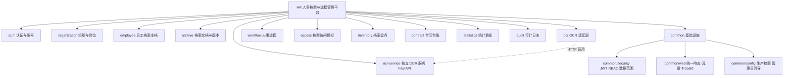
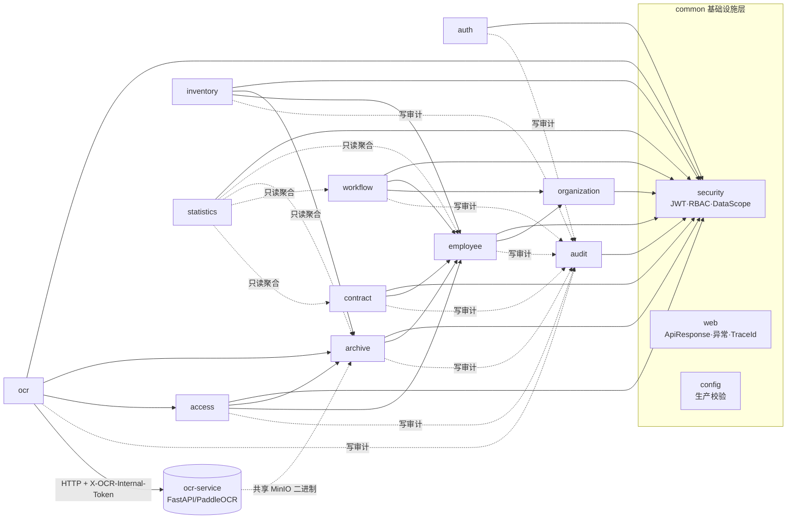
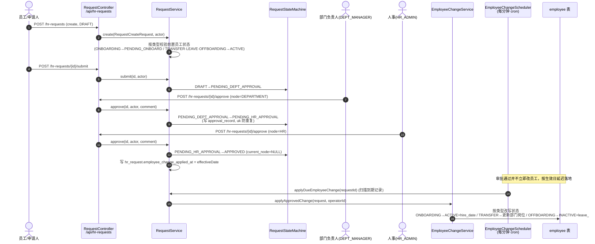
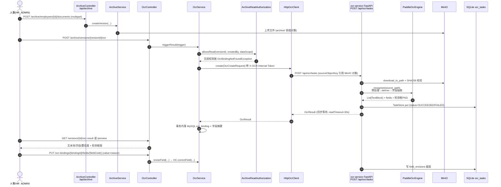
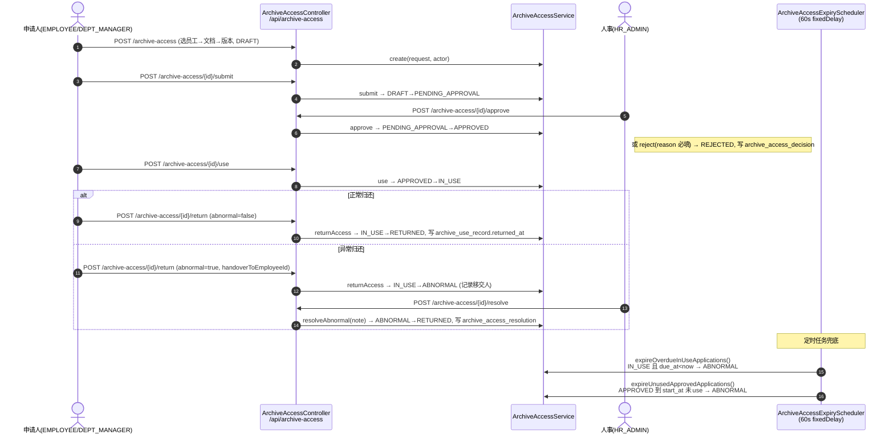
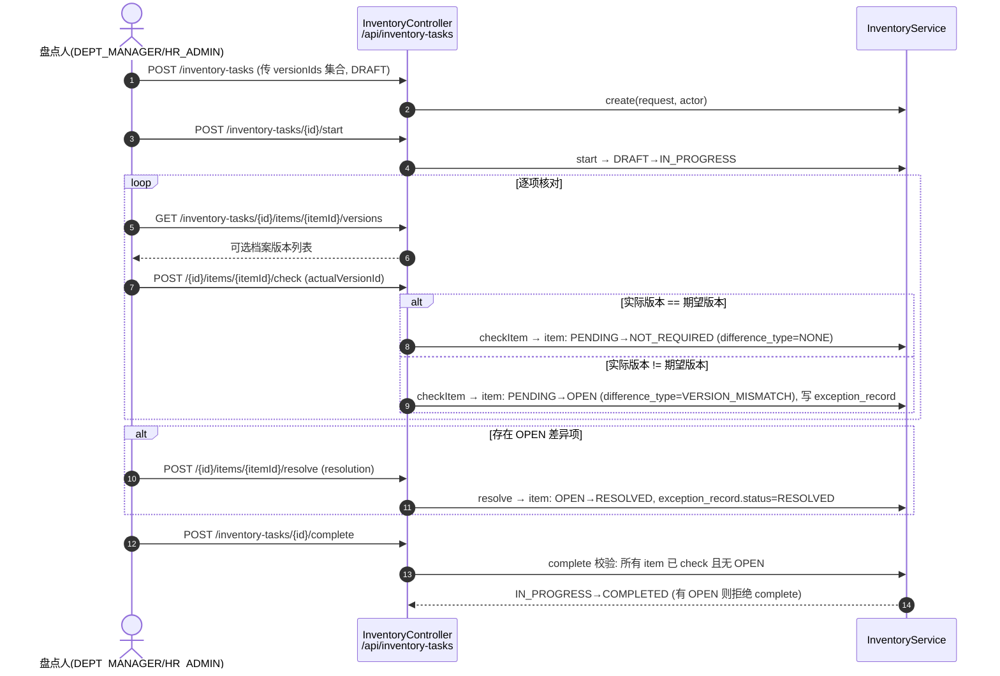

# 03 · 系统功能模块设计（论文第 4 章）

> 对应论文第 4 章「系统功能模块设计」。
> 事实来源：`_facts/01-backend-modules.md`（模块/Controller/Service/Mapper）、`_facts/03-state-machines.md`（状态机与时序依据）、`_facts/04-frontend-views.md`（四端门户）、`_facts/05-ocr-service.md`（OCR 服务契约）。
> 标注约定：**【现状】**= 代码里已经实现；**【目标】**= 课题任务书要求、当前代码尚未闭环的设计补强。两者分开陈述，不混淆。

---

## 4.1 功能模块划分

系统按「业务能力域」而非「技术分层」切分模块。Spring Boot 主类 `com.hrplatform.PlatformApplication`（`@SpringBootApplication` + `@EnableScheduling`）扫描 `com.hrplatform` 下全部包，每个包即一个功能模块。系统功能树如下：



各模块一句话职责：

| 模块 | 职责（一句话） |
|---|---|
| **auth** | 账号密码登录、员工自助注册、系统用户与角色管理。 |
| **organization** | 维护部门树与岗位字典，为员工归属、审批节点、数据范围提供组织骨架。 |
| **employee** | 员工档案主档的创建、更新、查询与状态变更历史，是全平台的人员主数据。 |
| **archive** | 档案材料（证件照/表格等）的上传、文档—版本结构、MinIO 对象存储与下载。 |
| **ocr**（适配层） | 对档案版本触发 OCR、查询识别结果与检测预览、字段人工修订，并通过 HTTP 委托独立 OCR 服务。 |
| **workflow** | 入职/调动/请假/离职四类人事申请的草稿—审批—生效全流程，以及个人待办聚合。 |
| **access** | 档案借用/访问授权申请的审批、使用登记、归还与异常闭环，并为档案读取提供授权策略。 |
| **inventory** | 档案盘点任务的创建、启动、逐项核对、差异登记与异常闭环。 |
| **contract** | 员工劳动合同台账的登记、查询与续签状态标记。 |
| **statistics** | 跨表只读聚合的人事概览指标与月度报表，供各端首页看板。 |
| **audit** | 操作日志的落库记录与分页查询（被所有业务模块调用）。 |
| **common/security** | JWT 签发与校验、方法级 RBAC、`DataScope` 数据范围裁决。 |
| **common/web** | `ApiResponse` 统一包装、全局异常到错误码的映射、`X-Trace-Id` 透传。 |
| **common/config** | 生产环境启动期密钥校验与首个系统管理员引导。 |
| **ocr-service**（独立进程） | 基于 PaddleOCR 的图像预处理—文字识别—字段抽取—检测框渲染，任务元数据落本地 SQLite。 |

> 说明：`employee` 与 `archive` 在代码中是两个包，但在业务语义上共同构成「员工档案三层」——主档层（`employee`）→ 文档层（`archive_document`）→ 版本层（`archive_version`）。下文 4.2 详表仍按代码包分列，以与 `_facts/01` 对齐。

---

## 4.2 模块职责详表

下表逐模块列出核心实体（主表）、对外 API 的 Controller 路径前缀、核心 Service、依赖模块与数据范围口径。路径与类名均取自 `_facts/01` 第 2、3 节。

| 模块 | 核心实体（主表） | 对外 API（Controller 路径前缀） | 核心 Service | 依赖模块 | 数据范围 |
|---|---|---|---|---|---|
| auth | `sys_user`, `sys_user_role`, `sys_role` | `/api/auth`、`/api/admin/users` | `AuthService`、`AdminUserService` | common/security | 公开（login/register）→ 登录后按角色；`/admin/users` 限 `SYSTEM_ADMIN` |
| organization | `org_department`, `org_position` | `/api/departments` | `OrganizationService` | common | 读：四角色可见；写：`HR_ADMIN`/`SYSTEM_ADMIN` |
| employee | `employee`, `employee_status_history` | `/api/employees` | `EmployeeService` | organization、common | `DataScope`：HR→ALL、DEPT_MANAGER→本部门、EMPLOYEE→本人 |
| archive | `employee_archive`, `archive_document`, `archive_version`, `file_object` | `/api/archive` | `ArchiveService`、`ArchiveCatalog`、`MinioObjectStorage` | employee、access（读取策略）、common | `DataScope` 二次过滤 + `ArchiveReadAuthorization` |
| ocr（适配层） | `ocr_binding`, `business_field` | `/api/archive`（与 ArchiveController 同前缀） | `OcrService`、`HttpOcrClient`（实现 `OcrClient`） | archive、access（授权校验）、common、外部 ocr-service | 先过 `ArchiveReadAuthorization.allowsRead`，再叠 `DataScope` |
| workflow | `hr_request`, `onboarding/transfer/leave/offboarding_detail`, `approval_record` | `/api/hr-requests`、`/api/todos` | `RequestService`、`RequestStateMachine`、`TodoService`、`EmployeeChangeService`、`EmployeeChangeScheduler` | employee、organization、common | `RequestActor`（申请人/部门负责人/HR 角色与节点双重校验） |
| access | `archive_access_application`, `archive_access_item`, `archive_use_record`, `archive_access_resolution`, `archive_access_decision` | `/api/archive-access` | `ArchiveAccessService`、`ArchiveAccessStateMachine`、`ArchiveAccessExpiryScheduler`、`ArchiveReadAuthorizationPolicy` | archive、employee、common | `AccessActor`；审批限 `HR_ADMIN` |
| inventory | `inventory_task`, `inventory_item`, `exception_record` | `/api/inventory-tasks` | `InventoryService` | archive、employee、common | `InventoryActor`：`DEPT_MANAGER`/`HR_ADMIN` |
| contract | `employee_contract` | `/api/contracts` | `ContractService` | employee、common | `DataScope`；写限 `HR_ADMIN` |
| statistics | （多表只读聚合，无独立业务表） | `/api/statistics` | `StatisticsService` | 只读聚合 employee/archive/workflow/contract | `DataScope`；`SYSTEM_ADMIN` 强制 ALL |
| audit | `operation_log` | `/api/operation-logs` | `OperationLogService` | common（被全模块反向依赖） | 查询限 `HR_ADMIN`/`SYSTEM_ADMIN` |
| common/security | （无表） | （无 Controller，过滤器链） | `JwtService`、`JwtAuthenticationFilter`、`SecurityConfiguration` | — | 裁决 `DataScope.Type ∈ {NONE, EMPLOYEE, DEPARTMENT, ALL}` |
| common/web | （无表） | （无 Controller，`@RestControllerAdvice`） | `GlobalExceptionHandler`、`TraceIdFilter`、`ApiResponse` | — | — |
| common/config | （无表） | （无 Controller，启动 Bean） | `ProductionConfigurationValidator`、`ProductionAdminBootstrap` | — | — |
| ocr-service | `ocr_tasks`(SQLite), `field_revisions`(SQLite) | `/api/ocr/*`（FastAPI，`X-OCR-Internal-Token`） | `app/service.py:OcrService`、`PaddleOcrEngine` | MinIO（共享对象存储） | 仅对内令牌可见，不直连 MySQL |

**关键跨模块调用事实**（取自 `_facts/01` 第 3、5、8 节）：

1. workflow → employee：`EmployeeChangeService.applyApprovedChange` 在审批生效时直接改写 `employee.status` 与部门/岗位，是唯一改写员工主档状态的旁路写入口。
2. ocr → access：`OcrService.triggerResult` 触发前先调 `ArchiveReadAuthorization.allowsRead(versionId, createdBy, dataScope)`，无授权抛 `OcrBindingNotFoundException`。
3. audit ← 全模块：`OperationLogService.record(...)` 被 13 个 Service 类手动调用，是反向被依赖最多的模块。
4. statistics → 全模块（只读）：通过 `StatisticsMapper` 对多张业务表做聚合 SQL，不持有可写依赖。

---

## 4.3 模块间依赖

### 4.3.1 依赖图



### 4.3.2 依赖设计原则

- **common 是基础设施，被所有业务模块依赖，不依赖任何业务模块**。`common/security` 提供 `JwtAuthenticationFilter`（`OncePerRequestFilter`）解析 `Authorization: Bearer <token>` 并构造 `JwtPrincipal` 放入 `SecurityContextHolder`；过滤器链顺序为 `TraceIdFilter` → `JwtAuthenticationFilter`（见 `_facts/01` 第 5 节）。
- **业务模块之间通过 Service 接口/领域对象协作，而非跨模块直接写 SQL**。例如 workflow 改员工状态走 `EmployeeChangeService`，access 的读取策略由 `ArchiveReadAuthorizationPolicy` 暴露给 archive 与 ocr 两方复用；不允许某模块 Mapper 直接 `UPDATE` 另一模块的表。
- **反向依赖 audit 是允许的、但应收敛**。现状是各 Service 手动 `operationLogService.record(...)`（13 处），**【现状】**耦合到调用方；**【目标】**改为 `@OperationLog` 注解 + AOP 切面统一拦截（见 4.5.4），让业务模块不再显式依赖 audit。
- **ocr-service 与 Spring Boot 进程隔离、数据库隔离**：Spring Boot 写 MySQL `ocr_binding`（仅摘要），完整 text_blocks/fields 在 ocr-service 的 SQLite；二者唯一二进制通道是共享 MinIO（`archive/` 前缀对象通过 `sourceObjectKey` 引用，不重复传文件）。

---

## 4.4 关键流程时序

以下时序图均以 `_facts/03` 的状态机转移表为依据绘制。

### 4.4.1 人事审批流（提交 → 部门负责人 → HR → 生效写员工状态）

对应状态机 `hr_request`：`DRAFT → PENDING_DEPT_APPROVAL → PENDING_HR_APPROVAL → APPROVED`，生效由定时任务延迟落地。



> **【现状缺口 · 请假闭环】** `EmployeeStatus.ON_LEAVE` 枚举已定义，但代码中**无任何写入路径**（`_facts/03` 第 1 节）：LEAVE 审批通过后只写 `employee_change_applied_at`，不把 `employee.status` 切到 `ON_LEAVE`。**【目标】**在 `EmployeeChangeService.applyApprovedChange` 的转移规则表中补一行 LEAVE 分支：生效时 ACTIVE→ON_LEAVE、销假时 ON_LEAVE→ACTIVE，使请假状态真正闭环。

### 4.4.2 OCR 处理流（上传 → Spring Boot 调 FastAPI → PaddleOCR → 人工修订 → 留痕）



> **【现状缺口 · OCR 回填】** 现状流程到「人工修订留痕」即结束——修订值只留在 ocr-service 的 `field_revisions` 与 MySQL `ocr_field_revision`，**没有任何「确认回填正式档案」步骤**把字段值写回 `employee` / `employee_archive`（`_facts/05` 第 8.4 节）。
>
> **【目标设计】** 在人工修订之后补一个回填动作：
> ```mermaid
> sequenceDiagram
>     actor HR as 人事(HR_ADMIN)
>     participant OCRC as OcrController
>     participant OCRS as OcrService
>     participant EMPS as EmployeeService
>     HR->>OCRC: POST /archive/ocr-bindings/{bindingId}/confirm
>     OCRC->>OCRS: confirmAndBackfill(bindingId, acceptedFields, operatorId)
>     OCRS->>OCRS: 校验 reviewRequired=false 且全部 validationStatus=PASSED
>     OCRS->>EMPS: updateProfile(... 回填 employee_name/phone/id_number ...)
>     OCRS->>OCRS: 标记 ocr_binding.backfilled_at, 写审计
> ```
> 即新增 `POST /archive/ocr-bindings/{bindingId}/confirm` 与 `OcrService.confirmAndBackfill(...)`，使 OCR 结果从「只读识别证据」升级为「可被采纳的档案数据来源」，并保留修订前后对照。

### 4.4.3 档案授权流（借用 → 批准 → 使用登记 → 归还/移交 → 异常处理）

对应 `archive_access_application` 状态机：`DRAFT → PENDING_APPROVAL → APPROVED → IN_USE → RETURNED`（异常分支 `→ ABNORMAL → RETURNED`）。



### 4.4.4 盘点流（建任务 → 启动 → 逐项核对 → 差异登记 → 异常闭环 → 完成）

对应 `inventory_task` / `inventory_item` 双状态机。



---

## 4.5 横切关注点

横切关注点是横跨所有业务模块、不能归入单一模块的通用机制。

### 4.5.1 认证与授权

- **认证**：`JwtAuthenticationFilter` 解析 `Authorization: Bearer <token>`，`liveValidation=true` 时回查 `sys_user` 是否 enabled 并重载角色；JWT claims 含 `sub=userId`、`employeeId`、`departmentId`、`roles`，默认过期 8 小时。
- **授权（两层）**：
  1. 方法级 RBAC：`@EnableMethodSecurity` 开启，Controller 方法上 `@PreAuthorize("hasRole('...')")`，角色集为 `EMPLOYEE / DEPT_MANAGER / HR_ADMIN / SYSTEM_ADMIN`。
  2. 数据范围二次过滤：业务层 `DataScope.canAccess(targetEmployeeId, targetDepartmentId)`，规则为 HR_ADMIN→ALL、DEPT_MANAGER+departmentId→DEPARTMENT、EMPLOYEE+employeeId→EMPLOYEE、否则 NONE。
- **现状说明**：`sys_permission` / `sys_role_permission` 表在 V1 建好但代码未读取，RBAC 当前只落地到「角色」维度；**【目标】**如需细粒度按钮/数据权限，再启用这两张表与 `PermissionEvaluator`。

### 4.5.2 参数校验

- 使用 Bean Validation（`@Valid` + DTO record 上的约束注解）；校验失败由 `GlobalExceptionHandler` 捕获 `MethodArgumentNotValidException` / `HttpMessageNotReadableException` / `IllegalArgumentException` → HTTP 400 + 错误码 `VALIDATION_ERROR`。
- 业务态非法由各模块状态机抛领域异常（如 `RequestStateException`、`ArchiveAccessStateException`、`InventoryStateException`）→ HTTP 409 `STATE_CONFLICT`。

### 4.5.3 统一响应与异常

所有 Controller 统一返回 `ApiResponse<T>{code, message, data, traceId}`，成功 `code="0"`。错误码映射集中在 `GlobalExceptionHandler`（`@RestControllerAdvice`）：

| 异常 | HTTP | 错误码 |
|---|---|---|
| 参数校验/请求体不可读 | 400 | `VALIDATION_ERROR` |
| 凭证无效 `InvalidCredentialsException` | 401 | `UNAUTHORIZED` |
| `AccessDeniedException` / `DataScopeDeniedException` / `ArchiveReadDeniedException` | 403 | `FORBIDDEN` |
| `OcrBindingNotFoundException` / `OcrFieldNotFoundException` | 404 | `NOT_FOUND` |
| 各类 `*StateException` | 409 | `STATE_CONFLICT` |
| 兜底 | 500 | `INTERNAL_ERROR` |

- **`X-Trace-Id`**：`TraceIdFilter` 从请求头读取或生成 UUID，写入 MDC 与响应头，贯穿日志与审计；失败响应同时由全局异常处理器落一条 `REQUEST_FAILED` 审计日志。

### 4.5.4 操作日志（现状 vs 目标）

- **【现状】** 操作日志靠 Service 层**手动调用** `OperationLogService.record(operatorId, action, objectType, objectId, result, beforeSummary, afterSummary)`，共 13 个类显式调用；`grep @Aspect/@Around` 在 `main/java` 下零命中，**没有 AOP 切面**。
- **【目标设计】** 引入 `@OperationLog(action="...", objectType="...")` 注解 + `@Aspect` 切面：在 Controller 或 Service 写方法上声明注解，切面环绕记录操作人、动作、对象、入参摘要、出参摘要、成功/失败与耗时；业务代码不再显式依赖 `OperationLogService`，消除 13 处散落调用并降低漏记风险。

### 4.5.5 分页约定

- 后端统一约定入参 `page`（从 1 起）与 `pageSize`；各模块返回 `XxxPage`（如 `EmployeePage`、`RequestPage`、`AccessPage`、`ContractPage`），内含记录列表与总数。
- 只读聚合类（`StatisticsService`）不分页；待办 `TodoController` 用 `limit` 参数（默认 50）控制聚合条数。

---

## 4.6 前后端交互约定

### 4.6.1 接口契约

- **协议**：REST over HTTP + JSON；前端 baseURL=`/api`（Vite dev proxy 到 `http://127.0.0.1:8080`，生产同源部署）。
- **认证**：请求头 `Authorization: Bearer <token>`；401 时 axios 拦截器清 `sessionStorage['hr.accessToken']` 并跳登录。
- **统一响应**：`ApiResponse<T>{code, message, data, traceId}`；前端 `request<T>` 助手在 `code !== '0'` 时抛错并携带 `code/traceId`。
- **分页参数**：`page` / `pageSize`；列表类接口同时支持业务过滤（如 `/api/employees?keyword=&departmentId=&status=`、`/api/hr-requests?type=&status=&employeeId=`）。
- **文件上传**：档案材料 `POST /api/archive/employees/{id}/documents` 用 multipart（`documentType` + `file`）；OCR 检测框图以 `image/png` 字节流下载。

### 4.6.2 四端门户路由

前端为 4 个独立 SPA（5 个 HTML 入口），共用 `views/`、`api/http.ts`、`styles.css`；导航结构取自 `_facts/04` 第 4 节。

| 门户（入口 HTML） | 允许角色 | 导航分组与主要菜单 |
|---|---|---|
| **员工端** `employee.html` | `EMPLOYEE` | 个人服务：个人工作台、我的待办、我的档案、申请与进度、档案访问、合同信息、OCR 复核 |
| **部门负责人端** `manager.html` | `DEPT_MANAGER` | 团队工作：团队概览、审批与待办、部门员工、人事流程、合同信息；档案资源：档案访问、部门盘点、OCR 复核 |
| **人事端** `hr.html` | `HR_ADMIN` | 运营中心：运营总览、人事待办；人员与档案：员工与档案、人事流程、合同台账；档案资源：档案授权、盘点与异常；系统运营：组织岗位、审计日志、OCR 触发/修订 |
| **系统管理员端** `admin.html` | `SYSTEM_ADMIN` | 平台管理：管理概览、账号与角色；平台配置：组织结构；平台审计：审计日志 |
| 公共入口 `index.html` | 公开 | `/login` 登录、`/register` 注册、`/workspaces` 登录后选工作台 |

- **角色守卫双层**：前端路由级 `meta.roles` + 门户级 `portal.allowedRoles` 做体验拦截；后端 `@PreAuthorize` + `DataScope` 是最终防线。
- **无权限兜底**：`/forbidden`（`PortalForbiddenView.vue`），其余未匹配路由 redirect 到 `/forbidden`。

---

## 本章小结

第 4 章将系统划分为 auth、organization、employee、archive、ocr、workflow、access、inventory、contract、statistics、audit 共 11 个业务模块，叠加 common/security、common/web、common/config 三个基础设施模块，以及独立部署的 ocr-service。模块间以 Service 接口协作、以 common 为统一底座；4.4 节以四张时序图落地了人事审批、OCR 识别、档案授权、档案盘点四条核心链路。过程中诚实标注了三处现状缺口与对应目标设计：**OCR 结果回填正式档案（4.4.2）、请假状态生效闭环（4.4.1）、操作日志由手动调用升级为注解 + AOP 切面（4.5.4）**，作为后续详细设计与实现章节的改进输入。
