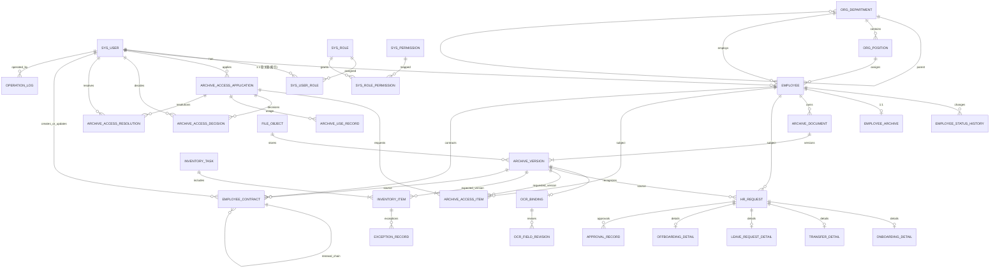

# 第 4 章 数据库设计

> 本章对应论文"数据库设计"部分。所有字段类型、长度、约束均来自 `server/src/main/resources/db/migration/V1__*.sql` ~ `V18__*.sql` 的全量迁移脚本阅读结果（事实来源：`docs/design/_facts/02-database-tables.md`），状态机取值来自 Java 枚举与状态机类（事实来源：`docs/design/_facts/03-state-machines.md`）。现状与目标设计在文中以"【现状】""【目标设计】"显式标注。

---

## 4.1 设计原则

### 4.1.1 技术选型

| 项 | 选择 | 说明 |
|---|---|---|
| 数据库 | MySQL 8.0 | 库名 `hr_platform` |
| 存储引擎 | InnoDB | 支持事务、外键、行锁 |
| 字符集 | utf8mb4 / utf8mb4_0900_ai_ci | 完整支持中文与 emoji |
| 文件内容存储 | MinIO 对象存储 | MySQL 只存 `object_key`、SHA-256、大小等元数据 |
| OCR 原始识别结果 | 独立 SQLite `ocr_tasks.sqlite3` | MySQL 侧只存绑定关系与摘要，详见 4.5 与事实 05 |

### 4.1.2 版本化迁移

- 使用 **Flyway** 管理 schema 演进，迁移脚本按 `V{n}__{description}.sql` 命名，启动时自动按版本顺序执行。
- 当前共 **18 个版本**（V1–V18），其中：
  - V1–V5、V7、V8 为结构建表；
  - V6、V15 为演示数据 seed；
  - V9–V14、V17、V18 为增量列、外键补全与新表；
  - V16 为演示账号在生产 profile 下的禁用脚本。
- 迁移脚本一经上线即不可修改，后续变更必须新增更高版本号的脚本（见 4.6 对 V9/V11/V12/V13/V14 的演进说明）。

### 4.1.3 命名与通用约定

| 约定 | 规则 |
|---|---|
| 主键 | 所有业务表统一 `id BIGINT AUTO_INCREMENT PRIMARY KEY` |
| 业务单号 | `*_no VARCHAR(32~64)`，建唯一索引，如 `employee_no / request_no / application_no / task_no / contract_no` |
| 时间戳 | `created_at TIMESTAMP DEFAULT CURRENT_TIMESTAMP`；需要跟踪更新的表加 `updated_at TIMESTAMP DEFAULT CURRENT_TIMESTAMP ON UPDATE CURRENT_TIMESTAMP` |
| 逻辑删除 | 使用 `enabled BOOLEAN DEFAULT TRUE`（部门、岗位、角色、账号），**不使用 `deleted_at` 式软删字段** |
| 乐观锁 | 高并发状态表加 `version_no INT DEFAULT 0`：`hr_request`、`archive_access_application`、`employee_contract` |
| 外键 | 核心主数据（员工、部门、岗位、档案版本等）建立物理外键；少量"软关联"只建索引不加外键（见 4.6.1） |
| 审计字段 | 业务表保留 `created_by / updated_by / operator_id` 等操作人字段；跨切面审计统一进入 `operation_log` |

### 4.1.4 版本不可变

- 档案文档的每一次上传都新建一行 `archive_version`，**绝不 UPDATE 旧版本**；新版本上传时只把旧版本的 `is_current` 置为 `false`，自身置 `true`。
- 每个版本记录 `sha256`，与 `file_object.sha256` 对齐，用于完整性校验与去重。
- OCR 人工修订同样追加 `ocr_field_revision` 行，不原地覆盖识别结果。

### 4.1.5 数据最小化

- `employee` 主档只保留 `employee_no / name / phone / department_id / position_id / status / hire_date / leave_date`。
- **不存储身份证号、银行卡号、家庭住址等非业务必需字段**；OCR 识别出的 `id_number` 等敏感字段只存在 OCR 服务 SQLite 中，MySQL 侧仅保留修订记录的 `previous_value / current_value`（最长 512 字符），列表默认不展示。
- 文件正文一律存 MinIO，MySQL 不存 BLOB。

---

## 4.2 实体关系总览（ER 图）

整体 ER 图按业务域分为六组：身份权限、组织员工、档案与 OCR、人事流程、档案访问与盘点、合同与审计。为避免单图过宽，下面给出合并视图，分组说明紧随其后。

**分组说明**：

1. **身份权限组**：`sys_user / sys_role / sys_permission / sys_user_role / sys_role_permission`。其中 `sys_permission / sys_role_permission` 已建表但代码不读取（见 4.6.1）。
2. **组织员工组**：`org_department / org_position / employee / employee_status_history`。部门自引用形成树；员工通过状态历史表留痕。
3. **档案与 OCR 组**：`employee_archive / archive_document / archive_version / file_object / ocr_binding / ocr_field_revision`。档案三层 = 员工档案主表 → 文档类别 → 版本。
4. **人事流程组**：`hr_request` 主表 + 四类 detail（入职/调动/请假/离职）+ `approval_record`。
5. **档案访问与盘点组**：`archive_access_application / item / decision / use_record / resolution` 与 `inventory_task / item / exception_record`。
6. **合同与审计组**：`employee_contract`（自引用续签链）与全局 `operation_log`。

---

## 4.3 核心表详细设计

> 字段表列：字段名 | 类型 | NULL | 默认值 | 约束/索引 | 说明。NULL 列中 `NO`/`YES` 与 DDL 一致；未列出 `created_at/updated_at` 通用列的表，表示该表仅有部分时间字段（在说明中标注）。

### 4.3.1 身份与权限

#### `sys_user` — 系统登录账号

| 字段 | 类型 | NULL | 默认 | 约束/索引 | 说明 |
|---|---|---|---|---|---|
| id | BIGINT | NO | AUTO_INCREMENT | PK | |
| username | VARCHAR(64) | NO | | UNIQUE | 登录名 |
| password_hash | VARCHAR(255) | NO | | | BCrypt 密文 |
| employee_id | BIGINT | YES | | `idx_user_employee`（**仅索引，非外键**） | 关联 `employee.id` |
| department_id | BIGINT | YES | | `idx_user_department`（**仅索引，非外键**） | 冗余部门，与员工主档一致 |
| enabled | BOOLEAN | NO | TRUE | | 禁用后 JWT liveValidation 拒绝 |
| created_at | TIMESTAMP | NO | CURRENT_TIMESTAMP | | |
| updated_at | TIMESTAMP | NO | CURRENT_TIMESTAMP ON UPDATE CURRENT_TIMESTAMP | | |

#### `sys_role` — 角色

| 字段 | 类型 | NULL | 默认 | 约束/索引 | 说明 |
|---|---|---|---|---|---|
| id | BIGINT | NO | AUTO_INCREMENT | PK | |
| code | VARCHAR(32) | NO | | UNIQUE | `EMPLOYEE / DEPT_MANAGER / HR_ADMIN / SYSTEM_ADMIN`（V1 seed） |
| name | VARCHAR(64) | NO | | | 中文角色名 |
| enabled | BOOLEAN | NO | TRUE | | |

#### `sys_permission` — 权限点【现状：表已建，代码未读取】

| 字段 | 类型 | NULL | 约束/索引 | 说明 |
|---|---|---|---|---|
| id | BIGINT | NO | PK | |
| code | VARCHAR(96) | NO | UNIQUE | 预留权限码 |
| name | VARCHAR(128) | NO | | |
| enabled | BOOLEAN | NO | | |

#### `sys_user_role` — 用户-角色关联

- 复合主键 `(user_id, role_id)`；
- 外键 `user_id → sys_user.id`、`role_id → sys_role.id`。

#### `sys_role_permission` — 角色-权限关联【现状：表已建，代码未读取】

- 复合主键 `(role_id, permission_id)`；
- 外键 `role_id → sys_role.id`、`permission_id → sys_permission.id`。

> 现状说明：代码中鉴权使用"用户 → 角色 code → 接口权限"的硬编码映射，并未读取 `sys_permission / sys_role_permission`。这两张表保留为未来细粒度权限模型的扩展点。

### 4.3.2 组织与员工

#### `org_department` — 部门

| 字段 | 类型 | NULL | 默认 | 约束/索引 | 说明 |
|---|---|---|---|---|---|
| id | BIGINT | NO | AUTO_INCREMENT | PK | |
| code | VARCHAR(32) | NO | | UNIQUE | |
| name | VARCHAR(128) | NO | | | |
| parent_id | BIGINT | YES | | 自引用外键 `fk_department_parent`；`idx_department_parent(parent_id)` | 顶层为 NULL |
| manager_employee_id | BIGINT | YES | | | 部门负责人（员工 id，软关联） |
| sort_order | INT | NO | 0 | | 展示排序 |
| enabled | BOOLEAN | NO | TRUE | | |

#### `org_position` — 岗位

| 字段 | 类型 | NULL | 约束/索引 | 说明 |
|---|---|---|---|---|
| id | BIGINT | NO | PK | |
| department_id | BIGINT | NO | FK → org_department.id | |
| code | VARCHAR(32) | NO | 联合唯一 `uk_position_department_code(department_id, code)` | |
| name | VARCHAR(128) | NO | | |
| enabled | BOOLEAN | NO | | 默认 TRUE |

#### `employee` — 员工主档

| 字段 | 类型 | NULL | 默认 | 约束/索引 | 说明 |
|---|---|---|---|---|---|
| id | BIGINT | NO | AUTO_INCREMENT | PK | |
| employee_no | VARCHAR(32) | NO | | UNIQUE | 工号 |
| name | VARCHAR(128) | NO | | | |
| phone | VARCHAR(32) | YES | | | 手机号（HR 视角外脱敏） |
| department_id | BIGINT | NO | | FK → org_department.id；联合索引 `idx_employee_department_status(department_id, status)` | |
| position_id | BIGINT | NO | | FK → org_position.id | |
| status | VARCHAR(24) | NO | 'ACTIVE' | | 枚举：`PENDING_ONBOARD / ACTIVE / ON_LEAVE / INACTIVE` |
| hire_date | DATE | YES | | | 入职日期（入职生效时写） |
| leave_date | DATE | YES | | | 离职日期（离职生效时写） |

#### `employee_status_history` — 员工状态/部门/岗位变更历史

| 字段 | 类型 | NULL | 说明 |
|---|---|---|---|
| id | BIGINT | NO PK | |
| employee_id | BIGINT | NO | FK → employee.id；索引 `idx_employee_status_history(employee_id, created_at)` |
| before_status | VARCHAR(24) | YES | 初始入职时为 NULL |
| after_status | VARCHAR(24) | NO | |
| before_department_id | BIGINT | YES | |
| after_department_id | BIGINT | YES | |
| before_position_id | BIGINT | YES | |
| after_position_id | BIGINT | YES | |
| source_request_id | BIGINT | YES | 触发本次变更的 `hr_request.id` |
| operator_id | BIGINT | YES | sys_user.id |
| created_at | TIMESTAMP | NO | 默认 CURRENT_TIMESTAMP |

### 4.3.3 档案、文件与 OCR

#### `employee_archive` — 员工档案主表（与员工 1:1）

| 字段 | 类型 | NULL | 默认 | 说明 |
|---|---|---|---|---|
| id | BIGINT | NO PK | | |
| employee_id | BIGINT | NO | UNIQUE, FK → employee.id | |
| completeness | DECIMAL(5,2) | NO | 0 | 完整度百分比 |
| confidentiality | VARCHAR(16) | NO | 'INTERNAL' | 密级 |
| status | VARCHAR(24) | NO | 'ACTIVE' | |

#### `archive_document` — 档案文档类别（身份证/学历/合同等）

| 字段 | 类型 | NULL | 约束/索引 | 说明 |
|---|---|---|---|---|
| id | BIGINT | NO PK | | |
| employee_id | BIGINT | NO | FK → employee.id；`idx_archive_document_employee(employee_id)` | |
| document_type | VARCHAR(64) | NO | 联合唯一 `uk_archive_document_type(employee_id, document_type)` | 业务类别码，如 `employee_profile / id_card / diploma / labor_contract` |
| title | VARCHAR(128) | NO | | 展示标题 |

#### `file_object` — 文件对象元数据（内容存 MinIO）

| 字段 | 类型 | NULL | 约束/索引 | 说明 |
|---|---|---|---|---|
| id | BIGINT | NO PK | | |
| object_key | VARCHAR(512) | NO | UNIQUE | MinIO object key |
| original_name | VARCHAR(255) | NO | | |
| content_type | VARCHAR(128) | NO | | MIME |
| byte_size | BIGINT | NO | | 字节数 |
| sha256 | CHAR(64) | NO | `idx_file_sha256(sha256)` | 完整性校验/去重 |

#### `archive_version` — 档案文档版本【不可变】

| 字段 | 类型 | NULL | 默认 | 约束/索引 | 说明 |
|---|---|---|---|---|---|
| id | BIGINT | NO | AUTO_INCREMENT | PK | |
| document_id | BIGINT | NO | | FK → archive_document.id；联合唯一 `uk_document_version(document_id, version_no)`；`idx_archive_current(document_id, is_current)` | |
| version_no | INT | NO | | | 同一文档内递增 |
| file_object_id | BIGINT | NO | | FK → file_object.id | |
| original_name | VARCHAR(255) | NO | | | 冗余自 file_object |
| content_type | VARCHAR(128) | NO | | | 冗余 |
| byte_size | BIGINT | NO | | | 冗余 |
| sha256 | CHAR(64) | NO | | | 冗余，便于版本级校验 |
| status | VARCHAR(24) | NO | 'UPLOADED' | 版本状态（当前仅 `UPLOADED`） |
| is_current | BOOLEAN | NO | TRUE | 是否当前版本 |
| created_by | BIGINT | NO | | 上传人 sys_user.id |
| change_reason | VARCHAR(255) | YES | | 变更原因 |

#### `ocr_binding` — OCR 任务与档案版本绑定（1:1 版本）

| 字段 | 类型 | NULL | 默认 | 约束/索引 | 说明 |
|---|---|---|---|---|---|
| id | BIGINT | NO | AUTO_INCREMENT | PK | |
| archive_version_id | BIGINT | NO | | FK → archive_version.id；联合唯一 `uk_ocr_binding_version(archive_version_id)` | 每个版本最多一个绑定 |
| task_id | VARCHAR(128) | YES | | UNIQUE `uk_ocr_binding_task(task_id)` | OCR 服务侧 UUID |
| document_type | VARCHAR(64) | NO | | | 如 `employee_profile` |
| status | VARCHAR(24) | NO | 'PENDING' | 索引 `idx_ocr_binding_status_time(status, updated_at)` | 与 OCR 服务一致：`PENDING / PREPROCESSING / RECOGNIZING / SUCCEEDED / FAILED` |
| engine_version | VARCHAR(128) | YES | | | PaddleOCR 版本 |
| processing_duration_ms | BIGINT | NO | 0 | | 识别耗时 |
| review_required | BOOLEAN | NO | FALSE | | 是否有待复核字段 |
| error_code | VARCHAR(64) | YES | | | 失败码 |
| error_message | VARCHAR(512) | YES | | | 失败原因 |
| preview_url / preview_content_type / preview_size / preview_sha256 / preview_width / preview_height | 多列 | YES | | | 检测框效果图元数据 |

#### `ocr_field_revision` — OCR 字段人工修订历史

| 字段 | 类型 | NULL | 说明 |
|---|---|---|---|
| id | BIGINT | NO PK | |
| binding_id | BIGINT | NO | FK → ocr_binding.id；`idx_ocr_revision_binding_field_time(binding_id, field_code, created_at)` |
| field_code | VARCHAR(96) | NO | 如 `employee_name / employee_id / id_number / phone` |
| previous_value | VARCHAR(512) | YES | |
| current_value | VARCHAR(512) | NO | |
| reason | VARCHAR(512) | YES | |
| operator_id | BIGINT | YES | sys_user.id |
| created_at | TIMESTAMP | NO | |

> 【现状】OCR 完整识别结果（`text_blocks / fields`）**不写 MySQL**，存于 OCR 服务 SQLite `ocr_tasks.payload`；MySQL 只保留绑定、状态、预览元数据与人工修订。

### 4.3.4 人事流程

#### `hr_request` — 人事申请主表

| 字段 | 类型 | NULL | 默认 | 约束/索引 | 说明 |
|---|---|---|---|---|---|
| id | BIGINT | NO | AUTO_INCREMENT | PK | |
| request_no | VARCHAR(64) | NO | | UNIQUE | 业务单号 |
| request_type | VARCHAR(24) | NO | | | `ONBOARDING / TRANSFER / LEAVE / OFFBOARDING` |
| employee_id | BIGINT | NO | | FK → employee.id；`idx_hr_request_employee_status(employee_id, status)` | |
| target_department_id | BIGINT | YES | | | 调动/入职目标部门 |
| target_position_id | BIGINT | YES | | | 调动/入职目标岗位 |
| approval_department_id | BIGINT | NO | | FK → org_department.id（V9）；`idx_hr_request_approval_department(approval_department_id, status, created_at)` | 审批归属部门 |
| applicant_id | BIGINT | NO | | FK → sys_user.id | 申请人 |
| source_version_id | BIGINT | YES | | FK → archive_version.id | 关联档案版本（如身份证扫描件） |
| payload_json | JSON | YES | | | 扩展载荷 |
| status | VARCHAR(32) | NO | 'DRAFT' | `idx_hr_request_status_type(status, request_type, created_at)` | 见 4.4 |
| current_node | VARCHAR(24) | YES | | | `DEPARTMENT / HR`，终态为 NULL |
| version_no | INT | NO | 0 | | 乐观锁 |
| submitted_at | TIMESTAMP | YES | | | |
| completed_at | TIMESTAMP | YES | | | |
| employee_change_applied_at | TIMESTAMP | YES | | V11；`idx_hr_request_due_employee_change(status, employee_change_applied_at, request_type)` | 员工变更生效时间，由调度器扫描 |
| created_at / updated_at | TIMESTAMP | NO | CURRENT_TIMESTAMP | | |

#### `onboarding_detail` — 入职申请扩展

- 主键 `request_id`，外键 → `hr_request.id`（1:1）。
- 字段：`hire_date DATE`、`contract_type VARCHAR(32)`。

#### `transfer_detail` — 调动申请扩展

- 主键 `request_id`，外键 → `hr_request.id`。
- 字段：`from_department_id BIGINT`、`from_position_id BIGINT`、`effective_date DATE`、`reason VARCHAR(512)`。

#### `leave_request_detail` — 请假申请扩展（V8）

- 主键 `request_id`，外键 → `hr_request.id`。
- 字段：
  - `leave_type VARCHAR(24) NOT NULL`，CHECK IN (`ANNUAL, SICK, PERSONAL, OTHER`)；
  - `start_date DATE NOT NULL`、`end_date DATE NOT NULL`，CHECK `end_date >= start_date`；
  - `reason VARCHAR(512) NOT NULL`。

#### `offboarding_detail` — 离职申请扩展

- 主键 `request_id`，外键 → `hr_request.id`。
- 字段：`leave_date DATE`、`handover_person VARCHAR(128)`、`handover_status VARCHAR(32)`、`reason VARCHAR(512)`。

#### `approval_record` — 审批节点记录

| 字段 | 类型 | NULL | 约束/索引 | 说明 |
|---|---|---|---|---|
| id | BIGINT | NO PK | | |
| request_id | BIGINT | NO | FK → hr_request.id；联合唯一 `uk_approval_request_node(request_id, node_code)` | 每节点只审一次 |
| node_code | VARCHAR(24) | NO | | `DEPARTMENT / HR` |
| approver_id | BIGINT | NO | | sys_user.id |
| decision | VARCHAR(16) | NO | | `APPROVED / REJECTED` |
| comment | VARCHAR(512) | YES | | |
| decided_at | TIMESTAMP | NO | | |

### 4.3.5 档案访问申请

#### `archive_access_application` — 档案借用申请

| 字段 | 类型 | NULL | 默认 | 约束/索引 | 说明 |
|---|---|---|---|---|---|
| id | BIGINT | NO | AUTO_INCREMENT | PK | |
| application_no | VARCHAR(64) | NO | | UNIQUE | |
| applicant_id | BIGINT | NO | | FK → sys_user.id（V10 补外键）；`idx_access_applicant(applicant_id, created_at)` | |
| department_id | BIGINT | YES | | | 申请时冗余部门 |
| purpose | VARCHAR(512) | NO | | | 借用用途 |
| use_type | VARCHAR(32) | NO | | | 借用类型 |
| start_at | DATETIME | NO | | V13 改为 NOT NULL | 预计开始使用时间 |
| due_at | DATETIME | NO | | V13 改为 NOT NULL；`idx_access_status_due(status, due_at)` | 应归还时间 |
| status | VARCHAR(24) | NO | 'DRAFT' | | 见 4.4 |
| version_no | INT | NO | 0 | | 乐观锁 |

#### `archive_access_item` — 申请明细

| 字段 | 类型 | NULL | 约束/索引 | 说明 |
|---|---|---|---|---|
| id | BIGINT | NO PK | | |
| application_id | BIGINT | NO | FK → archive_access_application.id；联合唯一 `uk_access_application_version(application_id, archive_version_id)` | |
| archive_version_id | BIGINT | NO | FK → archive_version.id | 本次借用的具体版本 |
| employee_id | BIGINT | NO | FK → employee.id（冗余，便于数据范围过滤） | |
| department_id | BIGINT | YES | | 冗余部门 |
| status | VARCHAR(24) | NO | 'REQUESTED' | 明细状态 |

#### `archive_access_decision` — 审批决策历史（V18）

| 字段 | 类型 | NULL | 约束/索引 | 说明 |
|---|---|---|---|---|
| id | BIGINT | NO PK | | |
| application_id | BIGINT | NO | FK → archive_access_application.id；`idx_access_decision_application(application_id, decided_at, id)` | |
| decided_by_user_id | BIGINT | NO | FK → sys_user.id | |
| decision | VARCHAR(16) | NO | CHECK IN (`APPROVED, REJECTED`) | |
| decision_note | VARCHAR(512) | YES | | 驳回必填原因 |
| decided_at | TIMESTAMP | NO | | |

#### `archive_use_record` — 使用/归还流水

| 字段 | 类型 | NULL | 约束/索引 | 说明 |
|---|---|---|---|---|
| id | BIGINT | NO PK | | |
| application_id | BIGINT | NO | FK → archive_access_application.id；`idx_access_use_active(application_id, returned_at)` | |
| operator_id | BIGINT | NO | | 使用人 sys_user.id |
| used_at | TIMESTAMP | NO | | |
| returned_at | TIMESTAMP | YES | | |
| return_status | VARCHAR(24) | YES | | |
| remark | VARCHAR(512) | YES | | |
| returned_by_user_id | BIGINT | YES | V14；FK → sys_user.id | 实际归还人 |
| handover_to_employee_id | BIGINT | YES | V14；FK → employee.id；`idx_access_use_handover_employee(handover_to_employee_id, returned_at)` | 异常归还交接对象 |

#### `archive_access_resolution` — 异常归还闭环记录（V17）

| 字段 | 类型 | NULL | 约束/索引 | 说明 |
|---|---|---|---|---|
| id | BIGINT | NO PK | | |
| application_id | BIGINT | NO | FK → archive_access_application.id；`idx_access_resolution_application(application_id, resolved_at, id)` | |
| resolved_by_user_id | BIGINT | NO | FK → sys_user.id | HR_ADMIN |
| resolution_note | VARCHAR(512) | NO | | 闭环说明 |
| resolved_at | TIMESTAMP | NO | | |

### 4.3.6 盘点

#### `inventory_task` — 盘点任务

| 字段 | 类型 | NULL | 默认 | 说明 |
|---|---|---|---|---|
| id | BIGINT | NO | AUTO_INCREMENT PK | |
| task_no | VARCHAR(64) | NO | UNIQUE | |
| initiator_id | BIGINT | NO | | 发起人 sys_user.id |
| status | VARCHAR(24) | NO | 'DRAFT' | `DRAFT / IN_PROGRESS / COMPLETED / ABNORMAL`；索引 `idx_inventory_status_time(status, created_at)` |
| created_at | TIMESTAMP | NO | | |
| completed_at | TIMESTAMP | YES | | |

#### `inventory_item` — 盘点项（每份档案版本一条）

| 字段 | 类型 | NULL | 默认 | 说明 |
|---|---|---|---|---|
| id | BIGINT | NO | PK | |
| task_id | BIGINT | NO | FK → inventory_task.id | |
| archive_version_id | BIGINT | NO | FK → archive_version.id | 被盘点的"期望版本" |
| employee_id | BIGINT | YES | | 冗余 |
| department_id | BIGINT | YES | | 冗余 |
| actual_version_id | BIGINT | YES | | 盘点时实际版本 |
| actual_status | VARCHAR(24) | YES | | |
| difference_type | VARCHAR(32) | YES | | `NONE / VERSION_MISMATCH` |
| difference_description | VARCHAR(512) | YES | | |
| checked_by | BIGINT | YES | | |
| checked_at | TIMESTAMP | YES | | |
| resolution_status | VARCHAR(24) | NO | 'PENDING' | V12；`PENDING / OPEN / NOT_REQUIRED / RESOLVED` |
| resolution | VARCHAR(512) | YES | | V12；闭环说明 |

#### `exception_record` — 盘点异常记录

| 字段 | 类型 | NULL | 默认 | 说明 |
|---|---|---|---|---|
| id | BIGINT | NO | PK | |
| inventory_item_id | BIGINT | NO | FK → inventory_item.id；`idx_exception_inventory_status(inventory_item_id, status)` | |
| exception_type | VARCHAR(32) | NO | | |
| description | VARCHAR(512) | NO | | |
| status | VARCHAR(24) | NO | 'OPEN' | 闭环后 `RESOLVED` |
| resolved_by | BIGINT | YES | | |
| resolved_at | TIMESTAMP | YES | | |
| resolution | VARCHAR(512) | YES | | |

### 4.3.7 合同

#### `employee_contract` — 员工劳动合同

| 字段 | 类型 | NULL | 默认 | 约束/索引 | 说明 |
|---|---|---|---|---|---|
| id | BIGINT | NO | AUTO_INCREMENT | PK | |
| contract_no | VARCHAR(64) | NO | | UNIQUE | |
| employee_id | BIGINT | NO | | FK → employee.id；`idx_contract_employee_dates(employee_id, starts_on, ends_on)` | |
| contract_type | VARCHAR(32) | NO | | | `FIXED_TERM / OPEN_ENDED / INTERN` |
| signed_on | DATE | NO | | CHECK `ends_on >= starts_on >= signed_on` | 签署日 |
| starts_on | DATE | NO | | | 生效日 |
| ends_on | DATE | NO | |；`idx_contract_renewal_end(renewal_status, ends_on)` | 到期日 |
| renewal_status | VARCHAR(24) | NO | 'NOT_DUE' | CHECK IN (`NOT_DUE, RENEWED, NOT_RENEWING`) | 前端派生 `DUE` |
| source_version_id | BIGINT | YES | | FK → archive_version.id | 合同扫描件 |
| renewed_from_contract_id | BIGINT | YES | | 自引用 FK | 续签链路 |
| notes | VARCHAR(512) | YES | | | |
| version_no | INT | NO | 0 | | 乐观锁 |
| created_by | BIGINT | NO | | FK → sys_user.id | |
| updated_by | BIGINT | NO | | FK → sys_user.id | |

### 4.3.8 审计

#### `operation_log` — 操作审计日志

| 字段 | 类型 | NULL | 说明 |
|---|---|---|---|
| id | BIGINT | NO PK | |
| operator_id | BIGINT | YES | 匿名操作可为 NULL |
| action | VARCHAR(64) | NO | 如 `CREATE_EMPLOYEE / REQUEST_FAILED / BOOTSTRAP_CREATE` |
| object_type | VARCHAR(64) | NO | 如 `EMPLOYEE / HR_REQUEST / API_REQUEST / SYS_USER` |
| object_id | BIGINT | YES | |
| result | VARCHAR(32) | NO | `SUCCESS / FAILED` |
| before_summary | TEXT | YES | |
| after_summary | TEXT | YES | |
| trace_id | VARCHAR(64) | YES | 链路追踪 |
| created_at | TIMESTAMP | NO | |

索引：`idx_operation_object_time(object_type, object_id, created_at)`、`idx_operation_operator_time(operator_id, created_at)`。

---

## 4.4 关键状态字段与枚举

下表汇总跨表状态字段，状态机完整转移见事实文档 `03-state-machines.md`，本节只给枚举值与转移摘要。

| 表 | 字段 | 枚举值 | 中文含义 | 关键转移（引用 03） |
|---|---|---|---|---|
| employee | status | `PENDING_ONBOARD` | 待入职 | 入职申请创建时初始化 |
| | | `ACTIVE` | 在职 | 入职/调动生效后 |
| | | `ON_LEAVE` | 请假中 | 【现状】枚举存在但无写入路径 |
| | | `INACTIVE` | 离职/停用 | 离职生效后；V16 批量置 demo 员工 |
| hr_request | status | `DRAFT` | 草稿 | submit → PENDING_DEPT_APPROVAL；cancel → CANCELLED |
| | | `PENDING_DEPT_APPROVAL` | 待部门审批 | dept approve → PENDING_HR_APPROVAL；reject → REJECTED |
| | | `PENDING_HR_APPROVAL` | 待人事审批 | hr approve → APPROVED；reject → REJECTED |
| | | `APPROVED` | 审批通过 | 等待 `employee_change_applied_at` 生效 |
| | | `REJECTED` | 已驳回 | 终态 |
| | | `CANCELLED` | 已撤回 | 终态 |
| archive_access_application | status | `DRAFT` | 草稿 | submit → PENDING_APPROVAL |
| | | `PENDING_APPROVAL` | 待 HR 审批 | approve → APPROVED；reject → REJECTED（写 decision） |
| | | `APPROVED` | 已批准 | use → IN_USE；超时 → ABNORMAL（定时任务） |
| | | `REJECTED` | 已驳回 | 终态 |
| | | `IN_USE` | 使用中 | return(正常) → RETURNED；return(异常) → ABNORMAL；超时 → ABNORMAL |
| | | `ABNORMAL` | 异常归还 | resolveAbnormal → RETURNED（写 resolution） |
| | | `RETURNED` | 已闭环 | 终态 |
| ocr_binding | status | `PENDING / PREPROCESSING` | 预留 | 【现状】Literal 声明但实际不写 |
| | | `RECOGNIZING` | 识别中 | create_task 入口 |
| | | `SUCCEEDED` | 识别成功 | 识别完成 |
| | | `FAILED` | 识别失败 | 写 error_message |
| inventory_task | status | `DRAFT` | 草稿 | start → IN_PROGRESS |
| | | `IN_PROGRESS` | 盘点中 | complete → COMPLETED（无 OPEN 项） |
| | | `COMPLETED` | 已完成 | 终态 |
| | | `ABNORMAL` | 异常 | 存在未闭环差异 |
| inventory_item | resolution_status | `PENDING` | 待盘点 | check 后离开 |
| | | `NOT_REQUIRED` | 无差异 | difference_type=NONE |
| | | `OPEN` | 差异待闭环 | difference_type=VERSION_MISMATCH |
| | | `RESOLVED` | 已闭环 | resolve 后 |
| employee_contract | renewal_status | `NOT_DUE` | 未到期 | 默认 |
| | | `RENEWED` | 已续签 | 由新合同 `renewed_from_contract_id` 派生 |
| | | `NOT_RENEWING` | 不续签 | `markNotRenewing` |
| archive_version | is_current | `TRUE / FALSE` | 当前/历史版本 | 新版本上传时旧版本置 FALSE |
| archive_version | status | `UPLOADED` | 已上传 | 当前仅此取值 |

---

## 4.5 版本、审计与留痕机制

平台围绕"档案不可变、操作可追溯"设计了多层留痕：

### 4.5.1 档案版本不可变

- `archive_version` 行一旦插入，字段不再 UPDATE；仅 `is_current` 在新版本上传时翻转。
- 版本携带 `sha256` 并与 `file_object.sha256` 一致，便于事后校验文件是否被篡改。
- `created_by + change_reason` 记录谁、为什么上传该版本。

### 4.5.2 员工状态留痕

- `employee_status_history` 同时记录状态、部门、岗位的前后值，以及触发变更的 `source_request_id`（对应 `hr_request.id`）与 `operator_id`。
- 入职、调动、离职生效时由 `EmployeeChangeService.applyApprovedChange` 写入；生效时机由 `hr_request.employee_change_applied_at` 控制，调度器每分钟扫描。

### 4.5.3 OCR 字段修订留痕

- `ocr_field_revision` 以"时间序列"方式记录每次人工修订：`previous_value / current_value / reason / operator_id / created_at`。
- OCR 服务 SQLite 侧另有 `field_revisions` 表保留完整原始识别结果；MySQL 侧只保留平台可见的修订轨迹。

### 4.5.4 审批与异常处理留痕

- 人事审批：`approval_record` 按 `(request_id, node_code)` 唯一，每个节点一条，含 `approver_id / decision / comment / decided_at`。
- 档案访问审批：`archive_access_decision` 记录每次 approve/reject；异常归还闭环：`archive_access_resolution` 记录 HR 处理结果。
- 盘点差异：`exception_record` 与 `inventory_item.resolution_status / resolution` 共同闭环。

### 4.5.5 跨切面审计

- `operation_log` 由 AOP/过滤器统一写入，字段含 `operator_id / action / object_type / object_id / result / before_summary / after_summary / trace_id`。
- 通过 `trace_id` 可串联一次请求在 MySQL、OCR 服务、MinIO 之间的完整调用链。

### 4.5.6 合同续签链路

- `employee_contract.renewed_from_contract_id` 自引用指向上一份合同，形成可追溯的续签链；
- `renewal_status=RENEWED` 由该链路派生，不手工写入。

---

## 4.6 一致性约束与已知缺口

### 4.6.1 【现状】软关联不加外键

| 表.字段 | 关联 | 现状 |
|---|---|---|
| `sys_user.employee_id` | → employee.id | 仅 `idx_user_employee` 索引，无物理外键 |
| `sys_user.department_id` | → org_department.id | 仅 `idx_user_department` 索引，无物理外键；调动生效时由代码同步更新 |
| `org_department.manager_employee_id` | → employee.id | 软关联，无外键 |

原因：登录账号与员工主档创建时机不同（账号可能先于员工档案），且 V1 建表时有意解耦。一致性由 `EmployeeChangeService` 在调动/离职生效时同步维护。

### 4.6.2 【现状】OCR 完整结果不在 MySQL

- `text_blocks / fields` 完整识别结果存 OCR 服务 SQLite `ocr_tasks.payload`。
- MySQL `ocr_binding` 只存：绑定关系、`task_id`、状态、引擎版本、耗时、预览图元数据、`review_required` 标记。
- 跨库无分布式事务：OCR 失败时 MySQL 侧 binding 状态回滚由 `OcrService` 显式 catch 后写 `FAILED` 完成。

### 4.6.3 【现状】枚举存在但无写入路径

- `EmployeeStatus.ON_LEAVE` 已在 Java 枚举与 DDL 中声明，但请假审批通过后只写 `hr_request.employee_change_applied_at`，**未将 `employee.status` 切到 `ON_LEAVE`，也未在 `employee_status_history` 写 LEAVE 类型转移**。

### 4.6.4 【目标设计】请假状态闭环

为补齐上述缺口，目标 schema 扩展如下（未实施，仅设计）：

1. 在 `leave_request_detail` 增加 `effective_from DATE NOT NULL`、`effective_to DATE NOT NULL`（替代当前仅靠 `start_date / end_date`）；
2. 在 `EmployeeChangeService.applyApprovedChange` 中为 `LEAVE` 类型增加分支：
   - 前置状态校验 `ACTIVE`；
   - 生效时写 `employee.status = ON_LEAVE`，结束日反向调度切回 `ACTIVE`；
   - 在 `employee_status_history` 写两条转移记录（ACTIVE → ON_LEAVE、ON_LEAVE → ACTIVE），`source_request_id` 指向该请假申请。

### 4.6.5 【目标设计】OCR 回填正式档案

- 现状：OCR 修订只写 `ocr_field_revision`，不回写 `employee` / `employee_archive` 主档。
- 目标设计：在 `ocr_binding` 增加 `confirm_status VARCHAR(24)`（`UNCONFIRMED / CONFIRMED / DISCARDED`）与 `confirmed_by / confirmed_at`；HR 确认后按字段白名单（如 `employee_name / phone`，**排除 `id_number` 等敏感字段**）回写员工主档，并追加 `operation_log` 记录前后值。

---

## 4.7 索引与性能

### 4.7.1 常用查询索引清单

| 业务场景 | 表 | 索引 |
|---|---|---|
| 按部门查在职员工 | employee | `idx_employee_department_status(department_id, status)` |
| 员工状态时间线 | employee_status_history | `idx_employee_status_history(employee_id, created_at)` |
| 某文档当前版本 | archive_version | `idx_archive_current(document_id, is_current)` + 唯一 `uk_document_version(document_id, version_no)` |
| 文件按 hash 去重 | file_object | `idx_file_sha256(sha256)` |
| OCR 任务按状态扫描 | ocr_binding | `idx_ocr_binding_status_time(status, updated_at)` |
| 人事申请列表（按状态/类型） | hr_request | `idx_hr_request_status_type(status, request_type, created_at)` |
| 我的申请 | hr_request | `idx_hr_request_employee_status(employee_id, status)` |
| 部门待办 | hr_request | `idx_hr_request_approval_department(approval_department_id, status, created_at)` |
| 调度器扫描待生效变更 | hr_request | `idx_hr_request_due_employee_change(status, employee_change_applied_at, request_type)` |
| 档案借用按到期扫描 | archive_access_application | `idx_access_status_due(status, due_at)` |
| 我的借用 | archive_access_application | `idx_access_applicant(applicant_id, created_at)` |
| 盘点任务列表 | inventory_task | `idx_inventory_status_time(status, created_at)` |
| 合同到期提醒 | employee_contract | `idx_contract_renewal_end(renewal_status, ends_on)`、`idx_contract_employee_dates(employee_id, starts_on, ends_on)` |
| 审计日志按对象追溯 | operation_log | `idx_operation_object_time(object_type, object_id, created_at)` |
| 审计日志按人追溯 | operation_log | `idx_operation_operator_time(operator_id, created_at)` |

### 4.7.2 分页约定

- 列表接口统一采用 `page`（从 1 开始）+ `size`（默认 20，上限 100）；
- 后端使用 MyBatis-Plus 分页插件，COUNT 与 LIST 分离；
- 时间范围查询 `from / to` 均为闭区间（含端点），`created_at` 为排序默认键；
- 数据范围过滤：员工、申请、档案访问等列表按当前登录用户的 `department_id` 与角色 code 在 Service 层拼条件，不依赖数据库行级安全策略。

---

## 4.8 本章小结

本章以 Flyway V1–V18 迁移脚本为唯一事实来源，给出了平台 31 张业务表的字段级设计、ER 关系、状态枚举与索引方案。设计上坚持"档案版本不可变、操作全程留痕、敏感数据最小化"三条主线，同时诚实标注了 `sys_permission` 未启用、`sys_user` 软关联、OCR 结果跨库、请假状态未闭环等现状缺口，并给出了对应的目标 schema 扩展方向，作为后续迭代的依据。
