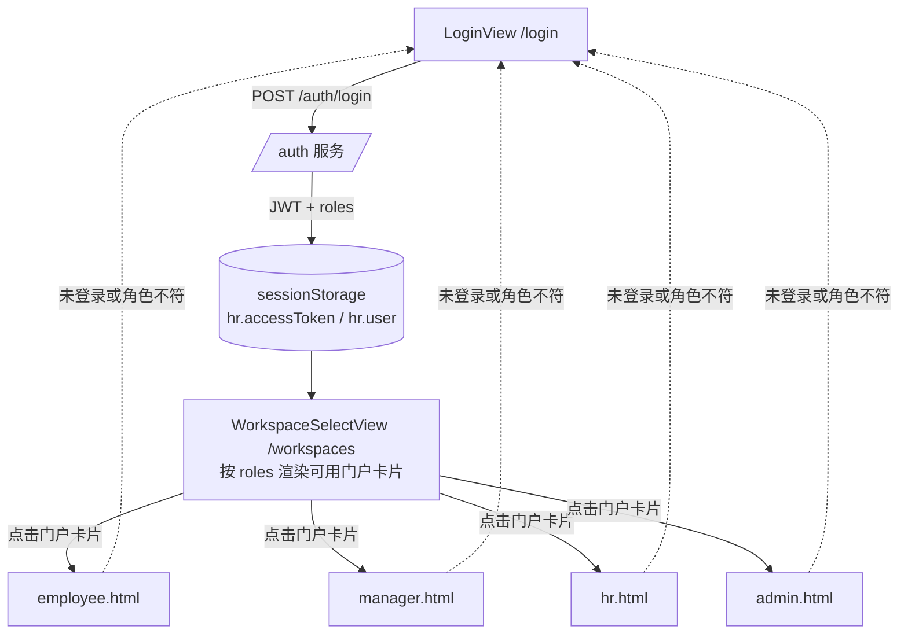
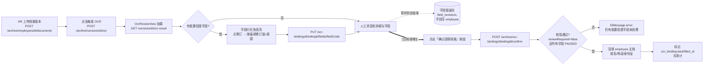
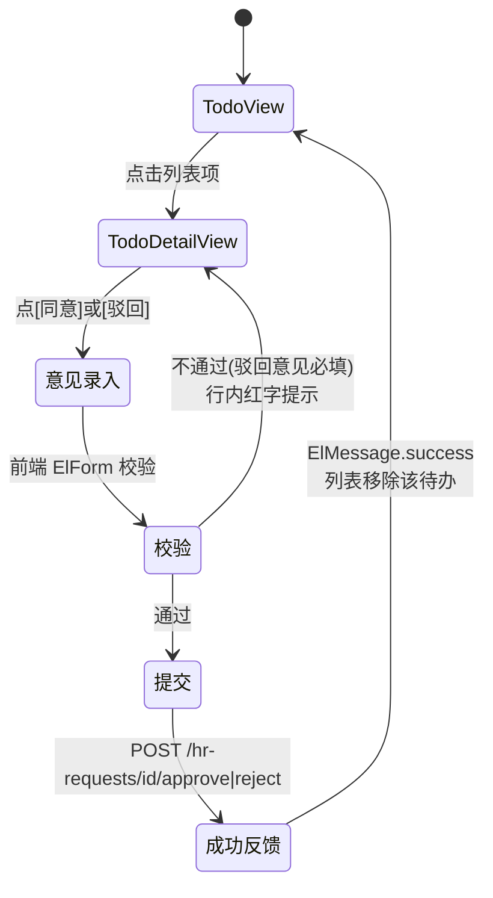
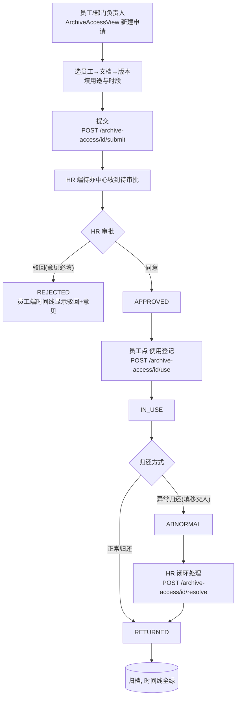
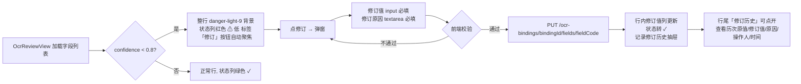

# 05 · 界面设计（论文第 5 章）

> 对应论文第 5 章「系统界面设计」。
> 事实来源：`_facts/04-frontend-views.md`（四端路由、21 个 `.vue` 页面、API 调用表）、`docs/current-api-reference.md`、`web/vite.config.ts`、`web/src/portal/portal-config.ts`。
> 标注约定：**【现状】**= 代码里已经实现；**【目标】**= 课题任务书要求、当前代码尚未闭环的界面补强。两者分开陈述，不混淆。

---

## 5.1 前端总体架构

### 5.1.1 技术栈与构建

| 项 | 选型 | 说明 |
|---|---|---|
| 框架 | Vue 3（Composition API + `<script setup>`） | SPA |
| 语言 | TypeScript | 视图与 API 层均强类型 |
| UI 库 | Element Plus | 表格、表单、对话框、消息提示 |
| 构建 | Vite 5 | dev 端口 5173，preview 4173 |
| 状态 | Pinia | 每个门户独立 store 实例 |
| 路由 | vue-router 4（hash 模式） | 每个门户独立 router 实例 |
| HTTP | axios | `baseURL=/api`，dev 代理到 `http://127.0.0.1:8080` |
| Token | `sessionStorage['hr.accessToken']` | 401 时由拦截器清除并跳登录 |

### 5.1.2 多入口结构

Vite `build.rollupOptions.input` 声明 5 个 HTML 入口，每个入口加载自己的 entry ts，最终通过 `mountPortal('<portal>')` 挂载独立 router + Pinia：

```
web/
├── index.html            # 公共入口：/login /register /workspaces
├── employee.html         # 员工端 SPA
├── manager.html          # 部门负责人端 SPA
├── hr.html               # 人事端 SPA
├── admin.html            # 系统管理员端 SPA
└── src/
    ├── main.ts           # 公共入口 router（/login /register /workspaces）
    ├── router/index.ts
    ├── portal/
    │   ├── create-portal-router.ts   # commonRoutes(roles, ocrRoles) 工厂
    │   ├── portal-config.ts          # 每端导航分组与菜单
    │   ├── employee-entry.ts
    │   ├── manager-entry.ts
    │   ├── hr-entry.ts
    │   └── admin-entry.ts
    ├── views/            # 21 个 .vue，四端共用
    └── api/http.ts       # 统一 request<T>() 与拦截器
```

四端共用 `views/`、`api/http.ts`、`styles.css`，差异只在「允许角色集合」与「导航菜单」。`create-portal-router` 在挂载时校验当前登录用户角色是否属于 `portal.allowedRoles`，不属于则 redirect `/forbidden`（`PortalForbiddenView.vue`）。

### 5.1.3 登录与门户跳转



**登录返回跳回**：未登录用户直接访问 `hr.html/#/todos` 时，`create-portal-router` 守卫把当前 URL 存入 `sessionStorage['hr.portalReturnTo']` 并跳 `/#/login`；登录成功后按 `authorizedReturnUrl` 回跳到原路径，避免用户登录后被踢回首屏。

### 5.1.4 路由表概览

| 端 | 入口 HTML | 允许角色 | 页面数 |
|---|---|---|---|
| 公共 | `index.html` | 公开 | 3（Login / Register / WorkspaceSelect） |
| 员工端 | `employee.html` | `EMPLOYEE` | 9 |
| 部门负责人端 | `manager.html` | `DEPT_MANAGER` | 10 |
| 人事端 | `hr.html` | `HR_ADMIN` | 12 |
| 系统管理员端 | `admin.html` | `SYSTEM_ADMIN` | 4 |
| 共用兜底 | — | — | 1（`/forbidden`） |

> 各端完整 path / 组件 / 标题对照表见 `_facts/04` 第 2 节；下文 5.2 节按门户归纳并补上「核心功能 / 调用 API」列。

---

## 5.2 四端门户设计

Demo 账号（密码统一 `password`）：`demo-employee`（员工）、`demo-manager`（部门负责人）、`demo-hr-manager`（同时具备部门负责人 + 人事）、`demo-hr`（人事）、`demo-admin`（系统管理员）。

### 5.2.1 员工端（employee.html）

- **入口**：`employee.html` → `employee-entry.ts` → `mountPortal('employee')`
- **目标角色**：`EMPLOYEE`
- **Demo 账号**：`demo-employee / password`
- **导航**（侧边分组「个人服务」）：个人工作台、我的待办、我的档案、申请与进度、档案访问、合同信息

| path | 页面组件 | 页面标题 | 核心功能 | 调用 API |
|---|---|---|---|---|
| `/` | `EmployeeHomeView.vue` | 个人工作台 | 个人待办数、我的档案概览 | `GET /statistics/overview`、`GET /todos?limit=6` |
| `/todos` | `TodoView.vue` | 待办中心 | 我的待办聚合列表（待审批/到期/异常/OCR 失败） | `GET /todos?limit=100` |
| `/todos/:kind/:id` | `TodoDetailView.vue` | 待办详情 | 申请详情、同意/驳回/撤回、离职交接、档案借用审批/归还 | `GET /hr-requests/{id}`、`GET /archive-access/{id}`、`POST /hr-requests/{id}/{approve\|reject\|submit\|cancel}`、`POST /archive-access/{id}/{approve\|reject\|return\|resolve}` |
| `/employees` | `EmployeeListView.vue` | 员工与档案（本人视角） | 本人档案主档只读视图 | `GET /employees`、`GET /departments/tree` |
| `/employees/:id/archive` | `EmployeeArchiveView.vue` | 档案详情 | 本人档案文档列表、版本历史、状态变更历史、下载 | `GET /employees/{id}`、`GET /employees/{id}/status-history`、`GET /archive/employees/{id}/documents`、`GET /archive/documents/{id}/versions` |
| `/workflows` | `WorkflowView.vue` | 人事流程 | 发起入职/调动/请假/离职申请、按类型/状态筛选、提交/取消 | `GET /hr-requests`、`POST /hr-requests`、`POST /hr-requests/{id}/submit\|cancel` |
| `/contracts` | `ContractsView.vue` | 合同台账 | 本人合同列表（只读） | `GET /contracts` |
| `/archive-access` | `ArchiveAccessView.vue` | 档案访问 | 发起档案借用申请、查看审批状态时间线、使用登记、归还 | `POST /archive-access`、`POST /archive-access/{id}/{submit\|use\|return}`、`GET /archive-access/{id}`、`GET /employees`、`GET /archive/employees/{id}/documents`、`GET /archive/documents/{id}/versions` |
| `/todos/ocr/:versionId`、`/ocr/:versionId` | `OcrReviewView.vue` | OCR 识别结果 | 查看本人档案版本的 OCR 文本块/字段/置信度（只读） | `GET /archive/versions/{id}/ocr-result`、`GET /archive/ocr-bindings/{id}/preview` |

### 5.2.2 部门负责人端（manager.html）

- **入口**：`manager.html` → `manager-entry.ts` → `mountPortal('manager')`
- **目标角色**：`DEPT_MANAGER`
- **Demo 账号**：`demo-manager / password`
- **导航**（两组）：「团队工作」= 团队概览、审批与待办、部门员工、人事流程、合同信息；「档案资源」= 档案访问、部门盘点

| path | 页面组件 | 页面标题 | 核心功能 | 调用 API |
|---|---|---|---|---|
| `/` | `ManagerHomeView.vue` | 团队概览 | 团队人数、待审批数、盘点任务数 | `GET /statistics/overview`、`GET /todos?limit=8`、`GET /inventory-tasks` |
| `/todos`、`/todos/:kind/:id` | `TodoView` / `TodoDetailView` | 审批与待办 | 部门审批节点处理：同意/驳回（意见必填） | `GET /todos`、`POST /hr-requests/{id}/approve\|reject`（node=DEPARTMENT） |
| `/employees`、`/employees/:id/archive` | `EmployeeListView` / `EmployeeArchiveView` | 部门员工 / 档案详情 | 本部门员工列表与档案主档（DataScope=DEPARTMENT） | `GET /employees?departmentId=...`、`GET /archive/employees/{id}/documents` |
| `/workflows` | `WorkflowView` | 人事流程 | 本部门发起/审批入职、调动、请假、离职 | `GET /hr-requests?departmentId=...`、`POST /hr-requests/{id}/approve\|reject` |
| `/contracts` | `ContractsView` | 合同信息 | 本部门员工合同台账（只读） | `GET /contracts?departmentId=...` |
| `/archive-access` | `ArchiveAccessView` | 档案访问 | 部门内发起借用申请、查看状态 | 同员工端 |
| `/inventory` | `InventoryView.vue` | 部门盘点 | 创建/启动/逐项核对/提交差异/闭环 | `GET/POST /inventory-tasks`、`POST /inventory-tasks/{id}/start\|complete`、`GET /inventory-tasks/{id}/items`、`POST /inventory-tasks/{id}/items/{itemId}/check\|resolve` |
| `/todos/ocr/:versionId`、`/ocr/:versionId` | `OcrReviewView` | OCR 识别结果 | 查看本部门档案版本 OCR 结果（只读） | 同员工端 |

### 5.2.3 人事端（hr.html）

- **入口**：`hr.html` → `hr-entry.ts` → `mountPortal('hr')`
- **目标角色**：`HR_ADMIN`
- **Demo 账号**：`demo-hr / password`
- **导航**（四组）：「运营中心」= 运营总览、人事待办；「人员与档案」= 员工与档案、人事流程、合同台账；「档案资源」= 档案授权、盘点与异常；「系统运营」= 组织岗位、审计日志

| path | 页面组件 | 页面标题 | 核心功能 | 调用 API |
|---|---|---|---|---|
| `/` | `HrHomeView.vue` | 人事运营总览 | 指标卡、月度趋势、部门分布、合同到期提醒（嵌入 `DashboardView`） | `GET /statistics/overview`、`GET /statistics/report`、`GET /todos`、`GET /contracts?status=ACTIVE&renewalStatus=DUE` |
| `/todos`、`/todos/:kind/:id` | `TodoView` / `TodoDetailView` | 人事待办 | HR 审批节点、档案借用审批/归还/异常闭环 | `POST /hr-requests/{id}/approve\|reject`（node=HR）、`POST /archive-access/{id}/{approve\|reject\|resolve}` |
| `/employees`、`/employees/:id/archive` | `EmployeeListView` / `EmployeeArchiveView` | 员工与档案 | 新建/编辑员工主档、上传档案新材料、触发 OCR、查看版本历史 | `POST /employees`、`PUT /employees/{id}/profile`、`POST /archive/employees/{id}/documents`（multipart）、`POST /archive/versions/{id}/ocr` |
| `/workflows` | `WorkflowView` | 人事流程 | HR 审批节点、离职交接回填 | `POST /hr-requests/{id}/approve\|reject`、`PUT /hr-requests/{id}/handover` |
| `/contracts` | `ContractsView` | 合同台账 | 新建合同、标记不续签 | `GET /contracts`、`POST /contracts`、`PUT /contracts/{id}/renewal-status` |
| `/archive-access` | `ArchiveAccessView` | 档案授权 | 审批本端收到的借用申请、异常闭环 | `POST /archive-access/{id}/{approve\|reject\|resolve}` |
| `/inventory` | `InventoryView` | 盘点与异常 | 全公司盘点任务、差异异常处理 | 同部门端（DataScope=ALL） |
| `/organization` | `OrganizationAdminView.vue` | 组织岗位 | 部门树与岗位字典增删改 | `GET /departments/admin`、`GET /departments/{id}/positions/admin`、`POST/PUT /departments[/{id}]`、`POST/PUT /departments/{id}/positions[/{posId}]` |
| `/audit-logs` | `AuditLogView.vue` | 审计日志 | 操作日志分页（按 action 过滤） | `GET /operation-logs` |
| `/todos/ocr/:versionId`、`/ocr/:versionId` | `OcrReviewView` | OCR 识别结果 | **触发 OCR、人工修订字段（写权限）** | `POST /archive/versions/{id}/ocr`、`PUT /archive/ocr-bindings/{bindingId}/fields/{fieldCode}` |

### 5.2.4 系统管理员端（admin.html）

- **入口**：`admin.html` → `admin-entry.ts` → `mountPortal('admin')`
- **目标角色**：`SYSTEM_ADMIN`
- **Demo 账号**：`demo-admin / password`
- **导航**（三组）：「平台管理」= 管理概览、账号与角色；「平台配置」= 组织结构；「平台审计」= 审计日志

| path | 页面组件 | 页面标题 | 核心功能 | 调用 API |
|---|---|---|---|---|
| `/` | `AdminHomeView.vue` | 平台管理概览 | 用户数、部门树、平台指标卡 | `GET /statistics/overview`、`GET /admin/users?pageSize=1`、`GET /departments/tree` |
| `/admin/users` | `AdminUsersView.vue` | 账号与角色 | 系统用户列表、新建用户、分配角色 | `GET /admin/users`、`GET /admin/users/roles`、`POST /admin/users`、`PUT /admin/users/{id}` |
| `/organization` | `OrganizationAdminView.vue` | 组织结构 | 部门树与岗位维护 | 同人事端 |
| `/audit-logs` | `AuditLogView.vue` | 审计日志 | 全平台操作日志 | `GET /operation-logs` |

> **【现状事实】** admin 端无独立 OCR 菜单、无 HR 业务菜单（员工/合同/盘点/借用），系统管理员只负责账号、组织、审计——业务运营全部归人事端。

---

## 5.3 核心页面布局描述

### 5.3.1 登录页（LoginView）

公共入口 `index.html/#/login`，居中卡片式布局，无侧边导航：

```
┌──────────────────────────────────────────────────────┐
│                                                      │
│              [Logo] HR 人事档案与流程平台             │
│                                                      │
│   ┌──────────────────────────────────────────┐       │
│   │  账号:  [________________________]        │       │
│   │  密码:  [________________________]        │       │
│   │                                          │       │
│   │        [   登  录   ]                    │       │
│   │                                          │       │
│   │  还没有账号？ [员工注册]                  │       │
│   └──────────────────────────────────────────┘       │
│                                                      │
└──────────────────────────────────────────────────────┘
```

- 表单校验：账号/密码必填（Element Plus `required`），失焦即校验。
- 提交：`POST /auth/login` → 成功写 `sessionStorage` → 跳 `/workspaces`；失败由 `request<T>` 抛错，`ElMessage.error(message)` 顶部弹出。
- 若 URL 带 `?returnTo=...`，登录成功后直接回跳该路径（即 5.1.3 的门户守卫写入的 `hr.portalReturnTo`）。

### 5.3.2 OCR 复核页（OcrReviewView）

路径 `/ocr/:versionId` 或 `/todos/ocr/:versionId`，是人事端**最核心的操作页**，左右分栏 + 底部字段修订表：

```
┌─────────────────────────────────────────────────────────────────────┐
│ 档案详情 / 版本 v3 / OCR 识别结果                    [重新触发 OCR] │
├──────────────────────────────┬──────────────────────────────────────┤
│                              │  字段列表                              │
│   检测框图（PNG）            │  ┌────────────────────────────────┐   │
│   ┌──────────────────┐       │  │字段│原值│修订值│置信度│状态│操作│   │
│   │                  │       │  │姓名│张 三│张三  │0.98│✓  │修订│   │
│   │   [红色检测框    │       │  │身份证│4301...│4301...│0.62│⚠低│修订│   │
│   │    叠加在原文档]  │       │  │电话│138...│138...│0.91│✓  │修订│   │
│   │                  │       │  └────────────────────────────────┘   │
│   └──────────────────┘       │                                      │
│                              │  选中行 → 修订对话框：                 │
│  由 GET /ocr-bindings/       │   修订值: [____________]               │
│  {id}/preview 返回 image/png │   修订原因: [____________] (必填)      │
│                              │            [取消] [提交修订]          │
├──────────────────────────────┴──────────────────────────────────────┤
│  文本块（text_blocks）：[块1: "张 三"] [块2: "4301..."] ...           │
│                                                                     │
│  【目标】[确认回填档案] 按钮 —— 见 5.4.1                             │
└─────────────────────────────────────────────────────────────────────┘
```

- **低置信度高亮**：置信度 < 0.8 的行整行 `bg-color: #fef0f0`（Element Plus danger-light-9），状态列显示红色 `⚠ 低` 标签。
- **修订原因必填**：点「修订」弹出对话框，`reason` 字段 `required`，未填禁止提交。
- **【现状】** 底部只有「重新触发 OCR」与字段修订，**没有「确认回填」按钮**；修订值只留在 `field_revisions` 与 `ocr_field_revision`，未写回 `employee` 主档——见 5.4.1 目标设计。

### 5.3.3 待办中心（TodoView + TodoDetailView）

待办中心是四端共用的聚合入口，左列表右详情：

```
┌─────────────────────────────────────────────────────────────────┐
│ 待办中心                                   共 12 条  [筛选 ▾]  │
├──────────────────────────────┬──────────────────────────────────┤
│ ┌──────────────────────────┐ │ 待办详情                          │
│ │● [人事] 张三 入职申请     │ │ 类型: 入职申请                    │
│ │  提交于 10-10 14:32      │ │ 申请人: 张三  部门: 研发部        │
│ ├──────────────────────────┤ │ 生效日: 2026-10-20               │
│ │○ [借用] 李四 借用档案 v2   │ │                                  │
│ │  提交于 10-11 09:10      │ │ 申请内容:                         │
│ │                          │ │  ┌──────────────────────────┐     │
│ │○ [到期] 王五 合同 11-01   │ │  │ 岗位: Java 开发工程师      │     │
│ │  到期提醒                 │ │  │ 薪资: 15k                  │     │
│ │                          │ │  │ ...                        │     │
│ │○ [异常] 盘点 #3 版本不符   │ │  └──────────────────────────┘     │
│ │                          │ │                                  │
│ │○ [OCR] v8 字段置信度过低  │ │ 审批意见:                          │
│ │                          │ │  ┌──────────────────────────┐     │
│ └──────────────────────────┘ │  │                            │     │
│                              │  └──────────────────────────┘     │
│                              │   [驳回]   [同意]                │
└──────────────────────────────┴──────────────────────────────────┘
```

- **列表项**按 `kind` 分色标签：`HR_REQUEST`（人事申请）、`ARCHIVE_ACCESS`（档案借用）、`CONTRACT_DUE`（合同到期）、`INVENTORY_EXCEPTION`（盘点异常）、`OCR_LOW_CONFIDENCE`（OCR 低置信度）。
- **审批意见必填校验**：点「驳回」时意见必填（`required` + `minLength: 2`）；点「同意」意见选填但建议填写。校验不通过时 `ElForm` 行内红字提示，不发请求。
- **不同 kind 的底部按钮组不同**：
  - 人事申请：同意 / 驳回 / 撤回（申请人本人）/ 离职交接（OFFBOARDING 类型 HR）。
  - 档案借用：同意 / 驳回 / 使用登记 / 归还 / 异常闭环。
  - OCR 低置信度：跳转 `OcrReviewView`。
  - 合同到期 / 盘点异常：跳转对应业务页。

### 5.3.4 员工档案详情（EmployeeArchiveView）

路径 `/employees/:id/archive`，上主档、中文档列表、下版本与 OCR 结果：

```
┌─────────────────────────────────────────────────────────────────┐
│  员工档案 / 张三                              [上传新材料]      │
├─────────────────────────────────────────────────────────────────┤
│  主档: 张三  |  研发部 / Java 开发工程师  |  状态: 在职          │
│        入职日 2024-03-01  |  电话 138****1234                    │
├─────────────────────────────────────────────────────────────────┤
│  档案目录（employee_archive 三层结构）                            │
│  ┌──────────────────────────────────────────────────────┐       │
│  │ 证件照/身份证  ─ v1 (2024-03-01)  v2 (2025-01-01)    │       │
│  │                └ v2 [OCR ✓] [下载] [查看 OCR 结果]   │       │
│  │ 学历证明        ─ v1 (2024-03-01) [下载]             │       │
│  │ 劳动合同        ─ v1 (2024-03-01) v2 (2026-01-01)     │       │
│  └──────────────────────────────────────────────────────┘       │
├─────────────────────────────────────────────────────────────────┤
│  状态变更历史:                                                    │
│   2024-03-01  待定入职 → 在职        系统自动（入职审批生效）    │
│   2025-07-01  在职 → 在职(调岗)      审批单 #23 生效             │
└─────────────────────────────────────────────────────────────────┘
```

- **三层结构**：员工主档（`employee`）→ 文档分类（`archive_document`，如证件照/学历/合同）→ 版本（`archive_version`，每次上传产生新版本，旧版本只读保留）。
- **HR 独有操作**：`[上传新材料]`（multipart 弹窗，选 documentType + 文件）、`[触发 OCR]`（在版本行右键按钮）、`[查看 OCR 结果]` 跳 `OcrReviewView`。
- **员工本人/部门负责人只读**：无上传、无触发 OCR 按钮，只能下载与查看版本历史。

### 5.3.5 档案借用申请（ArchiveAccessView）

路径 `/archive-access`，上表单、下时间线：

```
┌─────────────────────────────────────────────────────────────────┐
│  档案访问申请                              [新建申请]          │
├─────────────────────────────────────────────────────────────────┤
│  新建申请（弹窗 / 或右侧表单）:                                    │
│    选择员工:      [张三              ▾]                         │
│    选择文档:      [身份证             ▾]                         │
│    选择版本:      [v2 (2025-01-01)    ▾]                         │
│    使用用途:      [________________________________]           │
│    期望使用时段:  [开始] ~ [结束]                                │
│                        [取消]  [提交申请]                        │
├─────────────────────────────────────────────────────────────────┤
│  我提交的申请（时间线视图）:                                      │
│                                                                   │
│   ●─────●─────●─────●─────●                                     │
│   提交   HR    使用   归还   闭环                                 │
│   申请   审批   登记                                  │
│   10-11  10-11  10-12                                            │
│   09:10  10:05  09:30                                            │
│                                                                   │
│   状态: ●───●───●───○───○  (IN_USE，等待归还)                   │
└─────────────────────────────────────────────────────────────────┘
```

- **状态机**（与 03 设计文档 4.4.3 一致）：`DRAFT → PENDING_APPROVAL → APPROVED → IN_USE → RETURNED`；异常分支 `→ ABNORMAL → RETURNED`。
- **时间线**用 Element Plus `el-steps` 组件，当前节点高亮、已完成节点绿色、未到达节点灰色。
- **HR 在本页看到的是「待我审批」的申请列表**（DataScope=ALL），审批按钮弹意见框（驳回必填）。
- **归还**时可选「正常归还」或「异常归还（移交他人）」；异常归还后 HR 侧出现「[闭环处理]」按钮，填 `resolution` 后状态转 `RETURNED`。

### 5.3.6 盘点页（InventoryView）

路径 `/inventory`，部门负责人与 HR 双端共用：

```
┌─────────────────────────────────────────────────────────────────┐
│  档案盘点                                  [新建盘点任务]       │
├─────────────────────────────────────────────────────────────────┤
│  任务列表:                                                       │
│  ┌────────────────────────────────────────────────────┐         │
│  │ #3  研发部 2026Q4 盘点   状态: 进行中              │         │
│  │    期望档案版本 12 个  |  已核对 8  |  差异 1       │         │
│  │    [进入盘点] [完成盘点]                            │         │
│  └────────────────────────────────────────────────────┘         │
├─────────────────────────────────────────────────────────────────┤
│  进入盘点 → 逐项核对表:                                           │
│  ┌──────────────────────────────────────────────────────┐       │
│  │ 员工 │ 文档 │ 期望版本 │ 实际版本 │ 结果 │ 操作       │       │
│  │ 张三 │ 身份证│ v2      │ v2       │ ✓   │ [核对]     │       │
│  │ 李四 │ 合同  │ v3      │ v2       │ ✗差异│ [核对][登记]│       │
│  │ 王五 │ 学历  │ v1      │  (未选)  │ ○   │ [核对]     │       │
│  └──────────────────────────────────────────────────────┘       │
│                                                                   │
│  差异项处理: 实际版本 ≠ 期望版本时弹「差异登记」对话框:           │
│    差异类型: [VERSION_MISMATCH ▾]   备注: [_______]              │
└─────────────────────────────────────────────────────────────────┘
```

- **新建任务**：勾选若干档案版本（多选表格），提交后状态 `DRAFT`。
- **启动**：`[开始盘点]` → `DRAFT → IN_PROGRESS`。
- **逐项核对**：每点一次「核对」弹实际版本选择器；实际 = 期望 → `NOT_REQUIRED`；不等 → `OPEN` 并写 `exception_record`。
- **完成**：`[完成盘点]` 后端校验「所有 item 已 check 且无 OPEN」，否则拒绝（返回 409 `STATE_CONFLICT`），前端 `ElMessage.error` 提示。

---

## 5.4 关键交互流程

### 5.4.1 OCR 上传 → 复核 → 确认回填



> **【现状缺口】** 现状 OCR 流程到「人工修订留痕」即结束（5.3.2 布局图底部标注），修订值只留在 `field_revisions` 与 `ocr_field_revision` 表，**没有任何按钮把字段值写回 `employee` 主档**。
>
> **【目标设计】** 在 `OcrReviewView` 底部加主色按钮 `[确认回填档案]`，调用新增后端接口 `POST /archive/ocr-bindings/{bindingId}/confirm`（见 03 设计文档 4.4.2 时序图）。前端校验：
> 1. 所有低置信度字段（confidence < 0.8）必须已人工修订且修订后 `validationStatus=PASSED`，否则按钮置灰并 `title` 提示「仍有 N 个低置信度字段未处理」；
> 2. 点击后弹二次确认对话框：「将以以下字段值更新员工主档：姓名=X、电话=Y、身份证=Z，是否继续？」；
> 3. 确认后 loading 态，成功 `ElMessage.success('已回填档案')` 并刷新页面主档区。

### 5.4.2 审批待办处理（列表 → 详情 → 通过/驳回）



- **意见必填规则**：驳回 = `required`（`minLength: 2`）；同意 = 选填但建议填。
- **防重复提交**：按钮在请求中 `loading` 态，禁用重复点击。
- **409 冲突**：若待办已被他人处理（状态机转移非法），后端返回 `STATE_CONFLICT`，前端 `ElMessage.error(message)` 并刷新列表。

### 5.4.3 档案借用申请全流程



- **时间线**：`ArchiveAccessView` 用 `el-steps` 实时回显申请当前所处节点（5.3.5 布局图）。
- **到期兜底**：后端 `ArchiveAccessExpiryScheduler`（60s fixedDelay）自动把过期未 use / 过期未归还的申请置 `ABNORMAL`，员工端时间线出现红色异常节点，HR 收到新待办。

### 5.4.4 低置信度字段高亮与修订



- **高亮规则**：前端按 `confidence < 0.8` 阈值渲染（与后端 `reviewRequired` 字段对应），阈值常量定义在 `web/src/views/ocr/ocr.constants.ts`，便于后续调整。
- **修订历史**：每次 `PUT` 成功后，行尾出现小图标 `🕘`，点开抽屉展示该字段所有修订记录（来自 `field_revisions`）。

---

## 5.5 统一交互约定

### 5.5.1 分页表格统一组件

所有列表页（员工、人事申请、合同、审计日志、账号）统一封装 `<PagedTable>` 组件，固定约定：

- **列**：表格头支持排序（时间列默认倒序）。
- **分页**：右下角 `el-pagination`，`pageSize` 固定 10 / 20 / 50 三档可选，`page` 从 1 起。
- **请求参数**：`page`、`pageSize` + 业务过滤（keyword / departmentId / status 等）。
- **响应**：后端返回 `XxxPage{total, records}`，组件内自动绑定 `total`。

### 5.5.2 表单校验规则

- 统一用 Element Plus `el-form` + `:rules`，`validate-on-rule-change=false`，失焦即校验。
- 通用规则：
  - 必填：`required: true, message: '必填', trigger: 'blur'`。
  - 手机号：正则 `/^1[3-9]\d{9}$/`。
  - 身份证：正则 `/^\d{17}[\dXx]$/`。
  - 审批意见：驳回时 `required: true, minLength: 2`。
- 提交按钮在 `form.validate()` 通过后才发请求；不通过时滚动到第一个错误字段并 `ElMessage.warning('请完善必填项')`。

### 5.5.3 错误提示（统一 `{code, message}`）

- axios 响应拦截器：HTTP 200 但业务 `code !== '0'` 时，统一 `ElMessage.error(message)`（message 已含中文）并 reject；HTTP 401 时清 `sessionStorage` 并跳 `/login`。
- 错误码到用户提示的映射（前端不硬编码 code 语义，直接展示后端 `message`）：
  - `VALIDATION_ERROR` → 表单行内红字 + `ElMessage.warning`。
  - `UNAUTHORIZED` → 跳登录。
  - `FORBIDDEN` → `ElMessage.error('无权限')`，2s 后跳 `/forbidden`。
  - `STATE_CONFLICT` → `ElMessage.error(message)`，自动刷新当前列表。
  - `NOT_FOUND` → `ElMessage.error('数据不存在或已被删除')`，返回上一页。
  - 兜底 `INTERNAL_ERROR` → `ElMessage.error('系统繁忙，请稍后重试')`，同时把 `traceId` 附在 message 后便于排查。

### 5.5.4 空数据 / 加载中状态

- **加载中**：表格区用 `v-loading="loading"` 指令，全屏操作（提交、审批）用按钮 `loading`。
- **空数据**：`el-table` 的 `empty-text` 统一显示「暂无数据」；列表页顶部支持「新建」按钮时，空态同时显示「新建一条」引导按钮。
- **加载失败**：表格区显示错误卡片 + `[重试]` 按钮。

### 5.5.5 权限不足跳转

- 路由级 `meta.roles` 校验失败 → redirect `/forbidden`（`PortalForbiddenView.vue`）。
- 后端返回 403 → 前端拦截器跳 `/forbidden`。
- `/forbidden` 页面布局：居中大图标「无权限」+ 文案「当前账号无权访问该页面，请联系管理员或切换门户」+ `[返回工作台]` 按钮（跳 `/workspaces`）。

---

## 5.6 现状 vs 目标

### 5.6.1 现状盘点

| 维度 | 现状 |
|---|---|
| 技术栈 | Vue 3 + TS + Element Plus + Vite + Pinia + vue-router（hash） |
| HTML 入口 | 5 个（index + employee / manager / hr / admin） |
| `.vue` 页面 | 21 个（公共 3 + 四端业务 17 + 兜底 1） |
| 前端测试 | 38 个测试用例全部通过（路由守卫、API mock、组件渲染） |
| 导航 | `portal-config.ts` 按端分组，侧边 `el-menu` |
| API 层 | `api/http.ts` 统一 `request<T>`，`ApiResponse{code,message,data,traceId}` |
| 认证 | JWT Bearer + `sessionStorage`，401 自动跳登录 |
| 权限双层 | 前端 `meta.roles` + `portal.allowedRoles`；后端 `@PreAuthorize` + `DataScope` |

### 5.6.2 目标补强（界面侧）

| 缺口 | 现状 | 【目标】设计 | 对应章节 |
|---|---|---|---|
| **OCR 确认回填按钮** | `OcrReviewView` 只有「重新触发 OCR」与字段修订，修订值不回写 `employee` 主档 | 底部加 `[确认回填档案]` 主色按钮，调用新增 `POST /archive/ocr-bindings/{bindingId}/confirm`；低置信度未处理时按钮置灰；二次确认弹窗展示将回填的字段值 | 5.3.2、5.4.1 |
| **请假开始/结束状态展示** | 员工主档状态列只显示「在职/离职/待定入职」，`ON_LEAVE` 枚举后端已定义但无写入路径，前端无休假中徽标 | 员工主档卡片与列表状态列增加「休假中」橙色徽标；请假申请详情页显示「休假开始日 / 预计销假日」；销假流程在 `TodoDetailView` 增加销假按钮 | 5.3.4、5.4.2 |
| **合同到期提醒待办入口** | `DashboardView` 顶部有合同到期卡片，但待办中心 `TodoView` 的 kind 列表中无 `CONTRACT_DUE` 单独筛选 | `TodoView` 左侧筛选 tabs 增加「合同到期」tab，点击直接跳 `ContractsView?renewalStatus=DUE`；首页指标卡数字与待办中心 badge 联动 | 5.3.3 |
| **四角色浏览器端到端验收** | 现状只有组件级与路由级单测（38 个），无真实浏览器 E2E | 引入 Playwright 或 Cypress，对 4 个 demo 账号（`demo-employee` / `demo-manager` / `demo-hr` / `demo-admin`）跑核心链路：登录 → 首页 → 待办 → 审批 → 档案下载 → 退出 | 5.1.3、5.2 |

---

## 本章小结

第 5 章从前端总体架构（5.1）、四端门户（5.2）、核心页面布局（5.3）、关键交互流程（5.4）、统一交互约定（5.5）五个维度落地了系统界面设计。现状已实现 5 个 HTML 入口、21 个 `.vue` 页面、38 个前端测试全部通过；过程中诚实标注了四处界面侧缺口并给出目标设计：**OCR 复核页补「确认回填档案」按钮（5.3.2 / 5.4.1）、员工主档补「休假中」状态展示、待办中心补「合同到期」入口、四角色浏览器端到端验收**，作为第 6 章实现与测试的输入。
