# 06 · 模块详细设计（论文第 5 章）

> 对应论文第 5 章「系统详细设计」——类结构、接口、状态机与关键算法。
> 事实来源：`_facts/01-backend-modules.md`（Controller/Service/Mapper 与方法签名）、`_facts/03-state-machines.md`（状态值与转移）、`_facts/05-ocr-service.md`（OCR 流水线）、`_facts/07-key-classes-and-paths.md`（全限定名与代码锚点）、`docs/current-api-reference.md`（接口清单）。
> 标注约定：**【现状】**= 代码已实现；**【目标】**= 任务书要求、当前未闭环的设计补强。状态值一律以代码枚举/Pydantic Literal 为准，不作文臆改。

---

## 5.1 后端分层架构

### 5.1.1 三层调用骨架

Spring Boot 端严格按「Controller → Service → Mapper」三层组织，横切关注点由过滤器链与切面承载。主类 `com.hrplatform.PlatformApplication`（`@SpringBootApplication` + `@EnableScheduling` + `@MapperScan(annotationClass=Mapper.class)`）扫描 `com.hrplatform` 全包。

```mermaid
flowchart TD
    REQ[HTTP 请求] --> TF[TraceIdFilter<br/>X-Trace-Id → MDC]
    TF --> JF[JwtAuthenticationFilter<br/>Bearer Token → JwtPrincipal]
    JF --> CTL[Controller 层<br/>@RestController · @Valid 参数校验 · @PreAuthorize]
    CTL --> SVC[Service 层<br/>业务逻辑 · @Transactional · 状态机校验]
    SVC --> SM[状态机类<br/>RequestStateMachine / ArchiveAccessStateMachine]
    SVC --> MAP[Mapper 层<br/>MyBatis @Mapper · XML SQL]
    MAP --> DB[(MySQL)]
    SVC -.手动调用.-> AUD[OperationLogService]
    SVC --> EXT[HttpOcrClient<br/>REST 委托 ocr-service]
    EXT --> MINIO[(MinIO 共享对象存储)]
    CTL -.异常.--> EXH[GlobalExceptionHandler<br/>@RestControllerAdvice]
    EXH --> RESP[ApiResponse code/message/data/traceId]
```

### 5.1.2 各层职责

| 层 | 职责 | 代表类（全限定名见 `_facts/07`） |
|---|---|---|
| **Controller** | 路由声明、DTO 绑定与 Bean Validation、`@PreAuthorize` 角色校验、组装 `ApiResponse<T>`；不含业务规则 | `com.hrplatform.auth.AuthController`、`com.hrplatform.employee.EmployeeController`、`com.hrplatform.workflow.RequestController`、`com.hrplatform.access.ArchiveAccessController`、`com.hrplatform.inventory.InventoryController`、`com.hrplatform.ocr.OcrController`、`com.hrplatform.archive.ArchiveController` |
| **Service** | 业务逻辑、事务边界（`@Transactional`）、状态机转移裁决、调用 Mapper 与外部客户端、写审计 | `com.hrplatform.auth.AuthService`、`com.hrplatform.employee.EmployeeService`、`com.hrplatform.workflow.RequestService`、`com.hrplatform.workflow.EmployeeChangeService`、`com.hrplatform.access.ArchiveAccessService`、`com.hrplatform.inventory.InventoryService`、`com.hrplatform.ocr.OcrService`、`com.hrplatform.archive.ArchiveService` |
| **Mapper** | 仅做 SQL，不携带业务判断；XML 位于 `server/src/main/resources/mapper/**/*.xml` | `com.hrplatform.employee.EmployeeMapper`、`com.hrplatform.workflow.RequestMapper`、`com.hrplatform.access.AccessMapper`、`com.hrplatform.inventory.InventoryMapper`、`com.hrplatform.ocr.OcrBindingMapper`、`com.hrplatform.archive.ArchiveMapper` |

### 5.1.3 横切关注点

| 横切 | 实现类 | 位置/时机 |
|---|---|---|
| 认证 | `com.hrplatform.common.security.JwtAuthenticationFilter`（`OncePerRequestFilter`） | 过滤器链：`TraceIdFilter` → `JwtAuthenticationFilter`；解析 `Authorization: Bearer <token>`，`liveValidation=true` 时回查 `sys_user` 并重载角色 |
| 授权 | `com.hrplatform.common.security.SecurityConfiguration`（`@EnableMethodSecurity`）+ `@PreAuthorize` | 方法级；数据范围由 `com.hrplatform.common.security.DataScope` 在 Service 层二次裁决 |
| 异常 | `com.hrplatform.common.web.GlobalExceptionHandler`（`@RestControllerAdvice`） | 异常 → HTTP 状态码 + 错误码，失败落 `REQUEST_FAILED` 审计 |
| 链路追踪 | `com.hrplatform.common.web.TraceIdFilter` | 请求头 `X-Trace-Id` 读取/生成 UUID → MDC → 响应头 |
| 操作日志 | `com.hrplatform.audit.OperationLogService` | **【现状】** Service 层手动 `record(...)`，13 个类调用，无 AOP 切面；**【目标】** `@OperationLog` 注解 + `@Aspect` 切面（见 5.7） |
| 定时任务 | `com.hrplatform.workflow.EmployeeChangeScheduler`、`com.hrplatform.access.ArchiveAccessExpiryScheduler` | 前者每分钟 cron 扫描到期生效；后者 60s fixedDelay 处理超时档案借用 |

---

## 5.2 核心模块类设计

### 5.2.1 认证模块（auth）

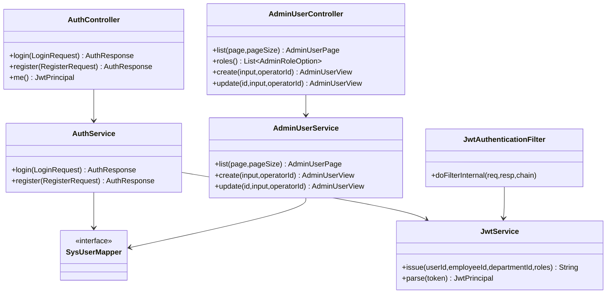

- **登录链路**：`AuthController.login` → `AuthService.login` → BCrypt 校验密码 → `JwtService.issue` 签发 claims（`sub=userId`、`employeeId`、`departmentId`、`roles`，默认 `PT8H`）→ 返回 `AuthResponse{accessToken, user}`。
- **注册链路**：`AuthService.register` 按员工编号匹配唯一在职员工档案并绑定账号，注册后仅授予 `EMPLOYEE` 角色（不允许客户端自报部门/角色）。
- **用户管理**：`AdminUserController` 类级 `@PreAuthorize("hasRole('SYSTEM_ADMIN')")`，负责系统账号与角色分配。

### 5.2.2 员工档案模块（employee + archive）

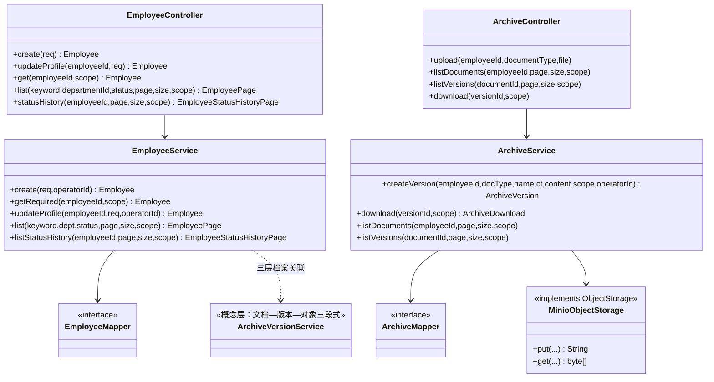

- **员工档案三层**：主档层 `employee` → 文档层 `archive_document` → 版本层 `archive_version`；文件二进制落 MinIO（`file_object` 记录 object_key），新版本上传时旧版本自动 `is_current=false`。
- **数据范围**：所有读入口收 `DataScope scope` 参数，由 `EmployeeService.getRequired/list` 在 SQL 层与业务层双重过滤（HR→ALL、部门负责人→本部门、员工→本人）。
- **版本服务**：`ArchiveVersionService` 在概念上承担「文档—版本—对象」三段式关联（代码中由 `ArchiveService` 内聚实现），下载前过 `ArchiveReadAuthorization` 内容级授权。

### 5.2.3 人事流程模块（workflow）

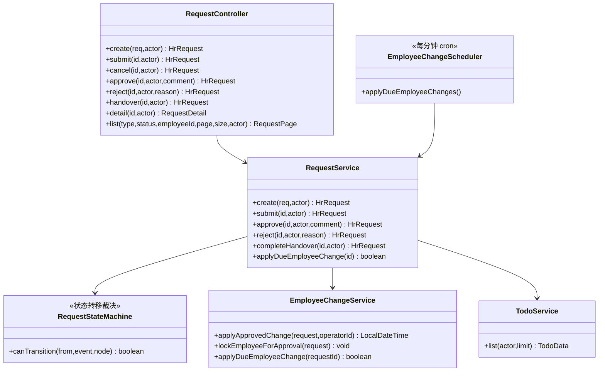

> **【现状 · 待补强】** `EmployeeChangeService.applyApprovedChange` 当前转移规则只处理三种申请类型：
> - `ONBOARDING`：前置 `PENDING_ONBOARDING` → 生效后 `ACTIVE`，写 `hire_date`；
> - `TRANSFER`：前置 `ACTIVE` → 保持 `ACTIVE`，更新 `department_id/position_id` 并同步 `sys_user.department_id`；
> - `OFFBOARDING`：前置 `ACTIVE` → 生效后 `INACTIVE`，写 `leave_date` 并清空部门/岗位。
>
> **`LEAVE` 走默认分支——请假审批通过后只写 `employee_change_applied_at`，不把 `employee.status` 切到 `ON_LEAVE`**（`EmployeeStatus.ON_LEAVE` 枚举已定义但无写入路径，见 `_facts/03` 第 1 节）。
> **【目标】** 在 `applyApprovedChange` 补 LEAVE 分支：生效时 `ACTIVE → ON_LEAVE`，销假反向 `ON_LEAVE → ACTIVE`，使请假状态闭环。

### 5.2.4 档案访问模块（access）

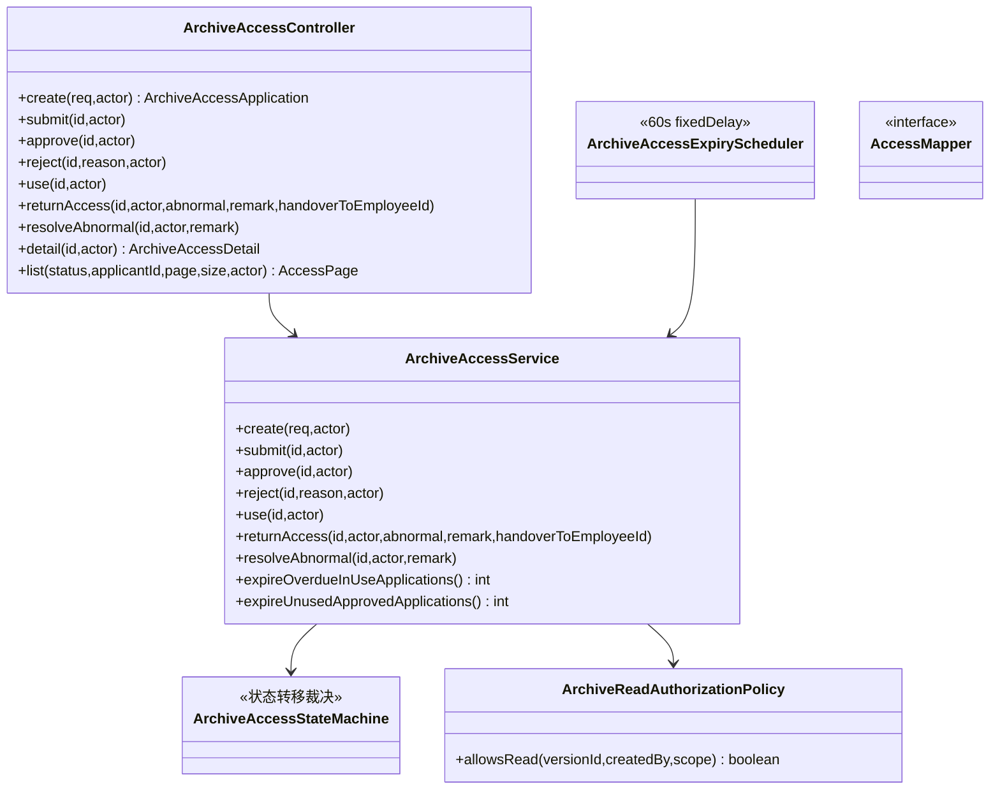

- **状态机校验位置**：每个写方法入口先经 `ArchiveAccessStateMachine.canTransition(...)` 裁决当前状态是否允许该事件，不合法抛 `ArchiveAccessStateException` → HTTP 409 `STATE_CONFLICT`。
- **超时兜底**：`ArchiveAccessExpiryScheduler` 每 60s 调 `expireOverdueInUseApplications()`（`IN_USE` 且 `due_at < now` → `ABNORMAL`）与 `expireUnusedApprovedApplications()`（`APPROVED` 到 `start_at` 未 use → `ABNORMAL`）。
- **内容级授权**：`ArchiveReadAuthorizationPolicy.allowsRead` 被 archive 下载与 ocr 触发两侧复用，是档案明细可读与否的唯一裁决点。

### 5.2.5 OCR 模块（Spring Boot 适配层 + FastAPI 服务）

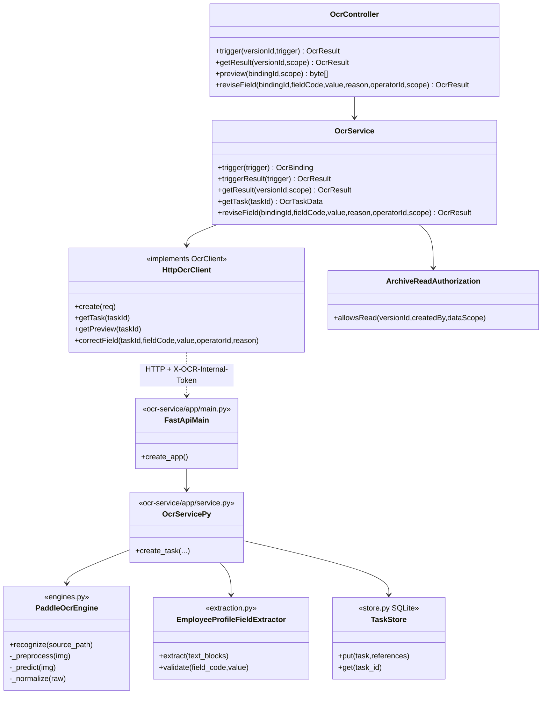

- **Spring Boot 侧**：`OcrController` 挂在 `/api/archive` 前缀下；`OcrService.triggerResult` 在事务内同步调 `HttpOcrClient.create`（connect 3s / read 30s），返回后落 MySQL `ocr_binding` 摘要。
- **FastAPI 侧**：`main.py::create_app()` 注册 `/api/ocr/*` 路由（中间件 `protect_internal_api` 校验 `X-OCR-Internal-Token`），`service.py::OcrService.create_task` 编排 MinIO 下载 → PaddleOCR 推理 → 字段抽取 → 检测框渲染 → SQLite 落库。

### 5.2.6 盘点模块（inventory）

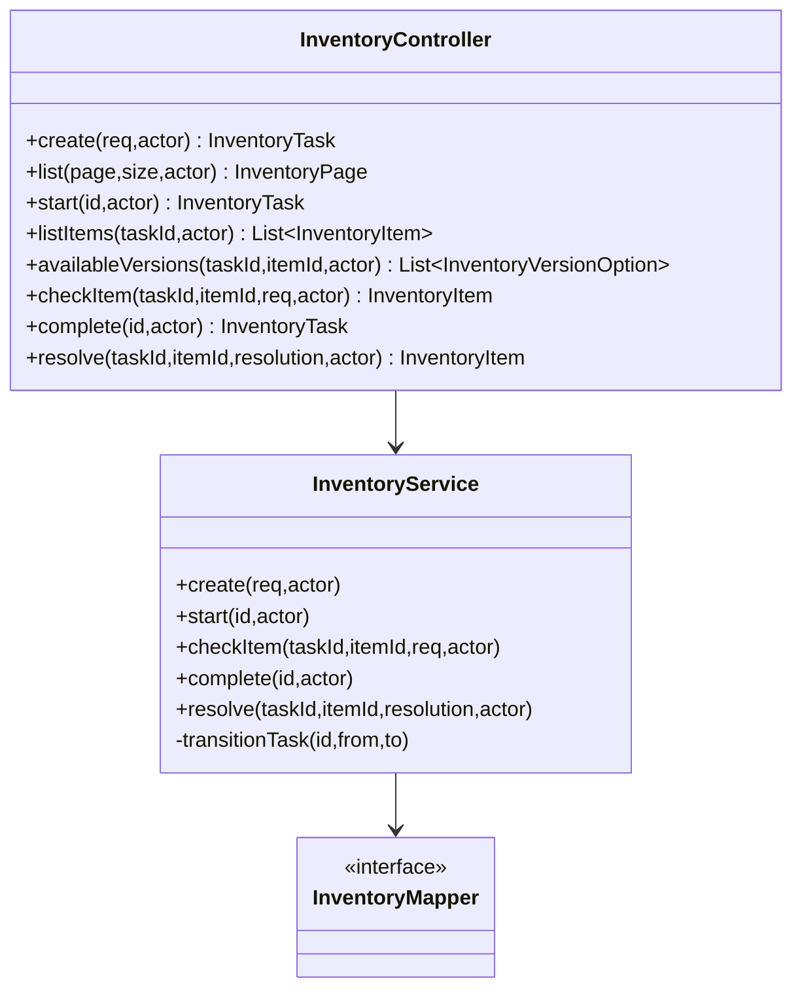

- **双状态机**：任务级 `inventory_task.status`（DRAFT/IN_PROGRESS/COMPLETED）与盘点项级 `inventory_item.resolution_status`（PENDING/NOT_REQUIRED/OPEN/RESOLVED）分离。
- **完成校验**：`complete` 时要求所有 item 已 check（`resolution_status != PENDING`）且无 OPEN 项，否则抛 `InventoryStateException`。

---

## 5.3 关键接口清单

> 按模块列表；请求体关键字段与状态机校验取自 `_facts/01` 第 2 节与 `current-api-reference.md`。响应统一为 `ApiResponse<T>{code,message,data,traceId}`，二进制接口除外。

### 5.3.1 认证与账号

| 方法 | 路径 | 请求体关键字段 | 响应 | 权限 | 状态机校验 |
|---|---|---|---|---|---|
| POST | `/api/auth/login` | `username`,`password` | `AuthResponse{accessToken,user}` | 公开 | — |
| POST | `/api/auth/register` | `employeeCode`,`password` | `AuthResponse` | 公开 | 员工编号须匹配唯一在职档案 |
| GET | `/api/auth/me` | — | `JwtPrincipal` | 已登录 | — |
| POST | `/api/admin/users` | `username`,`password`,`roleCodes` | `AdminUserView` | SYSTEM_ADMIN | — |
| PUT | `/api/admin/users/{id}` | `roleCodes`,`enabled` | `AdminUserView` | SYSTEM_ADMIN | — |

### 5.3.2 人事申请（hr-requests）

| 方法 | 路径 | 请求体关键字段 | 响应 | 权限 | 状态机校验 |
|---|---|---|---|---|---|
| POST | `/api/hr-requests` | `requestType`(ONBOARDING/TRANSFER/LEAVE/OFFBOARDING)、`employeeId`、`effectiveDate`、各类型专属 detail | `HrRequest`（DRAFT） | 申请人本人 | 按类型校验员工前置状态（见 5.4.2） |
| POST | `/api/hr-requests/{id}/submit` | — | `HrRequest`（PENDING_DEPT_APPROVAL） | 申请人本人 | DRAFT → PENDING_DEPT_APPROVAL |
| POST | `/api/hr-requests/{id}/cancel` | — | `HrRequest`（CANCELLED） | 申请人本人 | 仅 DRAFT 可取消 |
| POST | `/api/hr-requests/{id}/approve` | `comment`（可选） | `HrRequest`（PENDING_HR_APPROVAL 或 APPROVED） | 当前节点对应角色（DEPARTMENT→DEPT_MANAGER，HR→HR_ADMIN） | PENDING_DEPT_APPROVAL→PENDING_HR_APPROVAL；PENDING_HR_APPROVAL→APPROVED |
| POST | `/api/hr-requests/{id}/reject` | `comment`（必填，≤512） | `HrRequest`（REJECTED） | 当前节点对应角色 | PENDING_* → REJECTED |
| PUT | `/api/hr-requests/{id}/handover` | — | `HrRequest` | HR_ADMIN | 仅 OFFBOARDING 且 APPROVED；写 `offboarding_detail.handover_status` |
| GET | `/api/hr-requests` | query：`type,status,employeeId,page,pageSize` | `RequestPage` | 按角色+数据范围 | — |
| GET | `/api/hr-requests/{id}` | — | `RequestDetail`（含审批记录、display 上下文） | 按角色+数据范围 | — |

### 5.3.3 档案访问申请（archive-access）

| 方法 | 路径 | 请求体关键字段 | 响应 | 权限 | 状态机校验 |
|---|---|---|---|---|---|
| POST | `/api/archive-access` | `applicantId`,`reason`,`startAt`,`dueAt`,`items[{employeeId,documentId,versionId}]` | `ArchiveAccessApplication`（DRAFT） | 申请人 | — |
| POST | `/api/archive-access/{id}/submit` | — | → PENDING_APPROVAL | 申请人 | DRAFT → PENDING_APPROVAL |
| POST | `/api/archive-access/{id}/approve` | — | → APPROVED | HR_ADMIN | PENDING_APPROVAL → APPROVED |
| POST | `/api/archive-access/{id}/reject` | `reason`（必填） | → REJECTED（写 decision） | HR_ADMIN | PENDING_APPROVAL → REJECTED |
| POST | `/api/archive-access/{id}/use` | — | → IN_USE | 申请人 | APPROVED → IN_USE |
| POST | `/api/archive-access/{id}/return` | `abnormal`,`remark`,`handoverToEmployeeId` | → RETURNED 或 ABNORMAL | 申请人 | IN_USE → RETURNED/ABNORMAL |
| POST | `/api/archive-access/{id}/resolve` | `remark` | → RETURNED（写 resolution） | HR_ADMIN | ABNORMAL → RETURNED |
| GET | `/api/archive-access/{id}` | — | `ArchiveAccessDetail`（items/uses/resolutions/decisions） | 按角色+数据范围 | — |

### 5.3.4 OCR 触发/查询/修订

| 方法 | 路径 | 请求体关键字段 | 响应 | 权限 | 状态机校验 |
|---|---|---|---|---|---|
| POST | `/api/archive/versions/{versionId}/ocr` | `documentType`（当前仅 `employee_profile`） | `OcrResult`（同步等待） | HR_ADMIN | 先过 `ArchiveReadAuthorization.allowsRead` |
| GET | `/api/archive/versions/{versionId}/ocr-result` | — | `OcrResult{status,textBlocks,fields,revisions}` | 按角色+数据范围+内容授权 | — |
| GET | `/api/archive/ocr-bindings/{bindingId}/preview` | — | `image/png` 检测框流 | 同上 | — |
| PUT | `/api/archive/ocr-bindings/{bindingId}/fields/{fieldCode}` | `value`,`reason` | `OcrResult` | HR_ADMIN | 重跑 `validate`；`review_required = not validation_passed` |

> FastAPI 内部接口（仅 `X-OCR-Internal-Token` 可见）：`POST/GET /api/ocr/tasks`、`GET /api/ocr/tasks/{id}`、`GET /api/ocr/tasks/{id}/detection-preview`、`PUT /api/ocr/tasks/{id}/fields/{field_code}`、`GET /api/ocr/statistics`、`POST /api/ocr/evaluations`。

### 5.3.5 盘点（inventory-tasks）

| 方法 | 路径 | 请求体关键字段 | 响应 | 权限 | 状态机校验 |
|---|---|---|---|---|---|
| POST | `/api/inventory-tasks` | `name`,`versionIds[]` | `InventoryTask`（DRAFT） | DEPT_MANAGER/HR_ADMIN | — |
| POST | `/api/inventory-tasks/{id}/start` | — | → IN_PROGRESS | DEPT_MANAGER/HR_ADMIN | DRAFT → IN_PROGRESS |
| GET | `/api/inventory-tasks/{id}/items` | — | `List<InventoryItem>` | 同上 | — |
| GET | `/api/inventory-tasks/{id}/items/{itemId}/versions` | — | `List<InventoryVersionOption>` | 同上 | — |
| POST | `/api/inventory-tasks/{id}/items/{itemId}/check` | `actualVersionId` | `InventoryItem`（NOT_REQUIRED 或 OPEN） | 同上 | item 须 PENDING；差异写 `exception_record` |
| POST | `/api/inventory-tasks/{id}/items/{itemId}/resolve` | `resolution` | → RESOLVED | DEPT_MANAGER/HR_ADMIN | task 须 IN_PROGRESS/ABNORMAL；item 须 OPEN |
| POST | `/api/inventory-tasks/{id}/complete` | — | → COMPLETED | DEPT_MANAGER/HR_ADMIN | 无 PENDING、无 OPEN 项 |

---

## 5.4 状态机详细转移表

> 状态值取自代码枚举与 Pydantic Literal（`_facts/03`）。每张图配 Mermaid `stateDiagram-v2`。

### 5.4.1 员工状态 `employee.status`

枚举 `com.hrplatform.employee.EmployeeStatus`：`PENDING_ONBOARDING / ACTIVE / ON_LEAVE / INACTIVE`。

| 当前状态 | 事件 | 目标状态 | 触发方法 | 副作用 |
|---|---|---|---|---|
| PENDING_ONBOARDING | 入职生效 | ACTIVE | `EmployeeChangeService.applyApprovedChange` | 写 `hire_date`，关联部门/岗位 |
| ACTIVE | 调动生效 | ACTIVE（不变） | 同上 | 更新 `department_id/position_id`，同步 `sys_user.department_id` |
| ACTIVE | 离职生效 | INACTIVE | 同上 | 写 `leave_date`，部门/岗位置 NULL |
| ACTIVE | 请假生效（**【现状未实现】**） | ON_LEAVE | —（默认分支，无写入） | — |
| ON_LEAVE | 销假（**【目标新增】**） | ACTIVE | — | — |

> **【现状标注】** `ON_LEAVE` 无任何写入路径——请假审批通过后只写 `employee_change_applied_at`，状态留在 `ACTIVE`。`_facts/03` 第 1 节事实依据。

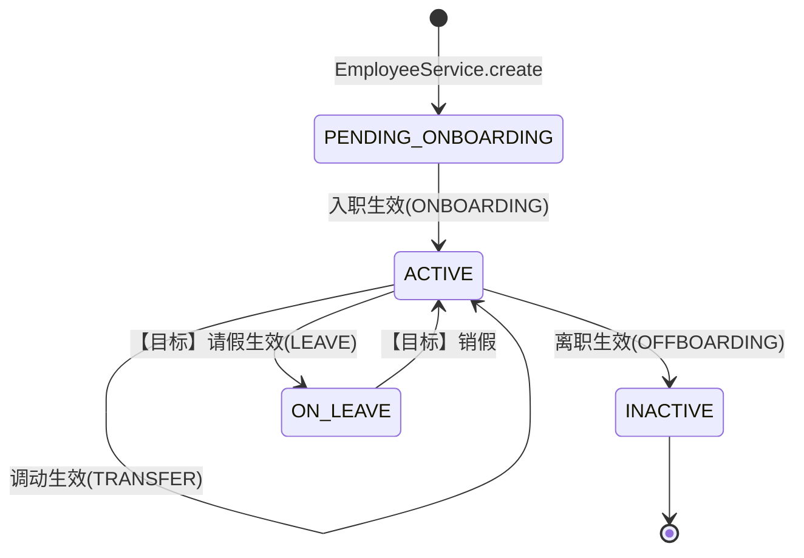

### 5.4.2 人事申请状态 `hr_request.status`

状态机类 `com.hrplatform.workflow.RequestStateMachine`。

| 当前状态 | 事件 | 目标状态 | 触发方法 | 角色校验 |
|---|---|---|---|---|
| DRAFT | submit | PENDING_DEPT_APPROVAL | `RequestService.submit` | 申请人本人 |
| DRAFT | cancel | CANCELLED | `RequestService.cancel` | 申请人本人 |
| PENDING_DEPT_APPROVAL | approve(node=DEPARTMENT) | PENDING_HR_APPROVAL | `RequestService.approve` | DEPT_MANAGER |
| PENDING_DEPT_APPROVAL | reject | REJECTED | `RequestService.reject` | DEPT_MANAGER 或 HR_ADMIN |
| PENDING_HR_APPROVAL | approve(node=HR) | APPROVED | `RequestService.approve` | HR_ADMIN |
| PENDING_HR_APPROVAL | reject | REJECTED | `RequestService.reject` | HR_ADMIN |
| APPROVED(OFFBOARDING) | handover | APPROVED（状态不变） | `RequestService.completeHandover` | HR_ADMIN；写 `handover_status` |
| APPROVED | 生效日到达 | （状态不变，由 scheduler 触发员工异动） | `EmployeeChangeScheduler` → `applyDueEmployeeChange` | 系统 |

> 节点字段 `current_node`：DEPARTMENT 节点审批前为 `DEPARTMENT`，HR 节点审批前为 `HR`，APPROVED 时置 NULL；每个节点写一条 `approval_record`（`uk_approval_request_node(request_id,node_code)` 防重）。

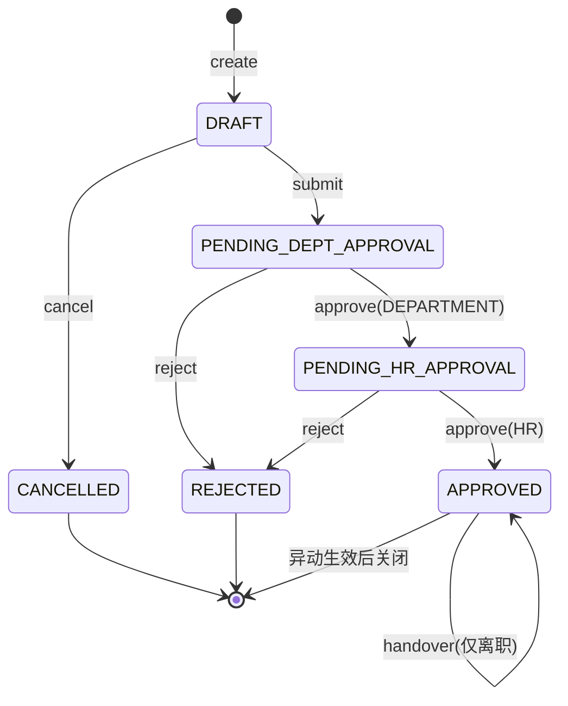

### 5.4.3 档案访问申请状态 `archive_access_application.status`

状态机类 `com.hrplatform.access.ArchiveAccessStateMachine`。

| 当前状态 | 事件 | 目标状态 | 触发方法 | 角色 |
|---|---|---|---|---|
| DRAFT | submit | PENDING_APPROVAL | `ArchiveAccessService.submit` | 申请人 |
| PENDING_APPROVAL | approve | APPROVED | `approve` | HR_ADMIN |
| PENDING_APPROVAL | reject(reason) | REJECTED | `reject` | HR_ADMIN（写 decision） |
| APPROVED | use | IN_USE | `use` | 申请人 |
| IN_USE | return(abnormal=false) | RETURNED | `returnAccess` | 申请人（写 `returned_at`） |
| IN_USE | return(abnormal=true) | ABNORMAL | `returnAccess` | 申请人（记录 `handover_to_employee_id`） |
| IN_USE 且 `due_at<now` | 定时任务 | ABNORMAL | `expireOverdueInUseApplications` | 系统（60s） |
| APPROVED 且 `start_at` 到点未 use | 定时任务 | ABNORMAL | `expireUnusedApprovedApplications` | 系统（60s） |
| ABNORMAL | resolveAbnormal(note) | RETURNED | `resolveAbnormal` | HR_ADMIN（写 resolution） |

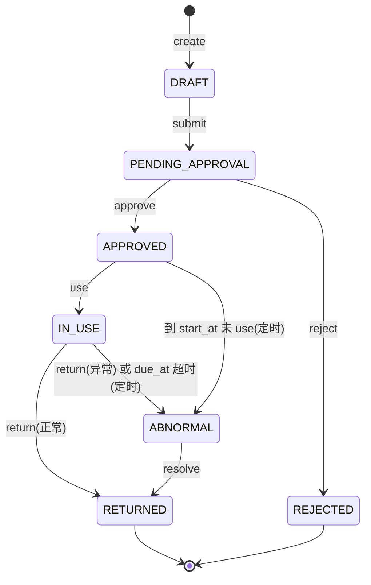

### 5.4.4 OCR 任务状态

OCR 服务侧 Pydantic Literal（`ocr-service/app/models.py::OcrTask.status`）：`PENDING / PREPROCESSING / RECOGNIZING / SUCCEEDED / FAILED`；MySQL `ocr_binding.status` 直接透传该字符串。

| 状态 | 是否实际写入 | 含义 | 写入位置 |
|---|---|---|---|
| PENDING | 预留（未写） | 排队 | Literal 声明，`create_task` 直接置 RECOGNIZING |
| PREPROCESSING | 预留（未写） | 版面预处理 | 预处理在 `_preprocess` 内同步完成，不落状态 |
| RECOGNIZING | 是 | 识别中 | `OcrService.create_task` 入口 |
| SUCCEEDED | 是 | 识别成功 | `engine.recognize()` 正常返回后 |
| FAILED | 是 | 识别失败 | except 分支，写 `error_message` |

> 派生（不写库）：`OcrResult.status=UNAVAILABLE`，当 Spring Boot 侧捕获 `OcrClientException` 时派生，`errorCode=OCR_RESULT_UNAVAILABLE`。
> 字段级：`validationStatus ∈ {PASSED,FAILED}`；`reviewRequired = (block.confidence < 0.85) OR (not validation_passed)`。

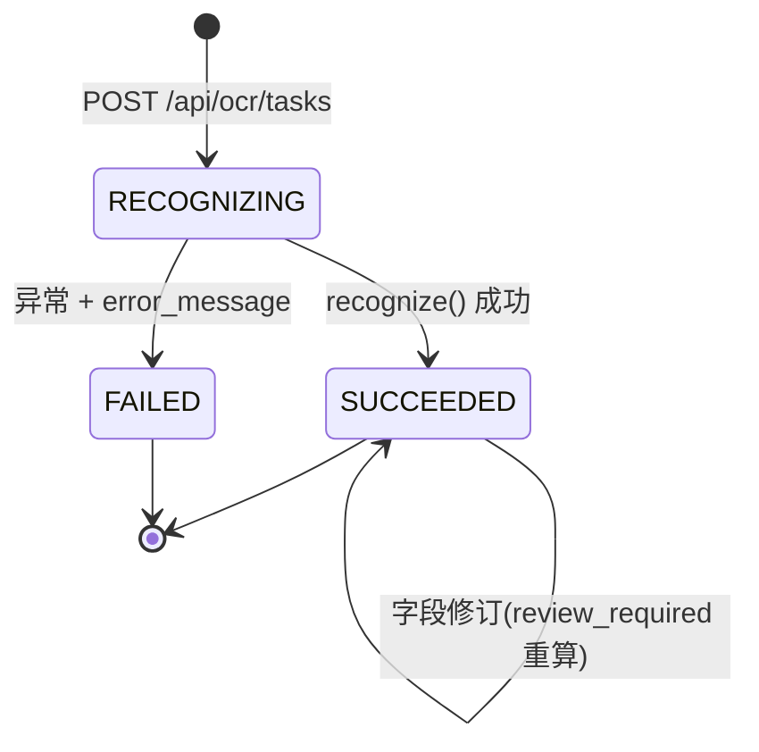

### 5.4.5 盘点任务状态 `inventory_task.status`

| 当前状态 | 事件 | 目标状态 | 触发方法 | 校验 |
|---|---|---|---|---|
| DRAFT | start | IN_PROGRESS | `InventoryService.start` | 必须 DRAFT |
| IN_PROGRESS | check(item) | IN_PROGRESS（任务不变） | `checkItem` | item 须 PENDING 且 `actualStatus` 为 null |
| IN_PROGRESS | complete | COMPLETED | `complete` | 所有 item 已 check 且无 OPEN 项 |
| IN_PROGRESS/ABNORMAL | resolve(item) | 任务不变 | `resolve` | item 须 OPEN；写 `exception_record.status=RESOLVED` |

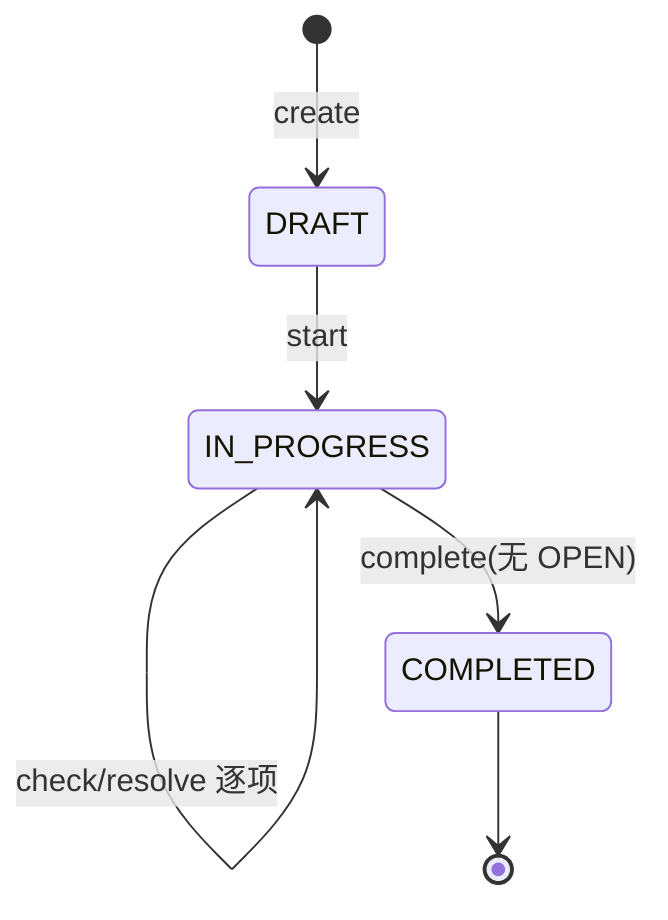

### 5.4.6 盘点项状态 `inventory_item.resolution_status`

| 当前状态 | 事件 | 目标状态 | 条件 |
|---|---|---|---|
| PENDING | check(实际版本==期望版本) | NOT_REQUIRED | `difference_type=NONE` |
| PENDING | check(实际版本!=期望版本) | OPEN | `difference_type=VERSION_MISMATCH`，写 `exception_record` |
| OPEN | resolve(resolution) | RESOLVED | HR/负责人闭环 |

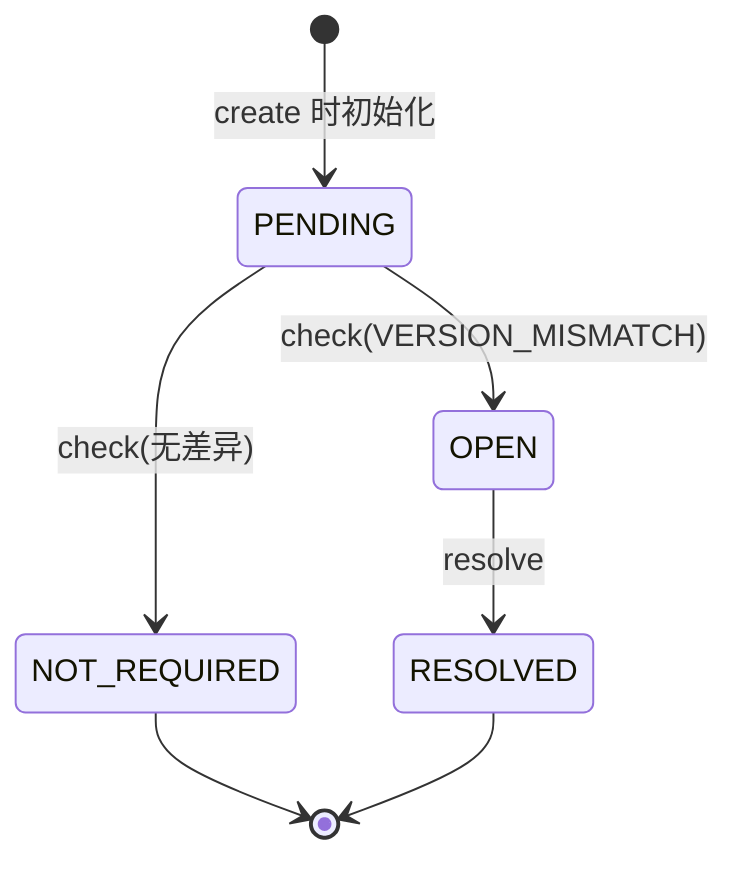

### 5.4.7 合同状态 `employee_contract`

数据库字段 `renewal_status`（V7 CHECK）：`NOT_DUE / RENEWED / NOT_RENEWING`；前端派生 `status ∈ {ACTIVE,EXPIRED}`（由 `ends_on` 与当日比较，DB 无此字段）；`DUE` 为 Dashboard 按到期临近派生展示。

| 当前状态 | 事件 | 目标状态 | 触发方法 |
|---|---|---|---|
| NOT_DUE | markNotRenewing | NOT_RENEWING | `ContractService.markNotRenewing` |
| NOT_DUE | 新合同 `renewed_from_contract_id` | RENEWED（派生） | 新建续签合同 |
| （按 `ends_on`） | 当日 > ends_on | EXPIRED（前端派生） | 查询时计算，无定时扫描 |

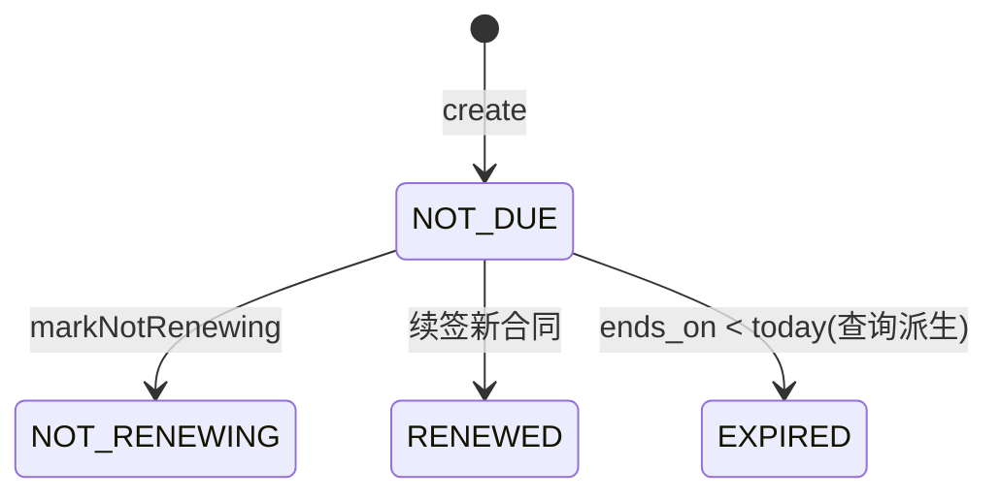

---

## 5.5 OCR 处理流水线详细设计

### 5.5.1 流水线阶段图

取自 `_facts/05` 第 3 节 `service.py::OcrService.create_task` 调用链。

```mermaid
flowchart TD
    UP[上传档案版本<br/>Spring Boot → MinIO archive/ 前缀] --> TRIG[Spring Boot POST /versions/{id}/ocr<br/>OcrService.triggerResult]
    TRIG --> AUTH[ArchiveReadAuthorization.allowsRead<br/>无授权抛 OcrBindingNotFoundException]
    AUTH --> CALL[HttpOcrClient.create<br/>X-OCR-Internal-Token]
    CALL --> REQ[FastAPI POST /api/ocr/tasks<br/>sourceObjectKey 引用 MinIO]
    REQ --> REG[SourceFileStore.register_reference<br/>object_key=ocr/source/&lt;sha256&gt;]
    REG --> W1[(SQLite TaskStore.put<br/>status=RECOGNIZING)]
    W1 --> DL[storage.download_to_path<br/>+ SHA256 一致性校验]
    DL --> PRE[版面预处理 _preprocess<br/>EXIF 转置→灰度→自动对比度→LANCZOS 缩边≤4096]
    PRE --> DET[PaddleOCR 文字检测<br/>ocr.predict / 回退 ocr.ocr(cls=True)<br/>lang=ch, det_limit_side_len=4096]
    DET --> REC[文字识别 _normalize<br/>统一旧版dict/新版Result/JSON<br/>→ List~TextBlock(pageNo,text,confidence,bbox)]
    REC --> MAP[字段映射 EmployeeProfileFieldExtractor.extract<br/>正则 ^label[:：]value$ 匹配 4 个 fieldCode]
    MAP --> VAL[格式校验 validate<br/>+ 置信度阈值 0.85 判定 review_required]
    VAL --> PV[检测框渲染 visualization<br/>画框/序号/置信度/文本 → PNG → MinIO ocr/preview/]
    PV --> W2[(SQLite TaskStore.put<br/>status=SUCCEEDED 或 FAILED + error_message)]
    W2 --> SYNC[Spring Boot 同步等待 readTimeout=30s<br/>落 MySQL ocr_binding 摘要]
    SYNC --> HUMAN{review_required?}
    HUMAN -- 是 --> REV[人工修订 PUT fields/{fieldCode}<br/>重跑 validate 写 field_revisions]
    HUMAN -- 否 --> OK[可采纳结果]
    REV --> OK
    W2 -.异常.-> FAIL[status=FAILED, error_message]
```

### 5.5.2 字段映射表

取自 `extraction.py::EmployeeProfileFieldExtractor`。标签提取正则：`^\s*(?P<label>[^:：]+?)\s*[:：]\s*(?P<value>.+?)\s*$`。

| fieldCode | 中文标签 | 来源文本块 | 校验正则 | 失败提示 | 置信度阈值 |
|---|---|---|---|---|---|
| `employee_name` | 员工姓名 / 姓名 | 匹配标签后的 value 文本块（同 fieldCode 取第一个） | `^[\u4e00-\u9fffA-Za-z· ]+$` | 员工姓名格式错误 | ≥ 0.85 |
| `employee_id` | 员工编号 / 工号 | 同上 | `^[A-Za-z0-9][A-Za-z0-9_-]{1,31}$` | 员工编号格式错误 | ≥ 0.85 |
| `id_number` | 身份证号 / 身份证号码 | 同上 | `^\d{17}[\dXx]$` | 身份证号格式错误 | ≥ 0.85 |
| `phone` | 联系电话 / 手机号码 / 手机号 | 同上 | `^1[3-9]\d{9}$` | 联系电话格式错误 | ≥ 0.85 |

复核触发：`review_required = (block.confidence < low_confidence_threshold) OR (not validation_passed)`，阈值由环境变量 `OCR_LOW_CONFIDENCE_THRESHOLD=0.85` 控制。修订后 `field.review_required = not validation_passed`——人工确认也不允许以无效格式关闭复核。

### 5.5.3 数据存储分工

| 数据 | 存储位置 | 说明 |
|---|---|---|
| 原图（档案版本二进制） | MinIO（`archive/` 前缀） | Spring Boot 上传；OCR 服务通过 `sourceObjectKey` 引用，不重复传文件 |
| OCR 源副本 | MinIO（`ocr/source/<sha256><suffix>`） | OCR 服务 `SourceFileStore.save/register_reference` |
| 检测框效果图 PNG | MinIO（`ocr/preview/<task_id>.png`） | `visualization.render_detection_preview` 输出 |
| 任务元数据 + 完整 text_blocks/fields | SQLite（`ocr-service/data/ocr_tasks.sqlite3`） | 表 `ocr_tasks(task_id PK, payload JSON, ...)`；payload 为 `OcrTask` 全量 JSON dump |
| 字段修订历史 | SQLite（`field_revisions`） | `revision_id PK, task_id, field_code, payload, created_at` |
| OCR 绑定摘要 | MySQL（`ocr_binding`） | status/engineVersion/processingDurationMs/reviewRequired/errorCode/previewUrl；完整证据仍在 SQLite，前端详情由 Spring Boot 透传 `getTask` |
| 修订留痕（MySQL 侧） | `ocr_field_revision` | 时间序列，无状态字段 |

### 5.5.4 【现状问题】

`_facts/05` 第 3、8 节明确指出：

1. **`create_ocr_task` 是 `async def` 但函数体内无任何 `await`**——路由直接同步调 `app.state.ocr_service.create_task(...)`，整个 PaddleOCR 推理 + MinIO 下载/上传 + Pillow 渲染都在 HTTP 请求线程内完成。
2. **PaddleOCR 推理同步阻塞 FastAPI 事件循环**——单并发推理会卡住所有后续请求。
3. **无超时/重试/并发上限**：Spring Boot 侧 `HttpOcrClient` readTimeout=30s 超时即抛 `OcrClientException`，但 OCR 服务仍在后台继续跑；服务端自身无任务超时、无失败重试、无并发数控制。
4. **无「确认回填正式档案」接口**：修订值只留在 `field_revisions` 与 `ocr_field_revision`，不会写回 `employee` / `employee_archive`，OCR 结果不能成为档案数据来源。

### 5.5.5 【目标设计】

```mermaid
flowchart LR
    REQ[POST /api/ocr/tasks] --> ENQ[任务入队<br/>立即返回 task_id + PENDING]
    ENQ --> POOL[后台工作进程池<br/>并发上限 = OCR_MAX_CONCURRENCY]
    POOL --> RUN[执行推理<br/>单任务超时 OCR_TASK_TIMEOUT]
    RUN -->|成功| OK[status=SUCCEEDED]
    RUN -->|失败可重试| RET[指数退避重试 ≤ N 次]
    RET -->|仍失败| FAIL[status=FAILED + error_message]
    POOL -->|幂等| DEDUP[(按 sourceObjectKey+sha256 去重<br/>重复 task 直接返回已有结果)]
    SYNC[Spring Boot 轮询/回调] --> CONFIRM[POST /archive/ocr-bindings/{id}/confirm<br/>校验 review_required=false 且 validation=PASSED]
    CONFIRM --> BACK[OcrService.confirmAndBackfill<br/>回填 employee_name/phone/id_number<br/>写 ocr_binding.backfilled_at + 审计]
```

- **后台任务队列/进程池**：路由改为入队即返回，推理放到独立 worker（`asyncio.to_thread` 或多进程池），不阻塞事件循环；`PENDING/PREPROCESSING` 两个预留状态真正落地为「排队/预处理中」。
- **超时与并发上限**：新增 `OCR_TASK_TIMEOUT`（如 120s）、`OCR_MAX_CONCURRENCY`（如 2）；超时任务标 FAILED 并释放 worker。
- **失败状态与重试**：FAILED 可配置指数退避重试（≤2 次），`error_message` 落库。
- **幂等**：按 `sourceObjectKey + sha256` 去重，同一档案版本重复触发直接返回已有 task，不重复推理。
- **受控回填接口**：新增 `POST /api/archive/ocr-bindings/{bindingId}/confirm` 与 `OcrService.confirmAndBackfill(bindingId, acceptedFields, operatorId)`——仅当 `review_required=false` 且全部 `validationStatus=PASSED` 时允许回填 `employee` 主档，并记录 `backfilled_at` 与修订前后对照。

---

## 5.6 权限模型

### 5.6.1 JWT 认证

- 登录：`AuthService.login` 校验 BCrypt 密码后由 `JwtService.issue` 签发；claims = `{sub:userId, employeeId, departmentId, roles[]}`，过期 `PT8H`（`platform.jwt.expiration`）。
- 校验：`JwtAuthenticationFilter` 解析 `Authorization: Bearer <token>`；`liveValidation=true` 时回查 `sys_user.enabled` 并重载角色，构造 `JwtPrincipal(userId, employeeId, departmentId, roles)` 放入 `SecurityContextHolder`。
- 放行清单：`POST /api/auth/login`、`POST /api/auth/register`、`GET /actuator/health`；其余 `.authenticated()`，无状态 Session。

### 5.6.2 RBAC 角色绑定

- 角色集（`sys_role` V1 seed）：`EMPLOYEE`（员工/业务经办）、`DEPT_MANAGER`（部门负责人）、`HR_ADMIN`（人事管理员）、`SYSTEM_ADMIN`（系统管理员）。
- 绑定表：`sys_user_role` 维护用户↔角色多对多。
- 拦截方式：`@EnableMethodSecurity` 开启，Controller 方法硬编码 `@PreAuthorize("hasRole('...')")` / `hasAnyRole(...)`；`AdminUserController` 类级限定 `SYSTEM_ADMIN`。

> **【现状标注】** `sys_permission` 与 `sys_role_permission` 表在 V1 已建好但**代码完全不读**——grep 未发现 `PermissionEvaluator` bean 或这两张表的 Mapper SQL。权限判断只到「角色」维度，无按钮级/数据项级细粒度权限。**【目标】** 如需细粒度授权再启用这两张表并实现 `PermissionEvaluator`。

### 5.6.3 数据范围（DataScope）

`com.hrplatform.common.security.DataScope`（record：`type, userId, employeeId, departmentId`，`Type ∈ {NONE, EMPLOYEE, DEPARTMENT, ALL}`）：

| 角色 | 数据范围 | 可见数据 |
|---|---|---|
| HR_ADMIN | ALL | 全企业员工/档案/流程 |
| DEPT_MANAGER（有 departmentId） | DEPARTMENT | 本部门员工及其档案 |
| EMPLOYEE（有 employeeId） | EMPLOYEE | 仅本人 |
| 其他 | NONE | 不可见 |

Service 层统一以 `DataScope.canAccess(targetEmployeeId, targetDepartmentId)` 做二次过滤；`StatisticsService` 中 `SYSTEM_ADMIN` 强制 ALL，但 **SYSTEM_ADMIN 不因此获得档案明细/流程明细权限**（只读聚合与审计日志）。

### 5.6.4 档案内容级授权

- 光有角色 + 数据范围还不能下载/OCR 档案版本，必须再有一条**有效的档案访问授权**：`ArchiveReadAuthorizationPolicy.allowsRead(versionId, createdBy, dataScope)`。
- 授权来源：`archive_access_application` 处于 `APPROVED` 且 `IN_USE` 区间（`start_at ≤ now ≤ due_at`），或 HR/系统预置的正式读权限。
- 无授权时：下载抛 `ArchiveReadDeniedException`（403 `FORBIDDEN`）；OCR 触发抛 `OcrBindingNotFoundException("档案版本不存在或无有效访问授权")`（404）。
- 超时未还/未用由 `ArchiveAccessExpiryScheduler` 自动转 `ABNORMAL`，授权随之失效。

---

## 5.7 异常处理与日志

### 5.7.1 全局异常处理器

`com.hrplatform.common.web.GlobalExceptionHandler`（`@RestControllerAdvice`）统一把异常映射为 HTTP 状态码 + 业务错误码，封装进 `ApiResponse<T>{code,message,data,traceId}`。

| 异常类 | HTTP | 错误码 |
|---|---|---|
| `MethodArgumentNotValidException` / `HttpMessageNotReadableException` / `IllegalArgumentException` / `InvalidArchiveFileException` | 400 | `VALIDATION_ERROR` |
| `InvalidCredentialsException` | 401 | `UNAUTHORIZED` |
| `AccessDeniedException` / `DataScopeDeniedException` / `ArchiveReadDeniedException` | 403 | `FORBIDDEN` |
| `OcrBindingNotFoundException` / `OcrFieldNotFoundException` / `OcrPreviewMissingException` | 404 | `NOT_FOUND` |
| `RequestStateException` / `ArchiveAccessStateException` / `InventoryStateException` / `OrganizationStateException` / `AccountAdminStateException` | 409 | `STATE_CONFLICT` |
| 其他 `Exception` | 500 | `INTERNAL_ERROR` |

### 5.7.2 统一错误码表

| 错误码 | HTTP | 含义 | 典型触发 |
|---|---|---|---|
| `VALIDATION_ERROR` | 400 | 参数校验失败 / 请求体不可读 | `@Valid` 不通过、非法参数 |
| `UNAUTHORIZED` | 401 | 凭证无效或缺失 | 登录密码错误、token 失效 |
| `FORBIDDEN` | 403 | 已认证但无权限 | 角色不符、数据范围越界、档案无读授权 |
| `NOT_FOUND` | 404 | 资源不存在 | OCR binding/字段/预览不存在 |
| `STATE_CONFLICT` | 409 | 当前状态不允许该操作 | 状态机非法转移 |
| `INTERNAL_ERROR` | 500 | 服务端未知错误 | 兜底 |

### 5.7.3 X-Trace-Id 贯穿

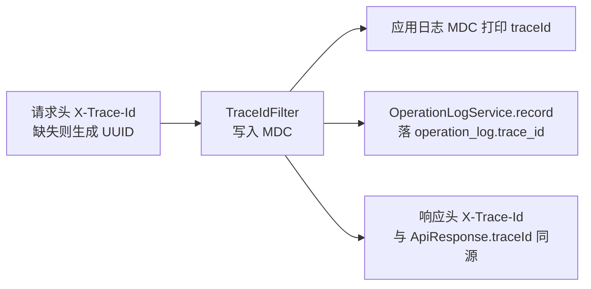

- `TraceIdFilter`（`OncePerRequestFilter`）：接受 1–128 位字母/数字/点/下划线/连字符；缺失或不安全的 traceId 替换为 UUID。
- 失败响应由 `GlobalExceptionHandler` 同时落一条 `REQUEST_FAILED / API_REQUEST` 审计日志，把异常与 traceId 绑定。

### 5.7.4 操作日志：现状 vs 目标

- **【现状】** `OperationLogService.record(operatorId, action, objectType, objectId, result[, beforeSummary, afterSummary])` 由 13 个 Service 类**手动显式调用**；`grep @Aspect/@Around` 在 `main/java` 下零命中，**无 AOP 切面**——存在漏记风险与调用散落。
- **【目标】** 引入 `@OperationLog(action="...", objectType="...")` 注解 + `@Aspect` 切面环绕写方法：自动捕获操作人（`JwtPrincipal`）、动作、对象 ID、入参/出参摘要、成功/失败、耗时与 traceId；业务代码不再显式依赖 `OperationLogService`，消除 13 处散落调用。

### 5.7.5 敏感数据脱敏

日志与审计落库时**禁止写入敏感原文**：员工姓名、手机号、身份证号、档案原图文本块、MinIO object_key 等只记对象 ID 与操作结果，不记明细；`beforeSummary/afterSummary` 仅记录字段名与变更方向（如 `phone: 138****0000`），不记完整号码。

---

## 本章小结

第 5 章在第 4 章模块划分基础上下沉到类与接口粒度：5.1 确立 Controller→Service→Mapper 三层与 Security/ExceptionHandler/OperationLog 三条横切；5.2 给出认证、员工档案、人事流程、档案访问、OCR、盘点六个核心模块的类图与关键方法；5.3 以表格收口全部关键接口（含请求体关键字段、权限与状态机校验）；5.4 为员工状态、人事申请、档案访问、OCR 任务、盘点任务/盘点项、合同共七张状态机各列转移表与 Mermaid 图；5.5 完整刻画 OCR 从上传到人工修订的流水线、字段映射与三端存储分工，并诚实指出「async 路由无 await、同步阻塞事件循环、无超时重试」的现状问题与队列化/幂等/受控回填的目标设计；5.6 与 5.7 收口 JWT+RBAC+DataScope+内容级授权的四层权限模型，以及全局异常码、TraceId 贯穿与操作日志由手动调用升级为注解切面的演进方向。
