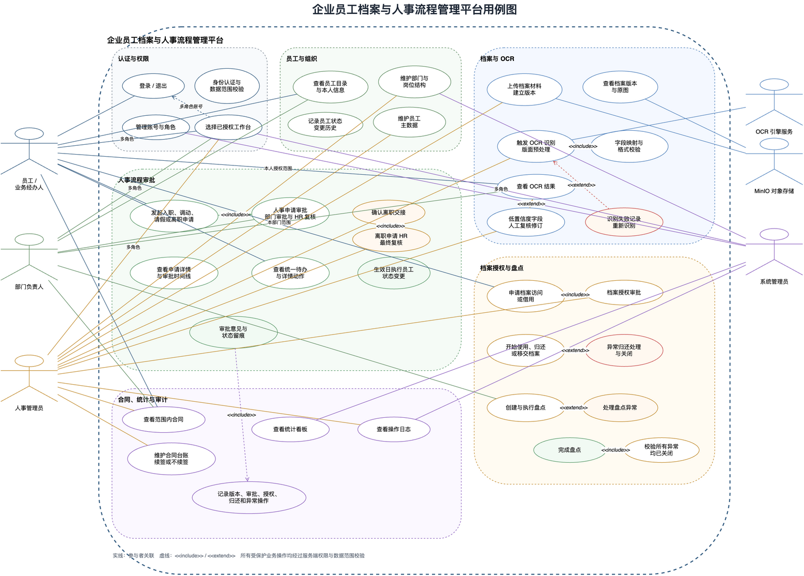

# 企业员工档案与人事流程管理平台用例分析

## 1. 分析目的

本用例分析把课题描述、已实现的业务流程和前后端接口统一到一个可审阅的系统边界中，明确谁可以执行什么操作、操作产生什么结果，以及异常如何回到可追溯的业务状态。系统服务于企业员工、业务经办人员、部门负责人、人事管理员和系统管理员，核心对象包括员工、组织岗位、员工档案、OCR 证据、人事申请、档案访问记录、合同、盘点任务和操作日志。

系统边界名称为 **企业员工档案与人事流程管理平台**。OCR 引擎服务和 MinIO 对象存储属于外部参与者：平台负责业务权限、状态、字段映射和留痕，OCR 引擎负责图像识别，MinIO 负责受控保存原图和预览文件。

## 2. 参与者

| 参与者 | 类型 | 数据范围 | 主要目标 |
| --- | --- | --- | --- |
| 员工/业务经办人员 | 人员角色 | 本人及已授权档案 | 查看本人信息和档案，发起人事申请，申请和使用档案，归还或移交档案 |
| 部门负责人 | 人员角色 | 所属部门 | 查看本部门员工和档案，审批本部门人事申请，参与盘点和异常处理 |
| 人事管理员 | 人员角色 | 企业授权范围内的全部员工和档案 | 维护员工和档案，复核 OCR，审批档案访问，复核人事流程，确认离职交接，维护合同和盘点 |
| 系统管理员 | 人员角色 | 账号、角色、组织配置和审计数据 | 管理账号角色、组织结构配置和系统级审计；不默认处理 HR 业务或查看员工档案 |
| OCR 引擎服务 | 外部系统 | 接收平台提交的受控文件引用 | 执行版面预处理和文字识别，返回字段、文本块、坐标、置信度和失败原因 |
| MinIO 对象存储 | 外部系统 | 平台私有对象 | 保存原图、OCR 检测框预览和其他受控文件，按平台授权提供读取 |

## 3. 系统边界与用例分组

### 3.1 认证与权限

- **登录**：使用账号和密码获取 JWT，系统返回角色、员工绑定和数据范围。
- **退出登录**：清理当前会话令牌，回到登录页。
- **权限与数据范围校验**：所有受保护接口根据角色、员工绑定、部门关系和资源状态校验访问范围。
- **管理账号与角色**：系统管理员创建、停用和更新账号角色及绑定员工。

### 3.2 员工与组织

- **查看员工目录**：按员工编号、姓名、部门和状态分页检索。
- **查看本人信息**：员工读取本人主数据，非授权字段保持脱敏。
- **维护员工主数据**：人事管理员创建员工并绑定部门、岗位和入职状态。
- **维护部门与岗位**：人事管理员或系统管理员维护组织树和岗位启用状态。
- **状态变更留痕**：入职、调动、离职等生效动作记录员工变更前后值、来源申请和操作时间；首期页面不单独提供状态历史检索。

### 3.3 档案与 OCR

- **建立员工档案**：为员工创建档案材料目录和当前版本。
- **上传档案材料**：上传 PNG/JPEG 等脱敏材料，保存原图元数据、文件指纹和版本记录。
- **查看档案版本**：按员工和材料目录查看不可覆盖的历史版本。
- **触发 OCR 识别**：对当前档案版本创建幂等识别任务。
- **查看 OCR 结果**：查看原图、检测框预览、文本块、字段映射、格式校验、置信度和任务状态。
- **复核低置信度字段**：对低置信度或格式校验失败的字段进行人工确认。
- **修订 OCR 字段**：填写修订值和原因，追加修订记录，不覆盖原始识别结果。
- **重试 OCR 失败任务**：保留失败任务和错误信息，生成新的识别任务。

OCR 状态为 `RECOGNIZING -> SUCCEEDED` 或 `RECOGNIZING -> FAILED`。成功结果仍可能因置信度或格式校验进入待复核；服务不可用、无绑定和无权限必须显示为明确错误状态，不能显示成空字段的识别成功。

### 3.4 人事流程审批

- **发起入职申请**：填写员工、生效日期、目标组织岗位和合同类型。
- **发起转岗调动申请**：填写目标部门、岗位、生效日期和原因。
- **发起请假申请**：填写假别、起止日期和原因。
- **发起离职申请**：填写离职日期、交接人和离职原因。
- **提交人事申请**：草稿校验通过后进入部门审批节点。
- **部门审批**：仅部门负责人审批所属部门申请；跨部门申请由目标部门负责人处理，系统管理员不参与业务审批。
- **HR 复核**：人事管理员审批部门通过的申请。
- **确认离职交接**：离职申请进入 HR 节点后，先确认交接完成再允许最终通过。
- **查看申请详情与审批时间线**：展示申请明细、员工当前信息、目标组织、审批意见和时间。
- **查看统一待办**：集中展示人事审批、档案授权、档案归还和 OCR 异常。

普通人事申请状态为 `DRAFT -> PENDING_DEPT_APPROVAL -> PENDING_HR_APPROVAL -> APPROVED`，任意审批节点可以进入 `REJECTED`。离职申请在 HR 节点必须先完成交接确认。未来生效的入职、调动和离职由生效任务执行员工主数据变更并写入状态历史。

### 3.5 档案授权、使用与盘点

- **申请档案访问/借用**：选择档案版本、使用方式、用途、有效时间和归还截止时间。
- **审批档案访问**：人事管理员核验用途、时间和数据范围后授权。
- **开始使用档案**：申请人在授权时间窗内开始查阅或借用，生成使用记录。
- **归还档案**：登记正常归还说明和归还时间。
- **移交档案**：选择同部门在职接收员工，登记移交结果。
- **登记异常归还**：记录逾期、缺件、损坏等异常，关闭当前使用记录并生成异常待办。
- **关闭归还异常**：人事管理员登记处理说明，关闭异常并将申请归档为已归还。
- **创建盘点任务**：按当前档案版本生成盘点项。
- **执行盘点核对**：逐项填写实际版本和核对状态。
- **处理盘点异常**：登记差异原因和处理结论。
- **完成盘点**：只有所有盘点异常关闭后才允许归档任务。

档案访问状态为 `DRAFT -> PENDING_APPROVAL -> APPROVED -> IN_USE -> RETURNED`。逾期、缺件或损坏进入 `ABNORMAL`，移交在使用记录中标记为 `HANDED_OVER`。申请人不能对已关闭的使用记录重复归还。

### 3.6 合同、统计与审计

- **维护合同台账**：关联员工和档案来源版本，记录合同期限、状态和续签关系。
- **登记续签或不续签**：续签创建新合同版本，不续签保留原因。
- **查看统计看板**：在当前数据范围内查看员工、档案完整率、人事流程、访问申请和 OCR 质量指标。
- **查看操作日志**：人事管理员和系统管理员按操作人、对象、动作、结果和日期检索审计记录。

## 4. 角色与用例关系矩阵

| 用例 | 员工/经办人 | 部门负责人 | 人事管理员 | 系统管理员 | 外部参与者 |
| --- | :---: | :---: | :---: | :---: | --- |
| 登录、退出、权限校验 | ✓ | ✓ | ✓ | ✓ | - |
| 查看员工目录/本人信息 | 本人 | 本部门 | 全部 | - | - |
| 维护员工主数据 | - | - | ✓ | - | - |
| 维护部门与岗位结构 | - | - | ✓ | ✓ | - |
| 上传档案材料 | - | - | ✓ | - | MinIO |
| 查看 OCR 结果 | 本人授权范围 | 本部门 | 全部 | - | OCR、MinIO |
| 触发或重试 OCR | - | - | ✓ | - | OCR |
| 复核和修订 OCR 字段 | - | - | ✓ | - | OCR |
| 发起入职/调动/请假/离职申请 | 本人或经办 | 本部门经办 | 可代办 | - | - |
| 部门审批 | - | 本部门 | - | - | - |
| HR 复核和离职交接 | - | - | ✓ | - | - |
| 申请档案访问 | ✓ | ✓ | ✓ | - | MinIO |
| 审批档案访问 | - | - | ✓ | - | - |
| 使用、归还或移交档案 | ✓ | ✓ | ✓ | - | MinIO |
| 创建、执行和完成盘点 | - | ✓ | ✓ | - | - |
| 查看范围内合同 | ✓ | ✓ | ✓ | - | - |
| 维护合同、续签或登记不续签 | - | - | ✓ | - | - |
| 查看统计 | 授权范围 | 部门范围 | 全部 | 聚合范围 | - |
| 查看审计日志 | - | - | ✓ | ✓ | - |
| 管理账号与角色 | - | - | - | ✓ | - |

系统管理员默认仅管理账号与角色、组织配置、聚合统计和审计。若需兼任 HR 或部门负责人，必须显式分配对应业务角色；此时业务范围按所获业务角色计算，系统管理员身份本身不提升数据范围。多角色用户登录后只会看到已分配角色对应的应用端入口。

## 5. 用例关系

以下关系用于用例图中的 `include` 和 `extend`：

| 基础用例 | 关系 | 被包含/扩展用例 | 说明 |
| --- | --- | --- | --- |
| 触发 OCR 识别 | `include` | 版面预处理、字段映射和格式校验 | 成功后生成可复核字段 |
| 查看 OCR 结果 | 被 `extend` | 低置信度字段人工复核 | 只有低置信度或校验失败字段进入复核 |
| OCR 识别 | `extend` | 失败记录和重新识别 | 失败任务保留原因并生成异常待办 |
| 提交人事申请 | `include` | 部门审批与 HR 复核 | 固定两级审批链 |
| 离职 HR 复核 | `include` | 离职交接确认 | 未确认交接不能最终通过 |
| 申请档案访问 | `include` | 档案授权审批 | 授权后才能开始使用 |
| 归还档案 | `extend` | 异常归还处理 | 逾期、缺件和损坏需要异常说明 |
| 创建与执行盘点 | 被 `extend` | 处理盘点异常 | 仅发现版本差异、缺失或损坏时发生 |
| 完成盘点 | `include` | 校验所有异常均已关闭 | 存在未解决异常时禁止完成 |
| 审批意见与状态留痕 | `include` | 记录版本及业务操作 | 日志保留操作人、时间、对象和结果 |

除图示关系外，身份认证、角色校验、数据范围校验、文件格式/大小/指纹校验和操作日志是服务端业务操作的通用约束。界面隐藏入口不能替代服务端授权。

## 6. 关键用例说明

### UC-01 登录

- **前置条件**：账号存在且处于启用状态。
- **主成功场景**：用户提交账号和密码；服务端校验密码和角色；返回 JWT、用户信息、角色和数据范围；前端进入工作台。
- **异常场景**：账号不存在、停用或密码错误时返回统一认证错误；前端保留在登录页并显示可理解的错误提示。
- **安全约束**：JWT 只包含必要身份信息；密码、令牌和完整个人敏感字段不写入日志。

### UC-02 OCR 识别与人工复核

- **前置条件**：HR 已上传员工档案材料并拥有当前版本访问权限。
- **主成功场景**：系统创建幂等 OCR 任务；OCR 服务返回文本块、字段、坐标和置信度；平台完成业务字段映射和格式校验；页面展示原图、检测框、结果和修订历史。
- **扩展场景**：字段置信度低或格式校验失败时进入人工复核；人工输入修订值和原因，平台追加修订记录。
- **失败场景**：OCR 服务不可用或识别失败时保留失败任务、错误码和原图，并提供重试入口。

### UC-03 人事申请审批

- **前置条件**：申请人能访问目标员工，申请明细和必要材料完整。
- **主成功场景**：创建草稿并提交；部门负责人审批；HR 复核；通过后即时或在生效日更新员工状态和组织关系；所有节点写入审批时间线和操作日志。
- **离职约束**：离职申请到达 HR 节点时，必须先确认交接；交接未确认只能驳回或等待，不能直接通过。
- **并发约束**：状态变更使用版本号乐观锁，已被其他人处理时返回状态冲突，详情页进入只读或刷新状态。

### UC-04 档案授权、使用与归还

- **前置条件**：申请人拥有档案访问范围，选择的版本仍有效。
- **主成功场景**：提交访问申请；HR 授权；申请人在时间窗内开始使用；完成后正常归还或向同部门在职员工移交；详情页保留完整时间线。
- **异常场景**：逾期、缺件或损坏时登记异常说明并关闭使用记录；HR 处理后关闭异常，申请转为 `RETURNED`。

### UC-05 盘点与异常关闭

- **前置条件**：盘点任务已创建并生成预期版本。
- **主成功场景**：运营人员开始任务，逐项核对实际版本，处理差异，关闭所有异常后完成盘点。
- **约束**：仍存在未解决异常时，完成接口必须拒绝；异常处理人、时间和说明写入审计记录。

## 7. 前端页面与后端接口追踪

| 业务用例 | 前端入口 | 主要接口 |
| --- | --- | --- |
| 登录与工作台选择 | `/`、`/#/workspaces` | `POST /api/auth/login` |
| 员工自助工作台 | `/employee.html#/` | `GET /api/statistics/overview`、`GET /api/todos` |
| 部门工作台 | `/manager.html#/` | `GET /api/statistics/overview`、`GET /api/todos`、`GET /api/inventory-tasks` |
| 人事运营工作台 | `/hr.html#/` | `GET /api/statistics/overview`、`GET /api/todos` |
| 系统管理工作台 | `/admin.html#/` | `GET /api/statistics/overview`、`GET /api/admin/users`、`GET /api/departments/tree` |
| 待办与详情 | `/todos`、`/todos/:kind/:id` | `GET /api/todos`、`GET /api/hr-requests/{id}`、`GET /api/archive-access/{id}` |
| 员工与档案 | `/employees`、`/employees/:id/archive` | `GET/POST /api/employees`、`GET/POST /api/archive/...` |
| OCR 复核 | `/ocr/:versionId`、`/todos/ocr/:versionId` | `POST /api/archive/versions/{id}/ocr`、`GET /api/archive/versions/{id}/ocr-result`、`PUT /api/archive/ocr-bindings/{id}/fields/{code}` |
| 人事流程 | `/workflows` | `GET/POST /api/hr-requests`、`POST /api/hr-requests/{id}/submit|approve|reject`、`PUT /api/hr-requests/{id}/handover` |
| 档案授权 | `/archive-access` | `POST/GET /api/archive-access`、`POST /api/archive-access/{id}/submit|approve|use|return|resolve` |
| 合同台账 | `/contracts` | `GET/POST /api/contracts`、`PUT /api/contracts/{id}/renewal-status` |
| 盘点异常 | `/inventory` | `POST/GET /api/inventory-tasks`、`POST /api/inventory-tasks/{id}/start|complete` |
| 组织岗位 | `/organization` | `GET/POST/PUT /api/departments/...` |
| 账号角色 | `/admin/users` | `GET/POST/PUT /api/admin/users` |
| 审计日志 | `/audit-logs` | `GET /api/operation-logs` |

## 8. 应用端信息架构

项目提供四个独立入口，路由、首页和导航按角色边界分离，共享认证、API 客户端和通用组件：

1. **员工自助端**：本人信息、个人档案、人事申请、合同只读、档案访问/借用/归还和本人待办。
2. **部门工作端**：本部门员工与档案、部门审批、部门待办、盘点差异和档案借用。
3. **人事运营端**：员工主数据、档案版本与 OCR 复核、人事 HR 复核和离职交接、档案授权、合同、企业盘点、统计和审计。
4. **系统管理端**：账号角色、组织结构配置、聚合统计和审计；默认不开放员工档案与 HR 业务处理。

根入口仅负责登录和工作台选择。单角色账号登录后进入唯一入口，多角色账号选择已授权入口并可在入口间切换；切换不会改变 JWT 权限。四个应用入口由 Vite 多页面构建，保持同一仓库和后端 API。系统管理员单独登录时，业务数据范围为 `NONE`；统计接口只返回聚合结果。所有业务授权仍由服务端角色和数据范围判定。

## 9. 验收标准

- 四个应用端拥有独立首页、导航和路由；系统管理员单独登录不会获得 HR/OCR/审批业务权限。
- 多角色账号只能切换到其已获得角色对应的应用端。
- 每个受保护路由都有页面标题和角色元数据，角色只看见其用例范围内的操作入口。
- 任一待办可以进入带业务数据的详情页；详情页根据当前状态只显示允许动作。
- OCR 页面能够区分识别成功、待复核、识别失败、预览缺失和服务不可用。
- 人事审批详情显示申请明细与审批时间线，离职交接确认前不能通过。
- 档案授权详情能覆盖提交、授权、使用、正常归还、移交、逾期和异常关闭。
- 盘点存在未解决异常时不能完成，解决后可以归档。
- 每次状态变更都能在审计日志中找到操作人、时间、对象、结果和必要摘要。
- Draw.io 文件可以直接导入并继续编辑，节点和连接线不依赖外部字体或图片资源。
